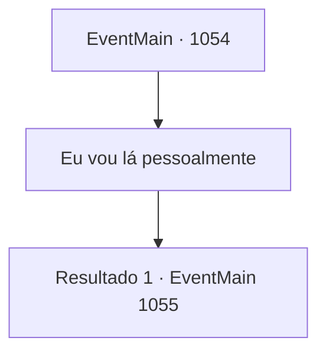

# Eventos principais · 1054

[Índice da tabela](index.md) · [Índice geral](../index.md)

ID: `pt:EventMain:1054` · Fonte: `EventMain4` · Versão: 1.2.47.

Mapeamento estático dos arquivos; a disponibilidade e a execução dependem do estado da run.

## Texto do evento

Uma voz familiar te desperta. 

 "...Meu senhor."

 Você mal consegue abrir os olhos. Uma mesa familiar. Você deve ter cochilado no seu escritório. Você se senta ereto, limpando a baba da bochecha. 

 "Tenho algo a relatar."

 Você olha para a fonte da voz. É Rennart, o mordomo meio-elfo que se dedicou à sua Casa desde que seu pai assumiu o governo. Sua aparência é a de um homem na casa dos quarenta, mas os olhos verde-azulados por trás dos óculos prateados carregam a experiência de quase um século. |drawing_lenart| Após se curvar respeitosamente por formalidade, Rennart vai direto ao ponto. 

 "A propriedade não está em boas condições. Nossas reservas de riqueza e comida estão quase acabando. E pior..."

 Rennart ajusta seus óculos prateados e continua. 

 "...houve relatos de confrontos com orcs, nas proximidades do entreposto comercial ao norte do Castelo Briovich."


## Dados de entrada

```json
{
  "id": 1054,
  "grade": 1,
  "normalGoal": "",
  "required": "13_6_0"
}
```

## Mapa das escolhas



## Escolhas e resultados

### Escolha 1

Eu vou lá pessoalmente

Requisitos e outros campos da escolha:

```json
{
  "required": ""
}
```

#### Resultado 1.1

Você lhe diz que vai até lá pessoalmente. Rennart cuidadosamente coloca a pilha de documentos sobre a escrivaninha. 

 "Entendido, meu Senhor."

 Você se levanta da cadeira e caminha até as janelas. O pátio é visível pela janela. Este lugar já foi densamente povoado por servos e cavaleiros. Agora, restam apenas estábulos vazios e lajes de pedra cobertas de musgo. 

 "Antes de você partir..."

 Nunca é demais conferir tudo duas vezes. 

 "Vou informar os soldados."

 Você se vira para encarar Rennart. Ele continua. Ele aguarda suas ordens, com as mãos cuidadosamente unidas.

Continuação registrada: [Evento 1055](1055.md) na mesma tabela.

```json
{
  "required": "",
  "chance": "1",
  "nextEvent": 1055,
  "type": 2,
  "reward": ""
}
```

## Referências que chegam a este evento

Nenhum `nextEvent` positivo da mesma tabela aponta para este nó. Isso não prova que seja inacessível: sorteio e estado de história podem selecioná-lo.

