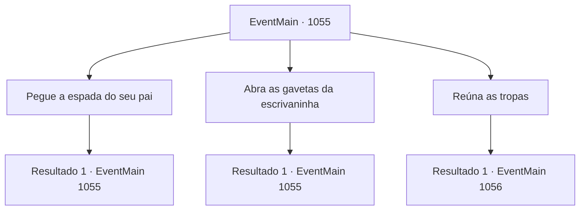

# Eventos principais · 1055

[Índice da tabela](index.md) · [Índice geral](../index.md)

ID: `pt:EventMain:1055` · Fonte: `EventMain4` · Versão: 1.2.47.

Mapeamento estático dos arquivos; a disponibilidade e a execução dependem do estado da run.

## Texto do evento

*Sem texto no arquivo.*

## Dados de entrada

```json
{
  "id": 1055,
  "grade": 1,
  "normalGoal": "",
  "required": ""
}
```

## Mapa das escolhas



## Escolhas e resultados

### Escolha 1

Pegue a espada do seu pai

Requisitos e outros campos da escolha:

```json
{
  "required": "5_878_0"
}
```

#### Resultado 1.1

Você pega a espada longa do brasão na parede. Esta é a arma empunhada pelo seu pai, Laszlo Briovich, carregada até sua morte durante a batalha contra a Tribo Orc hostil 'Zaraid'. O cabo riscado encaixa-se naturalmente em sua mão. Seu pomo é esculpido para se assemelhar à forma de um lobo. A arma parece feita sob medida para você, mesmo que você nunca a tenha empunhado antes. Ao contrário do cabo envelhecido, a lâmina brilha, polida à perfeição. Rennart se aproxima de você e, sem dizer nada, pega a bainha e a prende em sua cintura. Ele então dá um passo para trás. 

 "Olhe para você. Cresceu, já é capaz de empunhar essa espada."

 A voz dele soa melancólica. Rennart desvia o olhar, ajeitando os óculos.

Continuação registrada: [Evento 1055](1055.md) na mesma tabela.

```json
{
  "required": "",
  "chance": "1",
  "nextEvent": 1055,
  "type": 2,
  "reward": "3_378_1|5_878_1"
}
```

### Escolha 2

Abra as gavetas da escrivaninha

Requisitos e outros campos da escolha:

```json
{
  "required": "5_879_0"
}
```

#### Resultado 2.1

Você está em frente à escrivaninha. O hábito guia sua mão até as gavetas. Dentro há um embrulho de pano com alguns pedaços de queijo — seu prazer culposo de lanche, escondido de Rennart. Uma garrafa de tinta, uma pena, uma pilha de documentos e um saquinho de couro preenchem o resto das gavetas. Você pega o saquinho e ouve algumas moedas de ouro tilintando. Nada mais parece ter valor. Você coloca o saquinho na cintura e fecha as gavetas enquanto o olhar de Rennart passa por elas.

Continuação registrada: [Evento 1055](1055.md) na mesma tabela.

```json
{
  "required": "",
  "chance": "1",
  "nextEvent": 1055,
  "type": 2,
  "reward": "5_879_1|0_4_10|3_379_1"
}
```

### Escolha 3

Reúna as tropas

Requisitos e outros campos da escolha:

```json
{
  "required": ""
}
```

#### Resultado 3.1

Você convoca todos os soldados que ainda permaneciam no castelo. Não parecem muitos. Afinal, a maioria dos moradores — cavaleiros, vassalos e até soldados — já partira. Os que atenderam ao seu chamado nem ao menos tinham armaduras adequadas. Ou eram grandes demais para elas, gastas, ou ambos. Tarrys, o Marechal da propriedade, arqueia as sobrancelhas e fala. 

 "M- meu Senhor! Você pretende vir conosco?"

 As rugas e cicatrizes em seu rosto carregam a experiência de décadas como soldado. Você sente uma tênue preocupação através de sua barba. 

 "Enfrentaremos orcs... Estou preocupado, só isso."

 Rennart toca casualmente o ombro de Tarrys e responde. 

 "Cuide bem do nosso Senhor."

 Em vez de uma resposta verbal, Tarrys responde batendo a culatra da lança no chão. Seu aperto no cabo da lança se firma. Rennart se vira para encará-lo. 

 "Cuidado, meu Senhor."

 O portão se abre, e você começa a andar. O tilintar metálico segue seu rastro.

Continuação registrada: [Evento 1056](1056.md) na mesma tabela.

```json
{
  "required": "",
  "chance": "1",
  "nextEvent": 1056,
  "type": 2,
  "reward": ""
}
```

## Referências que chegam a este evento

- [Evento 1054 · escolha 1 · resultado 1](1054.md#escolha-1)
- [Evento 1055 · escolha 1 · resultado 1](1055.md#escolha-1)
- [Evento 1055 · escolha 2 · resultado 1](1055.md#escolha-2)
