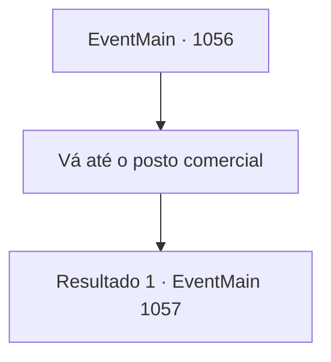

# Eventos principais · 1056

[Índice da tabela](index.md) · [Índice geral](../index.md)

ID: `pt:EventMain:1056` · Fonte: `EventMain4` · Versão: 1.2.47.

Mapeamento estático dos arquivos; a disponibilidade e a execução dependem do estado da run.

## Texto do evento

*Sem texto no arquivo.*

## Dados de entrada

```json
{
  "id": 1056,
  "grade": 1,
  "normalGoal": "",
  "required": ""
}
```

## Mapa das escolhas



## Escolhas e resultados

### Escolha 1

Vá até o posto comercial

Requisitos e outros campos da escolha:

```json
{
  "required": ""
}
```

#### Resultado 1.1

A jornada até o posto de comércio não demora. Um caminho de terra grosseiro atravessa as colinas próximas, e um trilho de rodas de carroça pode ser visto ao lado dele. 
 Após atravessar um declive, o posto de comércio aparece diante dos seus olhos. As muralhas de pedra perímetro estão cheias de aberturas aqui e ali, e o que parece ter sido uma torre de vigia de madeira já teve o telhado derrubado. Ao lado da confusão estão duas diligências. Uma delas já está tombada, espalhando as mercadorias que carregava por todo o chão. Um grupo de orcs a cerca. |drawing_orcAttackMarket| Todos os orcs estão equipados com armaduras de couro rústico com um símbolo de machado vermelho. Esses orcs fazem parte da tribo 'Zaraid' - um incômodo para o feudo desde o reinado do seu pai. Soldados que escoltavam a diligência caem ao chão a cada golpe dos machados dos orcs. Os mercadores indefesos tremem de medo, vendo o horror se desenrolar. Você olha para os soldados que trouxe. Armaduras enferrujadas, lanças cegas e espíritos quebrados. Eles hesitam, aguardando suas ordens. Tarrys é o único que conseguiu manter a calma. Silenciosamente, ele observa os orcs.

Continuação registrada: [Evento 1057](1057.md) na mesma tabela.

```json
{
  "required": "",
  "chance": "1",
  "nextEvent": 1057,
  "type": 2,
  "reward": ""
}
```

## Referências que chegam a este evento

- [Evento 1055 · escolha 3 · resultado 1](1055.md#escolha-3)
