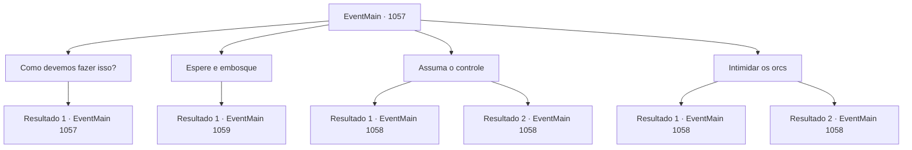

# Eventos principais · 1057

[Índice da tabela](index.md) · [Índice geral](../index.md)

ID: `pt:EventMain:1057` · Fonte: `EventMain4` · Versão: 1.2.47.

Mapeamento estático dos arquivos; a disponibilidade e a execução dependem do estado da run.

## Texto do evento

*Sem texto no arquivo.*

## Dados de entrada

```json
{
  "id": 1057,
  "grade": 1,
  "normalGoal": "",
  "required": ""
}
```

## Mapa das escolhas



## Escolhas e resultados

### Escolha 1

Como devemos fazer isso?

Requisitos e outros campos da escolha:

```json
{
  "required": "5_880_0"
}
```

#### Resultado 1.1

Após um breve silêncio, Tarrys fala, apoiando a lança no ombro. 

 "Sempre que orcs conseguem realizar um roubo, eles se distraem ao decidir quem fica com o quê. Se aproveitarmos essa oportunidade, temos a chance de vencer."

 Sua voz então abaixa. 

 "Embora... isso significaria que teríamos que esperar até que os orcs lidem com as escoltas e os mercadores."


Continuação registrada: [Evento 1057](1057.md) na mesma tabela.

```json
{
  "required": "",
  "chance": "1",
  "nextEvent": 1057,
  "type": 2,
  "reward": "5_880_1"
}
```

### Escolha 2

Espere e embosque

Requisitos e outros campos da escolha:

```json
{
  "required": "5_880_1"
}
```

#### Resultado 2.1

Você faz um gesto para que seus soldados parem. Em seguida, guia suas tropas para a parte de trás de uma colina e se deita. Seus soldados seguem o exemplo, deitando-se no chão. Tarrys dá um tapinha nas costas de um dos soldados — o soldado, por engano, produz ruídos de metal tilintando. 

 Os gritos finais dos mercadores e dos escoltas cessam. Agora só se ouve orcês — vozes ásperas e graves. Tarrys sussurra. 

 "M- meu senhor. Eles começaram a saquear. Agora é nossa chance."

 Você sinaliza com as mãos, dividindo a tropa em dois grupos. Um grupo deverá contornar a parede de pedra desmoronada, e o outro agachar-se e aproximar-se da diligência tombada. Os dois grupos começam a se mover e, por fim, emboscam os orcs desprevenidos. O som de uma besta sinaliza o início da luta, seu virote cravando-se no ombro de um orc vigia. 

 "Grrr! GACK!"

 Um orc cai no chão, largando o saque que carregava. Quando o restante dos orcs se volta para olhar, seus outros soldados já estão escalando as paredes de pedra. Lanças e espadas cravam repetidas vezes, cobrindo o chão com mais dois orcs mortos. Outros orcs, em pânico, empunham seus machados e começam a golpear, desprovidos de qualquer formação ou senso de ordem.

Continuação registrada: [Evento 1059](1059.md) na mesma tabela.

```json
{
  "required": "",
  "chance": "1",
  "nextEvent": 1059,
  "type": 2,
  "reward": "6_2_104|0_3_-2",
  "place": 13
}
```

### Escolha 3

Assuma o controle

Requisitos e outros campos da escolha:

```json
{
  "required": ""
}
```

#### Resultado 3.1

Você corre pelas colinas e parte para o ataque. Tarrys grita algo para você, mas você não para. Em seguida, você passa pela diligência tombada e se lança sobre um dos orcs. 

 "GRRK?!"

 O corpo do orc dobra-se ao meio ao ser arremessado. O machado que ele carregava escapa de sua mão e cai no chão. Quando o orc perde a consciência com um baque alto, os demais orcs se viram para olhar para você. Sua tropa segue você rapidamente e se posiciona em formação. Tarrys passa pelos soldados e fica ao seu lado. Então, ele desembainha sua arma. Ele olha para você por um breve momento e acena com a cabeça. 

 "Você tem a coragem do seu pai."


Continuação registrada: [Evento 1058](1058.md) na mesma tabela.

```json
{
  "required": "",
  "chance": "1|0_5_1",
  "nextEvent": 1058,
  "type": 0,
  "reward": "6_2_104|0_3_2",
  "place": 13
}
```

#### Resultado 3.2

Você corre pelas colinas e parte para o ataque. Tarrys grita algo para você, mas você não para. Então, você passa pela diligência tombada e se joga contra um dos orcs. 

 "GRRK?!"

 O orc cambaleia. Você é quem acaba sendo jogado ao chão pelo recuo. Ele vira o rosto para olhar para você, que agora está deitado no chão. A criatura tem pelo menos uma cabeça a mais de altura que você. 

 "Droga...!"

 Sua tropa segue você rapidamente e assume uma formação. Tarrys ajuda você a se levantar e fala. 

 "O que você estava pensando?! Venha, deixe o velho proteger você."

 Ele então desembainha sua arma para lutar contra os orcs.

Continuação registrada: [Evento 1058](1058.md) na mesma tabela.

```json
{
  "required": "",
  "chance": "14",
  "nextEvent": 1058,
  "type": 1,
  "reward": "6_0_104|0_3_2",
  "place": 13
}
```

### Escolha 4

Intimidar os orcs

Requisitos e outros campos da escolha:

```json
{
  "required": ""
}
```

#### Resultado 4.1

Você fica no topo de uma colina e recupera o fôlego. Então — você grita. Um rugido feroz ecoa por todo o posto comercial. Os orcs param de saquear, enquanto o vigia com o machado vira a cabeça na sua direção. Um a um, os orcs se voltam para olhar para você. 

 "Grrrr...!"

 Um orc recua. O que está ao lado dele faz o mesmo, abaixando o machado. E logo, todos os orcs estão recuando lentamente. Sua tropa rapidamente o segue e se posiciona em formação. Tarrys passa entre os soldados e fica ao seu lado. Então, ele desembainha sua arma. Ele olha para você por um breve momento e acena com a cabeça. 

 "Você tem a coragem do seu pai."


Continuação registrada: [Evento 1058](1058.md) na mesma tabela.

```json
{
  "required": "",
  "chance": "1|0_12_1",
  "nextEvent": 1058,
  "type": 0,
  "reward": "6_2_104|0_3_2",
  "place": 13
}
```

#### Resultado 4.2

Você fica no topo de uma colina e recupera o fôlego. Então — você grita. Sua voz ecoa por todo o posto de comércio. Os orcs param de saquear, enquanto o vigia com o machado vira a cabeça na sua direção. Um a um, os orcs se viram para olhar para você. Então, todos eles zombam. 

 "Ha!"

 O orc da frente mexe o nariz, rindo. Outros orcs se juntam, rindo e empunhando os machados num movimento lento e relaxado. Sua tropa segue você rapidamente e faz formação. Tarrys ajuda você a se levantar e fala. 

 "O que você estava pensando?! Venha, deixe o velho proteger você."

 Ele então saca sua arma para lutar contra os orcs.

Continuação registrada: [Evento 1058](1058.md) na mesma tabela.

```json
{
  "required": "",
  "chance": "14",
  "nextEvent": 1058,
  "type": 1,
  "reward": "6_0_104|0_3_2",
  "place": 13
}
```

## Referências que chegam a este evento

- [Evento 1056 · escolha 1 · resultado 1](1056.md#escolha-1)
- [Evento 1057 · escolha 1 · resultado 1](1057.md#escolha-1)
