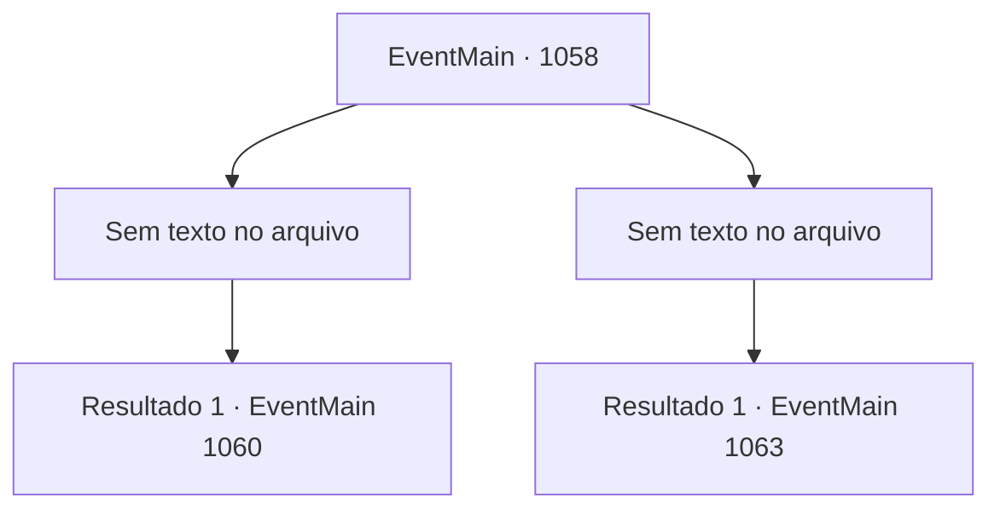

# Eventos principais · 1058

[Índice da tabela](index.md) · [Índice geral](../index.md)

ID: `pt:EventMain:1058` · Fonte: `EventMain4` · Versão: 1.2.47.

Mapeamento estático dos arquivos; a disponibilidade e a execução dependem do estado da run.

## Texto do evento

*Sem texto no arquivo.*

## Dados de entrada

```json
{
  "id": 1058,
  "grade": 1,
  "normalGoal": "",
  "required": ""
}
```

## Mapa das escolhas



## Escolhas e resultados

### Escolha 1

*Sem texto no arquivo; o papel dessa opção depende da interface do jogo.*

Requisitos e outros campos da escolha:

```json
{
  "required": ""
}
```

#### Resultado 1.1

O último orc cai ao chão. O silêncio toma o posto comercial. Os sons da batalha cessaram, e o cheiro de sangue e suor misturado com a fragrância de lama e terra ataca suas narinas. Você abaixa sua arma e respira fundo. Com os orcs desaparecidos, os mercadores saem um a um da carroça. Todos vêm agradecer, com os rostos cobertos de sangue e sujeira. 

 "Você nos salvou!"

 "Eu achei que todos nós íamos morrer!"

 Quando terminam de agradecer, Tarrys fala, mexendo inquieto na barba. 

 "Hmph... Não se demonstra gratidão apenas com palavras."

 Ele te observa com cuidado.

Continuação registrada: [Evento 1060](1060.md) na mesma tabela.

```json
{
  "required": "",
  "chance": "1",
  "nextEvent": 1060,
  "type": 2,
  "reward": ""
}
```

### Escolha 2

*Sem texto no arquivo; o papel dessa opção depende da interface do jogo.*

Requisitos e outros campos da escolha:

```json
{
  "required": ""
}
```

#### Resultado 2.1

O saqueador orc te chuta com sua perna robusta. Você é lançado no ar, então de volta ao chão. A sombra do orc paira sobre você. Você sente seu machado sendo erguido. Então, Tarrys se põe na sua frente. Um estalo alto vem em seguida. O orc crava o machado nos ombros de Tarrys. 

 "Ack...!"

 Tarrys sofre o golpe, segurando a lâmina do machado com a mão esquerda e esfaqueando a garganta do orc com sua arma. 

 "CACK! *gargarejo*...!"

 Por fim, o último orc cai ao chão. Tarrys luta para respirar. Sangue escorre de seus ombros, espalhando-se pela armadura. Ele se ajoelha, quase caindo no chão. 

 "*ofega*...*ofega*..."

 Após sufocar para recuperar o fôlego, Tarrys finalmente murmura algo. 

 "Bem... droga. Então é assim que termina..."

 Tarrys olha para você. Seu olhar está esbranquiçado. Parece ainda mais acinzentado do que você viu antes. Seus olhos enrugados finalmente se fecham. Você olha ao redor. Dos seis soldados que trouxe com você, apenas dois ainda estão de pé. Os corpos dos outros quatro estão espalhados entre os orcs, inertes. O sangue dos combatentes, sem distinção entre humano e orc, cobre o local. Logo, os mercadores surgem um a um da carroça-palco. Eles vêm todos agradecer a você, seus rostos todos cobertos de sangue e sujeira. 

 "Você nos salvou!"

 "Eu achei que íamos morrer todos!"


Continuação registrada: [Evento 1063](1063.md) na mesma tabela.

```json
{
  "required": "",
  "chance": "1",
  "nextEvent": 1063,
  "type": 2,
  "reward": "5_881_1|0_0_-1|0_1_-1"
}
```

## Referências que chegam a este evento

- [Evento 1057 · escolha 3 · resultado 1](1057.md#escolha-3)
- [Evento 1057 · escolha 3 · resultado 2](1057.md#escolha-3)
- [Evento 1057 · escolha 4 · resultado 1](1057.md#escolha-4)
- [Evento 1057 · escolha 4 · resultado 2](1057.md#escolha-4)
