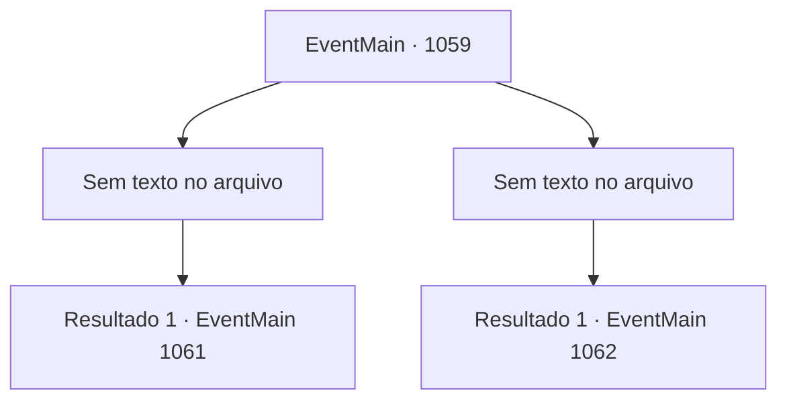

# Eventos principais · 1059

[Índice da tabela](index.md) · [Índice geral](../index.md)

ID: `pt:EventMain:1059` · Fonte: `EventMain4` · Versão: 1.2.47.

Mapeamento estático dos arquivos; a disponibilidade e a execução dependem do estado da run.

## Texto do evento

*Sem texto no arquivo.*

## Dados de entrada

```json
{
  "id": 1059,
  "grade": 1,
  "normalGoal": "",
  "required": ""
}
```

## Mapa das escolhas



## Escolhas e resultados

### Escolha 1

*Sem texto no arquivo; o papel dessa opção depende da interface do jogo.*

Requisitos e outros campos da escolha:

```json
{
  "required": ""
}
```

#### Resultado 1.1

O último orc cai no chão. O silêncio toma o posto comercial. Os sons da batalha cessaram, e o cheiro de sangue e suor misturado com a fragrância de lama e terra assaultam suas narinas. Você abaixa sua arma e recupera o fôlego. Seus soldados revistam a carroça. Dentro dela há sacos de farinha e um saquinho cheio de ixeridium, alcaçuz e dente-de-leão. Também é encontrado um saco de cogumelos orelha-de-troll, mais no fundo da carroça.

Continuação registrada: [Evento 1061](1061.md) na mesma tabela.

```json
{
  "required": "",
  "chance": "1",
  "nextEvent": 1061,
  "type": 2,
  "reward": "3_134_1"
}
```

### Escolha 2

*Sem texto no arquivo; o papel dessa opção depende da interface do jogo.*

Requisitos e outros campos da escolha:

```json
{
  "required": ""
}
```

#### Resultado 2.1

O saqueador orc te chuta com sua perna robusta. Você é lançado no ar, depois volta a cair no chão. A sombra do orc paira sobre você. Você sente seu machado sendo erguido. Então, Tarrys se põe na sua frente. Um estalo alto acontece. O orc finca seu machado nos ombros de Tarrys. 

 "Argh...!"

 Tarrys recebe o golpe, agarrando a lâmina do machado com a mão esquerda e esfaqueando a garganta do orc com sua arma. 

 "CACK! *gorgolejo*...!"

 Por fim, o último orc cai ao chão. Tarrys luta para respirar. Sangue escorre de seus ombros, espalhando-se pela armadura. Ele se ajoelha, quase caindo no chão. 

 "*ofeg*...*ofeg*..."

 Após ofegar, Tarrys finalmente murmura algo. 

 "Bem... droga. Então é assim que acontece..."

 Tarrys olha para você. Seu olhar fica esbranquiçado. Parece ainda mais acinzentado do que você viu antes. Seus olhos enrugados finalmente se fecham. Você olha ao redor. Dos seis soldados que você trouxe, apenas dois ainda estão de pé. Os corpos dos outros quatro estão espalhados entre os orcs, sem vida. O sangue dos combatentes, sem distinção entre humano e orc, cobre o local.

Continuação registrada: [Evento 1062](1062.md) na mesma tabela.

```json
{
  "required": "",
  "chance": "1",
  "nextEvent": 1062,
  "type": 2,
  "reward": "5_881_1|0_0_-1|0_1_-1"
}
```

## Referências que chegam a este evento

- [Evento 1057 · escolha 2 · resultado 1](1057.md#escolha-2)
