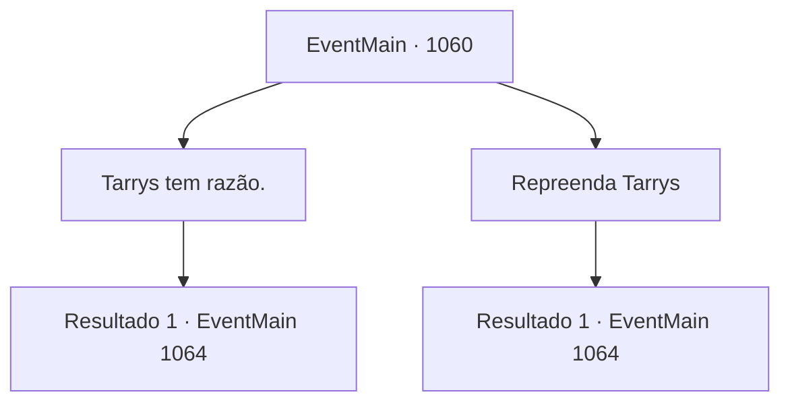

# Eventos principais · 1060

[Índice da tabela](index.md) · [Índice geral](../index.md)

ID: `pt:EventMain:1060` · Fonte: `EventMain4` · Versão: 1.2.47.

Mapeamento estático dos arquivos; a disponibilidade e a execução dependem do estado da run.

## Texto do evento

*Sem texto no arquivo.*

## Dados de entrada

```json
{
  "id": 1060,
  "grade": 1,
  "normalGoal": "",
  "required": ""
}
```

## Mapa das escolhas



## Escolhas e resultados

### Escolha 1

Tarrys tem razão.

Requisitos e outros campos da escolha:

```json
{
  "required": ""
}
```

#### Resultado 1.1

Você acena com a cabeça em resposta. Os sorrisos dos mercadores desaparecem. O mais velho dos mercadores vai até a carroça tombada e volta com alguns sacos. 

 "Nós vendemos principalmente ervas medicinais. Estas são todas que temos — por favor, aceite-as como um sinal de gratidão."

 Você percebe que os sacos estão cheios de um tipo de cogumelos. Você pega alguns para si, depois divide o restante das ervas entre seus soldados. Em seguida, você se despede dos mercadores e retoma o caminho de volta ao castelo.

Continuação registrada: [Evento 1064](1064.md) na mesma tabela.

```json
{
  "required": "",
  "chance": "1",
  "nextEvent": 1064,
  "type": 2,
  "reward": "3_134_1"
}
```

### Escolha 2

Repreenda Tarrys

Requisitos e outros campos da escolha:

```json
{
  "required": ""
}
```

#### Resultado 2.1

Você repreende Tarrys, dizendo que não quer nenhuma recompensa por fazer algo que deveria ter sido feito. Tarrys recua em silêncio, e os rostos dos mercadores se iluminam em sorrisos. 

 "Agradecemos por sua generosidade sem fim!"

 Eles se curvam em gratidão vez após vez. Você se despede dos mercadores, se vira e segue de volta ao castelo. Seus soldados seguem atrás de você.

Continuação registrada: [Evento 1064](1064.md) na mesma tabela.

```json
{
  "required": "",
  "chance": "1",
  "nextEvent": 1064,
  "type": 2,
  "reward": "0_3_3"
}
```

## Referências que chegam a este evento

- [Evento 1058 · escolha 1 · resultado 1](1058.md#escolha-1)
