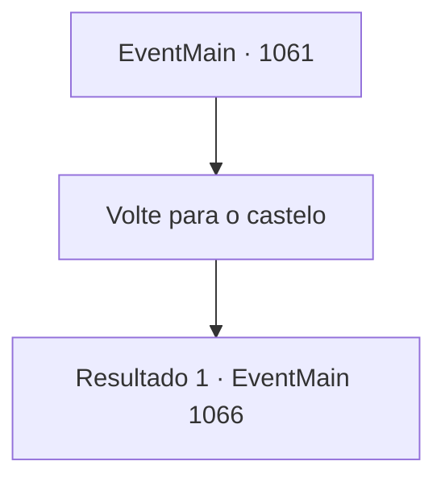

# Eventos principais · 1061

[Índice da tabela](index.md) · [Índice geral](../index.md)

ID: `pt:EventMain:1061` · Fonte: `EventMain4` · Versão: 1.2.47.

Mapeamento estático dos arquivos; a disponibilidade e a execução dependem do estado da run.

## Texto do evento

*Sem texto no arquivo.*

## Dados de entrada

```json
{
  "id": 1061,
  "grade": 1,
  "normalGoal": "",
  "required": ""
}
```

## Mapa das escolhas



## Escolhas e resultados

### Escolha 1

Volte para o castelo

Requisitos e outros campos da escolha:

```json
{
  "required": ""
}
```

#### Resultado 1.1

A visão das muralhas do castelo logo surge diante de você, pintadas de laranja com as cores do pôr do sol. Figuras humanoides aparecem no topo delas. Começam a se afastar, em direção ao portão do castelo. Quando você finalmente chega diante do portão, Rennart vem cumprimentá-lo enquanto ele se abre. Ele o examina da cabeça aos pés, depois os soldados, depois a carroça de viagem. 

 "É bom ver que voltou. Está ferido?"

 Você manda embora as tropas e volta para a mansão. Rennart o acompanha. Tarrys fica com os soldados, cuidando da carroça de viagem. 

 Você e Rennart retornam ao seu escritório. O meio-elfo mordomo coloca uma pilha de documentos sobre a escrivaninha. Com os dedos manchados de tinta, Rennart folheia os números nos papéis. Os mesmos papéis que você viu antes de ir ao posto comercial, mas você nota alguns números novos. 

 "Fiz um breve resumo dos custos de sua última expedição. Tratamento médico para os feridos, manutenção de equipamentos e reparos na carroça de viagem."

 Rennart ajusta os óculos. 

 "A propriedade está no seu limite, meu senhor. Comida e mão de obra, precisamos delas com certeza, mas..."

 Seus dedos param em uma linha de números. 

 "...nossa prioridade máxima é financeira. Precisamos de ouro."

 Nesse momento, você ouve alguém bater na porta do seu escritório. Um mensageiro entra no escritório, genuflete diante de você e puxa um envelope lacrado. Rennart verifica o lacre. 

 "...Casa Greymoor."

 Você pega o envelope e o abre. É uma carta curta, escrita em caligrafia limpa e organizada. Você percebe que é um convite para um banquete, da Condessa Katrin Greymoor.

Continuação registrada: [Evento 1066](1066.md) na mesma tabela.

```json
{
  "required": "",
  "chance": "1",
  "nextEvent": 1066,
  "type": 2,
  "reward": ""
}
```

## Referências que chegam a este evento

- [Evento 1059 · escolha 1 · resultado 1](1059.md#escolha-1)
