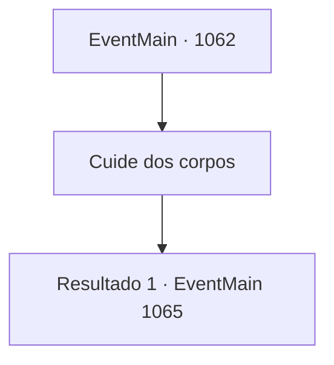

# Eventos principais · 1062

[Índice da tabela](index.md) · [Índice geral](../index.md)

ID: `pt:EventMain:1062` · Fonte: `EventMain4` · Versão: 1.2.47.

Mapeamento estático dos arquivos; a disponibilidade e a execução dependem do estado da run.

## Texto do evento

*Sem texto no arquivo.*

## Dados de entrada

```json
{
  "id": 1062,
  "grade": 1,
  "normalGoal": "",
  "required": ""
}
```

## Mapa das escolhas



## Escolhas e resultados

### Escolha 1

Cuide dos corpos

Requisitos e outros campos da escolha:

```json
{
  "required": ""
}
```

#### Resultado 1.1

Os dois soldados sobreviventes reagem imediatamente às suas ordens. Eles carregam os corpos dos mercadores na carroça, depois deitam os quatro soldados mortos ao lado deles. Armaduras enferrujadas tilintam e estralam. Tarrys vem por último. Um dos soldados arranca o machado do ombro de Tarrys com um curto grunhido. Você pega a velha espada cega de Tarrys e a coloca sobre o peito dele. Os cavalos que antes puxavam a carroça já estão mortos. Os dois soldados, relutantes, se movem para a frente da carroça e amarram as cordas da carroça nos ombros. Você os lidera na dianteira, enquanto os soldados seguem você com a carroça. O silêncio preenche a viagem de volta ao castelo, além do barulho das rodas da carroça.

Continuação registrada: [Evento 1065](1065.md) na mesma tabela.

```json
{
  "required": "",
  "chance": "1",
  "nextEvent": 1065,
  "type": 2,
  "reward": ""
}
```

## Referências que chegam a este evento

- [Evento 1059 · escolha 2 · resultado 1](1059.md#escolha-2)
