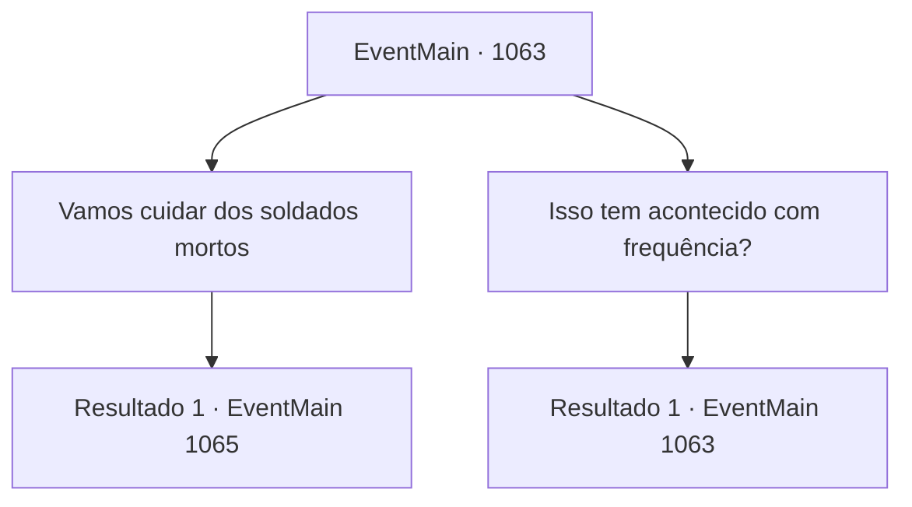

# Eventos principais · 1063

[Índice da tabela](index.md) · [Índice geral](../index.md)

ID: `pt:EventMain:1063` · Fonte: `EventMain4` · Versão: 1.2.47.

Mapeamento estático dos arquivos; a disponibilidade e a execução dependem do estado da run.

## Texto do evento

*Sem texto no arquivo.*

## Dados de entrada

```json
{
  "id": 1063,
  "grade": 1,
  "normalGoal": "",
  "required": ""
}
```

## Mapa das escolhas



## Escolhas e resultados

### Escolha 1

Vamos cuidar dos soldados mortos

Requisitos e outros campos da escolha:

```json
{
  "required": ""
}
```

#### Resultado 1.1

Você sugere recuperar os corpos dos soldados mortos. 

 "É claro. Ajudaremos de bom grado."

 Os mercadores arregaçam as mangas e se juntam a você na recuperação dos restos dos soldados, carregando-os na carroça. Você caminha com os soldados sobreviventes ao lado da carroça. O silêncio domina a viagem de volta ao castelo, exceto pelo barulho das rodas da carroça.

Continuação registrada: [Evento 1065](1065.md) na mesma tabela.

```json
{
  "required": "",
  "chance": "1",
  "nextEvent": 1065,
  "type": 2,
  "reward": ""
}
```

### Escolha 2

Isso tem acontecido com frequência?

Requisitos e outros campos da escolha:

```json
{
  "required": "5_882_0"
}
```

#### Resultado 2.1

Você pergunta aos comerciantes se esse tipo de assalto acontece com frequência. Eles abanam a cabeça em resposta. 

 "Bem... Aconteceu com bem mais frequência ultimamente. Nós apenas vendemos ervas medicinais. Não exatamente o alvo mais valioso. Mas agora, é como se estivessem desesperados o suficiente para pôr as mãos em praticamente qualquer coisa."


Continuação registrada: [Evento 1063](1063.md) na mesma tabela.

```json
{
  "required": "",
  "chance": "1",
  "nextEvent": 1063,
  "type": 2,
  "reward": "5_882_1"
}
```

## Referências que chegam a este evento

- [Evento 1058 · escolha 2 · resultado 1](1058.md#escolha-2)
- [Evento 1063 · escolha 2 · resultado 1](1063.md#escolha-2)
