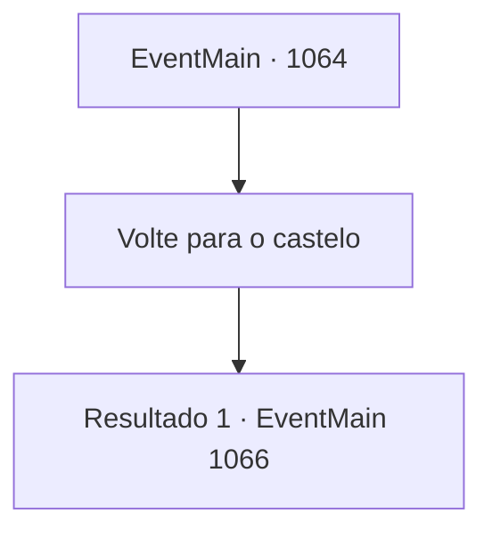

# Eventos principais · 1064

[Índice da tabela](index.md) · [Índice geral](../index.md)

ID: `pt:EventMain:1064` · Fonte: `EventMain4` · Versão: 1.2.47.

Mapeamento estático dos arquivos; a disponibilidade e a execução dependem do estado da run.

## Texto do evento

*Sem texto no arquivo.*

## Dados de entrada

```json
{
  "id": 1064,
  "grade": 1,
  "normalGoal": "",
  "required": ""
}
```

## Mapa das escolhas



## Escolhas e resultados

### Escolha 1

Volte para o castelo

Requisitos e outros campos da escolha:

```json
{
  "required": ""
}
```

#### Resultado 1.1

A visão das muralhas do castelo logo aparece à sua frente, pintada de laranja com as cores do pôr do sol. Figuras humanóides surgem no topo delas. Começam a se mover para longe, em direção ao portão do castelo. Quando você finalmente chega diante do portão, Rennart vem cumprimentá-lo enquanto ele se abre. Ele o examina dos pés à cabeça, depois os soldados, depois a carroça de palco. 

 "Feliz em vê-lo de volta. Você está ferido?"

 Você dispensa as tropas e volta para a mansão. Rennart o acompanha. Tarrys se junta aos soldados, cuidando da carroça de palco. 

 Você e Rennart retornam ao seu escritório. O meio-elfo mordomo coloca uma pilha de documentos sobre a escrivaninha. Com os dedos manchados de tinta, Rennart folheia os números nos papéis. Exatamente os mesmos documentos que você viu antes de ir ao posto de comércio, mas você percebe alguns números novos. 

 "Fiz um breve resumo do custo de sua última expedição. Tratamento médico para os feridos, manutenção de equipamentos e conserto da carroça de palco."

 Rennart ajusta os óculos. 

 "A propriedade está no limite, meu senhor. Comida e mão de obra, precisamos deles com certeza, mas..."

 Os dedos dele param em uma linha de números. 

 "...nossa prioridade máxima é a financeira. Precisamos de ouro."

 Nesse momento, você ouve alguém bater na porta do seu escritório. Um mensageiro entra no escritório, genuflete diante de você e tira um envelope selado. Rennart confere o selo. 

 "...Casa Greymoor."

 Você pega o envelope e o abre. É uma carta curta, escrita em caligrafia limpa e organizada. Você percebe que é um convite para um banquete, da Condessa Katrin Greymoor.

Continuação registrada: [Evento 1066](1066.md) na mesma tabela.

```json
{
  "required": "",
  "chance": "1",
  "nextEvent": 1066,
  "type": 2,
  "reward": ""
}
```

## Referências que chegam a este evento

- [Evento 1060 · escolha 1 · resultado 1](1060.md#escolha-1)
- [Evento 1060 · escolha 2 · resultado 1](1060.md#escolha-2)
