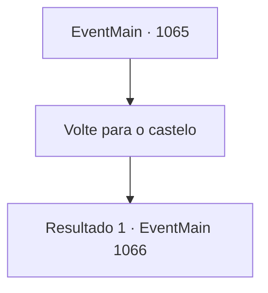

# Eventos principais · 1065

[Índice da tabela](index.md) · [Índice geral](../index.md)

ID: `pt:EventMain:1065` · Fonte: `EventMain4` · Versão: 1.2.47.

Mapeamento estático dos arquivos; a disponibilidade e a execução dependem do estado da run.

## Texto do evento

*Sem texto no arquivo.*

## Dados de entrada

```json
{
  "id": 1065,
  "grade": 1,
  "normalGoal": "",
  "required": ""
}
```

## Mapa das escolhas



## Escolhas e resultados

### Escolha 1

Volte para o castelo

Requisitos e outros campos da escolha:

```json
{
  "required": ""
}
```

#### Resultado 1.1

A visão das muralhas do castelo logo aparece diante de você, pintada toda de laranja com as cores do pôr do sol. Figuras humanoides surgem no alto delas. Começam a se mover, em direção ao portão do castelo. Quando você finalmente chega diante do portão, Rennart vem cumprimentá-lo enquanto o portão se abre. Ele o examina de cima a baixo, depois os soldados, depois a carroça. 

 "...Meu Senhor. Você está ferido?"

 Rennart fica em silêncio por um momento antes de continuar. 

 "...Eu assumo daqui."

 Você retorna à mansão, enquanto Rennart e os soldados começam a cuidar dos corpos no carroça. 

 Horas se passam antes de Rennart voltar ao escritório. Seus olhos estão marejados. 

 "Temos... algumas coisas a resolver."

 Com a voz baixa e contida, Rennart começa a revisar números nos documentos com seus dedos manchados de tinta. 

 "Custo da expedição, indenização para as famílias dos soldados mortos, e por fim..."

 Rennart faz uma breve pausa. 

 "...o funeral do Marechal Tarrys."

 Rennart puxa uma nova folha de papel e a coloca sobre a pilha de documentos. Manutenção das muralhas do castelo, salários dos soldados, compensações, funeral... Categorias se sucedem, com números ao lado de cada uma. 

 "O domínio está no limite, meu Senhor. Comida e mão de obra, precisamos com certeza, mas..."

 Seus dedos param em uma linha de números. 

 "...nossa prioridade máxima é financeira. Precisamos de ouro."

 Nesse momento, você ouve alguém batendo na porta do seu escritório. Um mensageiro entra no escritório, ajoelha-se diante de você e puxa um envelope selado. Rennart confere o selo. 

 "...Casa Greymoor."

 Você pega o envelope e o abre. É uma carta curta, escrita com caligrafia limpa e organizada. Você percebe que é um convite para um banquete, da Condessa Katrin Greymoor.

Continuação registrada: [Evento 1066](1066.md) na mesma tabela.

```json
{
  "required": "",
  "chance": "1",
  "nextEvent": 1066,
  "type": 2,
  "reward": ""
}
```

## Referências que chegam a este evento

- [Evento 1062 · escolha 1 · resultado 1](1062.md#escolha-1)
- [Evento 1063 · escolha 1 · resultado 1](1063.md#escolha-1)
