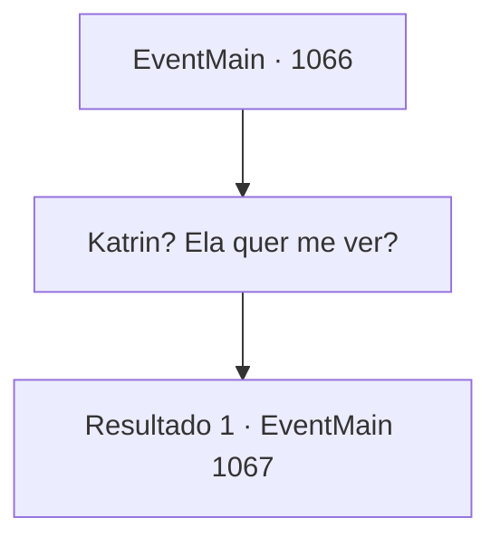

# Eventos principais · 1066

[Índice da tabela](index.md) · [Índice geral](../index.md)

ID: `pt:EventMain:1066` · Fonte: `EventMain4` · Versão: 1.2.47.

Mapeamento estático dos arquivos; a disponibilidade e a execução dependem do estado da run.

## Texto do evento

*Sem texto no arquivo.*

## Dados de entrada

```json
{
  "id": 1066,
  "grade": 1,
  "normalGoal": "",
  "required": ""
}
```

## Mapa das escolhas



## Escolhas e resultados

### Escolha 1

Katrin? Ela quer me ver?

Requisitos e outros campos da escolha:

```json
{
  "required": ""
}
```

#### Resultado 1.1

Katrin Greymoor - a estimada filha da Casa Greymoor. Ela foi uma amiga íntima de infância sua, quando vocês dois eram crianças. Mas depois que seu predecessor faleceu e Briovich entrou em crise, os laços entre as duas Casas naturalmente chegaram ao fim. Não houve mais cartas, nem mensageiros. 

 "Pelo que ouvi, depois que o Conde Ulrich faleceu, Lady Katrin tornou-se a nova chefe da Casa Greymoor."

 Rennart aponta para uma parede - um mapa centrado no condado de Briovich, que descreve todas as propriedades próximas. O dedo dele para em um ponto no noroeste, 'Greymoor'. Rennart continua. 

 "Um banquete pode parecer um simples encontro social, mas na verdade é um evento político, onde acordos e negociações acontecem e as pessoas vêm sondar as cartas nas mãos dos outros."

 O olhar de Rennart se volta para você. 

 "Normalmente, eu preferiria que você não comparecesse... mas em uma situação como esta, sua presença lá poderia ajudar nossa propriedade."


Continuação registrada: [Evento 1067](1067.md) na mesma tabela.

```json
{
  "required": "",
  "chance": "1",
  "nextEvent": 1067,
  "type": 2,
  "reward": ""
}
```

## Referências que chegam a este evento

- [Evento 1061 · escolha 1 · resultado 1](1061.md#escolha-1)
- [Evento 1064 · escolha 1 · resultado 1](1064.md#escolha-1)
- [Evento 1065 · escolha 1 · resultado 1](1065.md#escolha-1)
