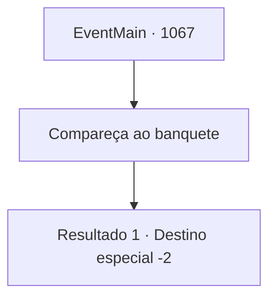

# Eventos principais · 1067

[Índice da tabela](index.md) · [Índice geral](../index.md)

ID: `pt:EventMain:1067` · Fonte: `EventMain4` · Versão: 1.2.47.

Mapeamento estático dos arquivos; a disponibilidade e a execução dependem do estado da run.

## Texto do evento

*Sem texto no arquivo.*

## Dados de entrada

```json
{
  "id": 1067,
  "grade": 1,
  "normalGoal": "",
  "required": ""
}
```

## Mapa das escolhas



## Escolhas e resultados

### Escolha 1

Compareça ao banquete

Requisitos e outros campos da escolha:

```json
{
  "required": ""
}
```

#### Resultado 1.1

Você decide aceitar o convite. Rennart acena com a cabeça. 

 "Vou fazer os preparativos necessários... para entregar sua resposta à Casa Greymoor."

 Ele então tira uma cera de lacre e um pedaço de pergaminho das gavetas, colocando-os sobre a escrivaninha à sua frente. Ele escreve rapidamente no pergaminho. Logo, Rennart coloca a carta pronta diante de você. Você pega o selo da Casa e o pressiona na cera vermelha. O brasão do lobo da Casa Briovich fica impresso nela. Rennart move a carta cuidadosamente para o lado e olha de volta para você. 

 "Cuidarei bem da propriedade enquanto estiver ausente, meu Senhor. Pretendo distribuir os alimentos que nos restam e continuar a manutenção das muralhas do castelo."

 Ele se inclina respeitosamente. 

 "Desejo apenas o seu retorno seguro..."

 Você acena em silêncio e sai do escritório. Você passa pelos corredores da mansão até o portão do castelo. Você nota a silhueta de Rennart nas janelas. Ele fica ali e não se move até o seu último passo. Com o som de correntes tilintando, o portão do castelo se abre. Você dá seu primeiro passo em direção a Greymoor.

Continuação registrada: [Destino especial `-2`](../destinos-especiais.md).

```json
{
  "required": "",
  "chance": "1",
  "nextEvent": -2,
  "type": 2,
  "reward": "13_6_1"
}
```

## Referências que chegam a este evento

- [Evento 1066 · escolha 1 · resultado 1](1066.md#escolha-1)
