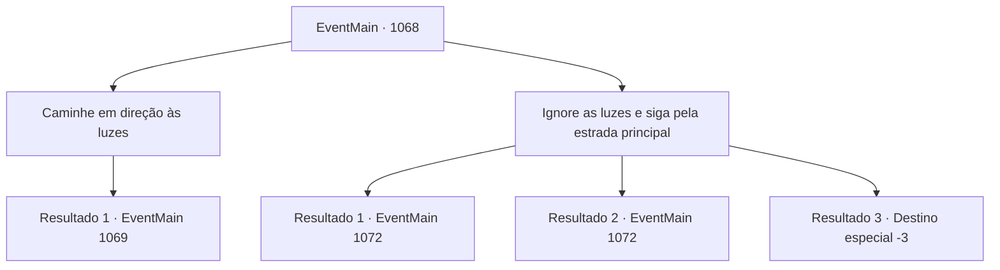

# Eventos principais · 1068

[Índice da tabela](index.md) · [Índice geral](../index.md)

ID: `pt:EventMain:1068` · Fonte: `EventMain4` · Versão: 1.2.47.

Mapeamento estático dos arquivos; a disponibilidade e a execução dependem do estado da run.

## Texto do evento

Ao passar por campos de grãos, fazendas em ruínas e um aqueduto seco, você percebe que a paisagem mudou significativamente. Ao se deparar com áreas de plantações abundantes e aquedutos cheios de água corrente, você percebe que entrou oficialmente na Propriedade Greymoor. Você nota uma série de luzes através da floresta, longe da estrada principal. Ao redor das luzes alaranjadas, você percebe um grupo de sombras com formato de tendas.

## Dados de entrada

```json
{
  "id": 1068,
  "grade": 1,
  "normalGoal": "",
  "required": "13_6_1|1_2_10"
}
```

## Mapa das escolhas



## Escolhas e resultados

### Escolha 1

Caminhe em direção às luzes

Requisitos e outros campos da escolha:

```json
{
  "required": ""
}
```

#### Resultado 1.1

Você se afasta da estrada principal e caminha em direção às luzes. Sob as sombras de grandes e antigos carvalhos, uma caravana de mercadores itinerantes montou acampamento. Você vê três fogueiras, das quais duas ainda estão acesas. Deliciosos aromas de sopas de feijão emanam das panelas sobre elas. Ao lado de dois carroções de viagem, os mercadores estão ocupados carregando suas mercadorias. Enquanto um pega um saco no ombro, outro no carroção o recebe e o empurra para dentro. É óbvio que estão prestes a partir, embora você não perceba nenhuma sensação de pressa. Há um perto da fogueira apreciando uma tigela de sopa, e outro untando as rodas do carroção, preparando-se para a viagem à frente. Ao entrar no acampamento deles, um dos mercadores volta o olhar para você e te observa dos pés à cabeça. 

 "...Quem é você?"


Continuação registrada: [Evento 1069](1069.md) na mesma tabela.

```json
{
  "required": "",
  "chance": "1",
  "nextEvent": 1069,
  "type": 2,
  "reward": ""
}
```

### Escolha 2

Ignore as luzes e siga pela estrada principal

Requisitos e outros campos da escolha:

```json
{
  "required": ""
}
```

#### Resultado 2.1

Você ignora as luzes e continua pela estrada principal. O sol se põe. Você percebe o luar, mas as nuvens obstruem o brilho. às vezes os rastros das carroças são visíveis, às vezes não. Você confia nos sentidos dos seus pés para seguir em frente. O vento noturno te gela através das roupas. Suas pernas ficam pesadas, mas você não para. Depois de caminhar mais, você finalmente vê o Castelo Greymoor, ao longe nas colinas.

Continuação registrada: [Evento 1072](1072.md) na mesma tabela.

```json
{
  "required": "",
  "chance": "1|0_13_1",
  "nextEvent": 1072,
  "type": 0,
  "reward": ""
}
```

#### Resultado 2.2

Você ignora as luzes e continua pela estrada principal. O sol se põe. Você sente a luz da lua, mas as nuvens obstruem o brilho. Logo, você tropeça em algo. Seu corpo avança para frente, com o peso do corpo puxando você para baixo. Você tenta usar as mãos, mas seu ombro esquerdo bate no chão primeiro. Com um forte baque, choque e dor se espalham pelo seu corpo. Você morde a dor e retoma a caminhada. Você caminha visivelmente mais devagar, e o vento noturno te gelou através das roupas. Depois de caminhar mais, você finalmente vê o Castelo Greymoor, lá embaixo nas colinas.

Continuação registrada: [Evento 1072](1072.md) na mesma tabela.

```json
{
  "required": "1_0_2",
  "chance": "10",
  "nextEvent": 1072,
  "type": 1,
  "reward": "0_0_-1"
}
```

#### Resultado 2.3

Você ignora as luzes e continua pela estrada principal. O sol se põe. Você percebe o luar, mas as nuvens obstruem o brilho. Logo, você tropeça em algo. Seu corpo lança-se para frente, com o peso do seu corpo puxando-o para baixo. Você tenta usar as mãos, mas sua testa bate no chão primeiro. Com um estrondo alto, choque e dor se espalham pelo seu corpo. Por fim, você perde a consciência.

Continuação registrada: [Destino especial `-3`](../destinos-especiais.md).

```json
{
  "required": "2_0_2",
  "chance": "10",
  "nextEvent": -3,
  "type": 1,
  "reward": "0_0_-1"
}
```

## Referências que chegam a este evento

Nenhum `nextEvent` positivo da mesma tabela aponta para este nó. Isso não prova que seja inacessível: sorteio e estado de história podem selecioná-lo.

