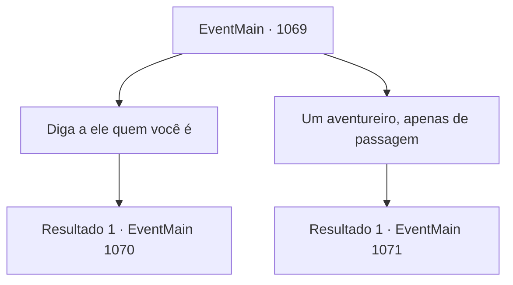

# Eventos principais · 1069

[Índice da tabela](index.md) · [Índice geral](../index.md)

ID: `pt:EventMain:1069` · Fonte: `EventMain4` · Versão: 1.2.47.

Mapeamento estático dos arquivos; a disponibilidade e a execução dependem do estado da run.

## Texto do evento

*Sem texto no arquivo.*

## Dados de entrada

```json
{
  "id": 1069,
  "grade": 1,
  "normalGoal": "",
  "required": ""
}
```

## Mapa das escolhas



## Escolhas e resultados

### Escolha 1

Diga a ele quem você é

Requisitos e outros campos da escolha:

```json
{
  "required": ""
}
```

#### Resultado 1.1

Sua resposta surpreende o mercador, que pisca em descrença. Ele olha para cima e para baixo mais uma vez. Finalmente, o olhar do mercador para no seu broche, com o símbolo do brasão de Briovich. Todos ao redor param o que estavam fazendo e se viram para você. O mercador à sua frente tira as mãos do saco e se curva. Os outros imitam. 

 "Bem, bem... nosso senhor em carne e osso. Posso perguntar o que o senhor está fazendo aqui no ermo, sem escolta?"

 O mercador endireita as costas e fala, coçando a cabeça. 

 "O senhor se importa se eu perguntar para onde está indo? Quer dizer, uh... não é muito seguro por aqui..."

 Ele abre as mãos e acrescenta. 

 "10 de ouro, e teremos o prazer de lhe dar uma carona em nossa carroça."


Continuação registrada: [Evento 1070](1070.md) na mesma tabela.

```json
{
  "required": "",
  "chance": "1",
  "nextEvent": 1070,
  "type": 2,
  "reward": ""
}
```

### Escolha 2

Um aventureiro, apenas de passagem

Requisitos e outros campos da escolha:

```json
{
  "required": ""
}
```

#### Resultado 2.1

O mercador acena com a cabeça, devagar, em resposta. Ele continua, empurrando o saco para cima da carroça. 

 "Um aventureiro, hein? Difícil ver um por aqui, especialmente hoje em dia."

 Outro mercador, sentado ao lado de uma fogueira, interrompe, dando um gole na sopa. 

 "São aqueles malditos orcs. Nos últimos meses eles têm atacado caravanas como loucos. Tivemos que contratar uma escolta adicional também."

 Ele aponta para a carroça com o queixo. Duas lanças estão apoiadas ao lado dela, com um homem em armadura de couro sentado na frente. O mercador volta o olhar para você. 

 "Pra onde você está indo? Não é exatamente um lugar seguro para estar sozinho..."

 Ele abre a mão, mostrando cinco dedos, acrescentando que, por uma pequena taxa, poderia lhe dar carona em sua carroça.

Continuação registrada: [Evento 1071](1071.md) na mesma tabela.

```json
{
  "required": "",
  "chance": "1",
  "nextEvent": 1071,
  "type": 2,
  "reward": ""
}
```

## Referências que chegam a este evento

- [Evento 1068 · escolha 1 · resultado 1](1068.md#escolha-1)
