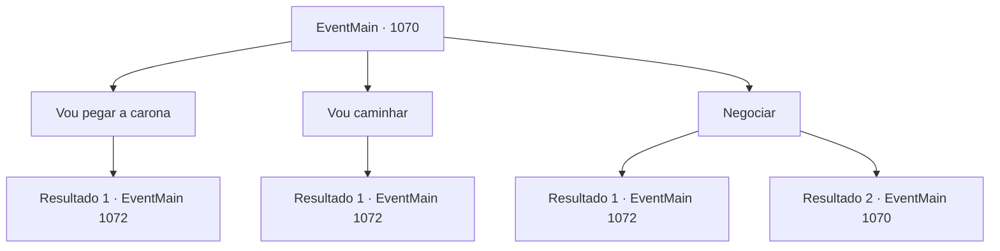

# Eventos principais · 1070

[Índice da tabela](index.md) · [Índice geral](../index.md)

ID: `pt:EventMain:1070` · Fonte: `EventMain4` · Versão: 1.2.47.

Mapeamento estático dos arquivos; a disponibilidade e a execução dependem do estado da run.

## Texto do evento

*Sem texto no arquivo.*

## Dados de entrada

```json
{
  "id": 1070,
  "grade": 1,
  "normalGoal": "",
  "required": ""
}
```

## Mapa das escolhas



## Escolhas e resultados

### Escolha 1

Vou pegar a carona

Requisitos e outros campos da escolha:

```json
{
  "required": "1_4_10"
}
```

#### Resultado 1.1

Você puxa a bolsa de couro. Você conta algumas moedas de ouro dela, as coloca na mão do mercador e acrescenta que está indo para Greymoor. O mercador olha para o ouro e sorri. 

 "Bom, bom. Nós também íamos naquela direção. Por aqui."

 Ele aponta para a parte de trás do carro de transporte. Entre sacos e caixas de madeira há um pequeno espaço, justo o suficiente para uma pessoa sentar, e um cobertor dobrado. Você se acomoda no carro de transporte. Não muito tempo depois, os mercadores terminam de arrumar as coisas, e o carro de transporte começa a se mover. Você se recosta sobre os sacos e contempla a paisagem. Logo você vê o Castelo Greymoor, lá embaixo, nas colinas. 

 "Aí está. Castelo Greymoor. Acho que é aqui que nos despedimos. Boa sorte por aí."

 Os mercadores te deixam nas proximidades e então seguem para leste, seguindo a estrada principal.

Continuação registrada: [Evento 1072](1072.md) na mesma tabela.

```json
{
  "required": "",
  "chance": "1",
  "nextEvent": 1072,
  "type": 2,
  "reward": "0_4_-10|0_0_1"
}
```

### Escolha 2

Vou caminhar

Requisitos e outros campos da escolha:

```json
{
  "required": ""
}
```

#### Resultado 2.1

O comerciante dobra as mãos para trás e dá de ombros. 

 "É mesmo? Bem, o que for melhor para você, eu acho."

 Sem o menor sinal de decepção, o comerciante se vira e continua carregando a carroça. Você passa pelo acampamento da caravana e volta para a estrada. Logo, você ouve o som de rodas de carroça vindo de trás. Você olha para trás e encontra a mesma caravana de comerciantes seguindo você. O comerciante nota você, as mãos nas rédeas. 

 "Íamos para o mesmo lado de qualquer forma. É só isso."

 Você continua caminhando sem dizer nada. A carroça abrandou o passo para acompanhar você. Atrás, os comerciantes da caravana conversam baixinho. As paisagens passam. Seus passos e as rodas da carroça são tudo que enche o ar. Logo, você vê o Castelo Greymoor, lá embaixo, nas colinas. 

 "Aí está. Castelo Greymoor. É aqui que nos despedimos, eu acho. Boa sorte por aí."

 Os comerciantes seguem para leste, acompanhando a estrada principal.

Continuação registrada: [Evento 1072](1072.md) na mesma tabela.

```json
{
  "required": "",
  "chance": "1",
  "nextEvent": 1072,
  "type": 2,
  "reward": ""
}
```

### Escolha 3

Negociar

Requisitos e outros campos da escolha:

```json
{
  "required": "5_883_0"
}
```

#### Resultado 3.1

Você se lembra do que ouviu e sugere que está disposto a fornecer proteção, caso os orcs ataquem. O comerciante olha para você silenciosamente e então acena com a cabeça. 

 "Bem... já estávamos indo pra lá de qualquer jeito, então entendo por que não deveríamos deixá-lo. Claro. Por aqui."

 Ele indica o fundo da carroça. Entre sacos e caixas de madeira há um pequeno espaço, justo o bastante para uma pessoa sentar, e um cobertor dobrado. Você se acomoda na carroça. Nem muito tempo depois, os mercadores terminam de arrumar as coisas e a carroça começa a se mover. Você se recosta nos sacos e encara a paisagem ao longe. Logo, você vê o Castelo Greymoor, lá embaixo, nas colinas. 

 "Ali está. Castelo Greymoor. É aqui que nos despedimos, acho. Boa sorte aí fora."

 Os mercadores o deixam nas proximidades e então seguem para leste, seguindo a estrada principal.

Continuação registrada: [Evento 1072](1072.md) na mesma tabela.

```json
{
  "required": "",
  "chance": "1|0_12_1",
  "nextEvent": 1072,
  "type": 0,
  "reward": "0_0_1"
}
```

#### Resultado 3.2

Você se lembra do que ouviu e sugere que está disposto a oferecer proteção, caso os orcs ataquem. O mercador olha para você em silêncio, depois balança a cabeça. 

 "Não é necessário."


Continuação registrada: [Evento 1070](1070.md) na mesma tabela.

```json
{
  "required": "",
  "chance": "10",
  "nextEvent": 1070,
  "type": 1,
  "reward": "5_883_9"
}
```

## Referências que chegam a este evento

- [Evento 1069 · escolha 1 · resultado 1](1069.md#escolha-1)
- [Evento 1070 · escolha 3 · resultado 2](1070.md#escolha-3)
