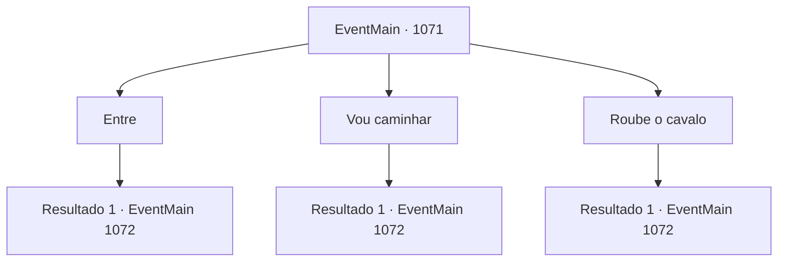

# Eventos principais · 1071

[Índice da tabela](index.md) · [Índice geral](../index.md)

ID: `pt:EventMain:1071` · Fonte: `EventMain4` · Versão: 1.2.47.

Mapeamento estático dos arquivos; a disponibilidade e a execução dependem do estado da run.

## Texto do evento

*Sem texto no arquivo.*

## Dados de entrada

```json
{
  "id": 1071,
  "grade": 1,
  "normalGoal": "",
  "required": ""
}
```

## Mapa das escolhas



## Escolhas e resultados

### Escolha 1

Entre

Requisitos e outros campos da escolha:

```json
{
  "required": "1_4_5"
}
```

#### Resultado 1.1

Você puxa a bolsa de couro. Você conta algumas moedas de ouro dela, as coloca na mão do mercador e acrescenta que está indo para Greymoor. O mercador olha para o ouro e sorri. 

 "Bom, bom. Nós também íamos naquela direção. Por aqui."

 Ele aponta para a parte de trás do carro de transporte. Entre sacos e caixas de madeira há um pequeno espaço, justo o suficiente para uma pessoa sentar, e um cobertor dobrado. Você se acomoda no carro de transporte. Não muito tempo depois, os mercadores terminam de arrumar as coisas, e o carro de transporte começa a se mover. Você se recosta sobre os sacos e contempla a paisagem. Logo você vê o Castelo Greymoor, lá embaixo, nas colinas. 

 "Aí está. Castelo Greymoor. Acho que é aqui que nos despedimos. Boa sorte por aí."

 Os mercadores te deixam nas proximidades e então seguem para leste, seguindo a estrada principal.

Continuação registrada: [Evento 1072](1072.md) na mesma tabela.

```json
{
  "required": "",
  "chance": "1",
  "nextEvent": 1072,
  "type": 2,
  "reward": "0_4_-5|0_0_1"
}
```

### Escolha 2

Vou caminhar

Requisitos e outros campos da escolha:

```json
{
  "required": ""
}
```

#### Resultado 2.1

O mercador entrelaça as mãos para trás e dá de ombros. 

 "É mesmo? Bem, o que mais lhe convier, eu acho."

 Sem o menor sinal de desapontamento, o mercador se vira e continua carregando a carroça. Os outros também voltam aos seus afazeres. Você passa pelo acampamento da caravana e volta para a estrada. Logo, você ouve o som de rodas de carroça vindo por trás. Você olha para trás e encontra a mesma caravana de mercadores seguindo você. O mercador percebe você, com as mãos nas rédeas. 

 "É melhor ter cuidado por estas bandas. Os orcs são criaturas violentas e temíveis."

 A carroça começa a se distanciar de você. A poeira se levanta e depois se assenta. Depois de dar uma última olhada na silhueta da carroça, você finalmente vê o Castelo Greymoor, lá embaixo nas colinas.

Continuação registrada: [Evento 1072](1072.md) na mesma tabela.

```json
{
  "required": "",
  "chance": "1",
  "nextEvent": 1072,
  "type": 2,
  "reward": ""
}
```

### Escolha 3

Roube o cavalo

Requisitos e outros campos da escolha:

```json
{
  "required": "2_3_0"
}
```

#### Resultado 3.1

Você dá uma espiada. Há um cavalo, não amarrado ao carro de feira. Você responde que não vai viajar com eles, e o mercador recolhe a mão. 

 "É assim? Bem, como você preferir, eu acho."

 Sem o menor sinal de desapontamento, o mercador se vira e continua carregando o carro. Outros voltam às suas tarefas também. Enquanto isso, você se aproxima furtivamente do cavalo e o solta. Então, você sobe em suas costas e lhe dá uma boa chute. 

 "*HIN-!*"

 O cavalo dispara para frente, e você vê a paisagem ao redor passar rapidamente. 

 "H- HEY! Ladrão! LADRÃO!!!"

 Os mercadores correm desesperados atrás de você, mas não são páreos para um cavalo. Logo eles perdem sua visão, e você já está a caminho do Castelo Greymoor. Após atravessar algumas colinas, o Castelo Greymoor finalmente surge diante de seus olhos. Você pula do cavalo e desce as colinas.

Continuação registrada: [Evento 1072](1072.md) na mesma tabela.

```json
{
  "required": "",
  "chance": "1",
  "nextEvent": 1072,
  "type": 2,
  "reward": "0_3_-1|0_0_1"
}
```

## Referências que chegam a este evento

- [Evento 1069 · escolha 2 · resultado 1](1069.md#escolha-2)
