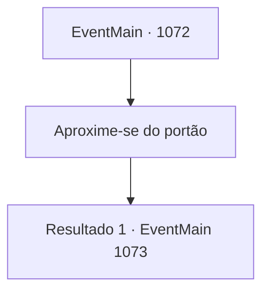

# Eventos principais · 1072

[Índice da tabela](index.md) · [Índice geral](../index.md)

ID: `pt:EventMain:1072` · Fonte: `EventMain4` · Versão: 1.2.47.

Mapeamento estático dos arquivos; a disponibilidade e a execução dependem do estado da run.

## Texto do evento

*Sem texto no arquivo.*

## Dados de entrada

```json
{
  "id": 1072,
  "grade": 1,
  "normalGoal": "",
  "required": ""
}
```

## Mapa das escolhas



## Escolhas e resultados

### Escolha 1

Aproxime-se do portão

Requisitos e outros campos da escolha:

```json
{
  "required": ""
}
```

#### Resultado 1.1

|drawing_greymoorCastle| O Castelo Greymoor fica no topo de uma colina baixa. Paredes de granito cinza se estendem sem fim, sem uma única brecha visível. Elas parecem se elevar sobre os humanos, pelo menos quatro ou cinco vezes mais altas, com torres de vigia erguidas em intervalos regulares. No topo delas, uma bandeira com um brasão de grifo — o símbolo da Casa Greymoor — tremula ao vento. Você se aproxima do portão do castelo. Massivas portas de carvalho, reforçadas com placas de aço, permanecem abertas e presas aos dois lados. Diante delas estão dois soldados usando elmos, em guarda. 

 "Que negócios você tem aqui?"

 Você responde tocando seu broche. O guarda olha para o broche e acena. 

 "Você pode entrar."

 Ao passar pelo portão externo, uma cidade extensa surge à sua frente. Estradas de pedra bem pavimentadas se estendem pelas largas ruas, levando eventualmente aos distritos mais internos do castelo. Uma série de edifícios robustos de madeira e pedra alinham-se às ruas. Você ouve o tilintar metálico de uma forja próxima. Um aroma delicioso de pão emana de uma padaria ao lado. Nem é preciso dizer que as ruas estão cheias de gente. Você continua caminhando, esbarrando na multidão. Eventualmente, surge um segundo portão. Este é mais acinzentado que o primeiro, ainda mais sólido. Você nota um número maior de guardas também. O portão está fechado. À sua frente estão quatro soldados de sentinela. Um deles se aproxima de você. 

 "Que negócios você tem aqui?"


Continuação registrada: [Evento 1073](1073.md) na mesma tabela.

```json
{
  "required": "",
  "chance": "1",
  "nextEvent": 1073,
  "type": 2,
  "reward": ""
}
```

## Referências que chegam a este evento

- [Evento 1068 · escolha 2 · resultado 1](1068.md#escolha-2)
- [Evento 1068 · escolha 2 · resultado 2](1068.md#escolha-2)
- [Evento 1070 · escolha 1 · resultado 1](1070.md#escolha-1)
- [Evento 1070 · escolha 2 · resultado 1](1070.md#escolha-2)
- [Evento 1070 · escolha 3 · resultado 1](1070.md#escolha-3)
- [Evento 1071 · escolha 1 · resultado 1](1071.md#escolha-1)
- [Evento 1071 · escolha 2 · resultado 1](1071.md#escolha-2)
- [Evento 1071 · escolha 3 · resultado 1](1071.md#escolha-3)
