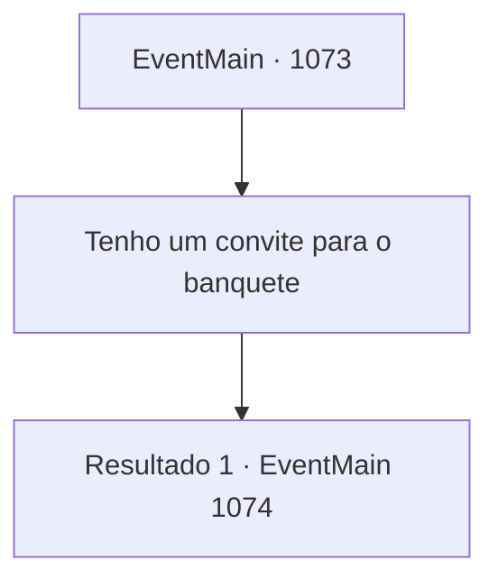

# Eventos principais · 1073

[Índice da tabela](index.md) · [Índice geral](../index.md)

ID: `pt:EventMain:1073` · Fonte: `EventMain4` · Versão: 1.2.47.

Mapeamento estático dos arquivos; a disponibilidade e a execução dependem do estado da run.

## Texto do evento

*Sem texto no arquivo.*

## Dados de entrada

```json
{
  "id": 1073,
  "grade": 1,
  "normalGoal": "",
  "required": ""
}
```

## Mapa das escolhas



## Escolhas e resultados

### Escolha 1

Tenho um convite para o banquete

Requisitos e outros campos da escolha:

```json
{
  "required": ""
}
```

#### Resultado 1.1

Você lhe entrega o convite para o banquete. Ele o examina atentamente. 

 "Ah. Conde Briovich. Dê-nos um momento, por favor."

 O soldado pega o convite e desaparece no castelo. Logo, o portão se abre. 

 "Conde Briovich, agora o acompanharemos para dentro."

 Você o segue e entra no castelo interno. É um mundo inteiramente diferente aqui dentro. Quartéis, arsenais e estábulos ficam ordenados ao longo da estrada de pedra, que leva ao castelo propriamente dito. O soldado o conduz para dentro, abrindo a porta. Uma ampla sala de baile surge diante de você. Um enorme lustre ilumina a sala, sua luz se refletindo no piso de mármore. Nobres já povoam o salão. Alguns dançam ao som da música, outros trocam bebidas e fofocas. Ao entrar, a nobreza se volta para olhar você, um a um. Manto empoeirado, botas esfarrapadas — sua aparência sobressai um pouco. Você os ouve murmurando. 

 "Seria... o Conde Briovich?"

 "Ah, aquela propriedade tomada por orcs?"

 Os nobres se afastam quando uma mulher se aproxima por entre eles. Seu cabelo acinzentado está cuidadosamente trançado, e seu vestido de seda lhe cai como mágica, cobrindo graciosamente sua silhueta. |drawing_katrinGreymoor| Ela é Katrin Greymoor, a matriarca da Casa Greymoor. Ela o reconhece e sorri levemente. 

 "...Faz tempo, Conde Briovich."

 Katrin se aproxima. Então, o que parece ser uma única gota de lágrima rola de seus olhos. Ela fica imóvel por um momento, e só ergue seu cálice quando o servo derrama o vinho. 

 "Ah, desculpe. Alegra-nos com sua presença. Deve ter sido uma longa viagem — por favor, aceite algumas de nossas bebidas."


Continuação registrada: [Evento 1074](1074.md) na mesma tabela.

```json
{
  "required": "",
  "chance": "1",
  "nextEvent": 1074,
  "type": 2,
  "reward": ""
}
```

## Referências que chegam a este evento

- [Evento 1072 · escolha 1 · resultado 1](1072.md#escolha-1)
