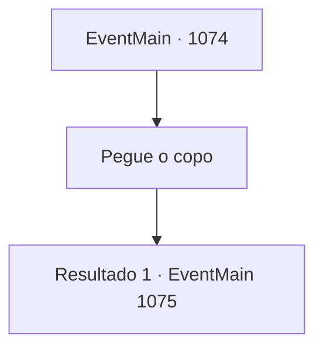

# Eventos principais · 1074

[Índice da tabela](index.md) · [Índice geral](../index.md)

ID: `pt:EventMain:1074` · Fonte: `EventMain4` · Versão: 1.2.47.

Mapeamento estático dos arquivos; a disponibilidade e a execução dependem do estado da run.

## Texto do evento

*Sem texto no arquivo.*

## Dados de entrada

```json
{
  "id": 1074,
  "grade": 1,
  "normalGoal": "",
  "required": ""
}
```

## Mapa das escolhas



## Escolhas e resultados

### Escolha 1

Pegue o copo

Requisitos e outros campos da escolha:

```json
{
  "required": ""
}
```

#### Resultado 1.1

Você pega o copo dela. Assim que você dá um gole, Katrin também ergue o copo. Os dois copos tilintam suavemente com um som claro. 

 "Por favor, aproveite o banquete."

 Então, ela vai se juntar a outro grupo de nobres. Você se senta num canto e começa a comer. Mas nenhum nobre se aproxima de você. Aqui e ali, alguns espiam você ou trocam olhares, mas é só isso. 

 Logo, a voz de Katrin ecoa pelo salão. 

 "Conde Briovich. Aqui está você."

 Você ergue o olhar e vê Katrin olhando para você. Outros nobres próximos também se viram para olhar. 

 "Por muito tempo, a Casa Briovich tem sido a muralha do leste."

 Um breve silêncio. 

 "Eles são a razão de que outras propriedades próximas não precisaram lidar com invasões de orcs com frequência."

 O olhar dela percorre os nobres próximos. 

 "É por isso que todos nós desejamos estender uma mão amiga a Briovich nestes tempos difíceis."

 Katrin faz um gesto a um de seus servos, que traz um pergaminho e o entrega a você. Nele está escrito um inventário de itens que devem ser entregues à Fazenda/Espaço Briovich — grãos, carne seca, minérios de ferro, madeira e muito mais. Embaixo estão estampados os brasões das Casas, com Greymoor na frente, seguido por Nádasdy, Bathory e Raziviu.

Continuação registrada: [Evento 1075](1075.md) na mesma tabela.

```json
{
  "required": "",
  "chance": "1",
  "nextEvent": 1075,
  "type": 2,
  "reward": ""
}
```

## Referências que chegam a este evento

- [Evento 1073 · escolha 1 · resultado 1](1073.md#escolha-1)
