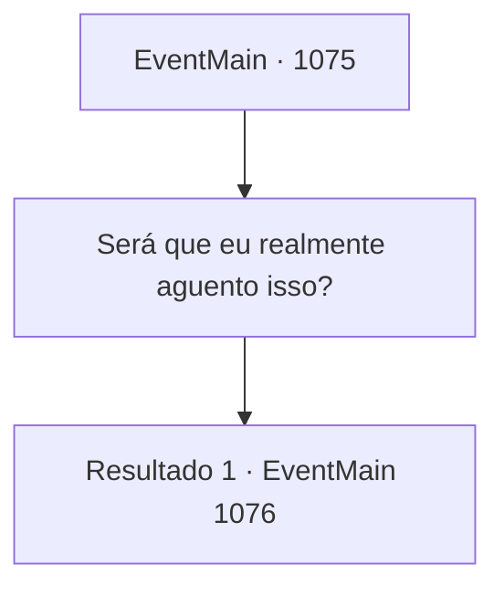

# Eventos principais · 1075

[Índice da tabela](index.md) · [Índice geral](../index.md)

ID: `pt:EventMain:1075` · Fonte: `EventMain4` · Versão: 1.2.47.

Mapeamento estático dos arquivos; a disponibilidade e a execução dependem do estado da run.

## Texto do evento

*Sem texto no arquivo.*

## Dados de entrada

```json
{
  "id": 1075,
  "grade": 1,
  "normalGoal": "",
  "required": ""
}
```

## Mapa das escolhas



## Escolhas e resultados

### Escolha 1

Será que eu realmente aguento isso?

Requisitos e outros campos da escolha:

```json
{
  "required": ""
}
```

#### Resultado 1.1

Katrin responde com outro leve sorriso. 

 "Claro. Considerando o quão vital foi o papel de Briovich, até esse apoio não é totalmente suficiente."

 Ela continua calmamente. 

 "Enquanto Briovich continuar sendo o baluarte do leste, os orcs não ousariam se aproximar de outras propriedades."

 Lentamente, Katrin ergue sua taça. Outros nobres próximos fazem o mesmo. 

 "À paz que Briovich manteve para nós."

 Sinos claros ecoam pelo salão ao tilintar das taças. Você abaixa o olhar em silêncio. O banquete continua por horas. Nobres se aproximam de você para compartilhar bebidas e trocar pequenas conversas. Alguns até vêm com um agradecimento e uma celebração, embora você logo perceba que são todas formalidades. Mais horas se passam, e os convidados começam a partir um por um. Há aqueles que retornam às suas próprias propriedades, e outros que passarão a noite nos quartos de hóspedes de Greymoor. Uma das criadas se aproxima de você e o saúda com cortesia. 

 "Posso acompanhá-lo(a) até os quartos de hóspedes?"


Continuação registrada: [Evento 1076](1076.md) na mesma tabela.

```json
{
  "required": "",
  "chance": "1",
  "nextEvent": 1076,
  "type": 2,
  "reward": ""
}
```

## Referências que chegam a este evento

- [Evento 1074 · escolha 1 · resultado 1](1074.md#escolha-1)
