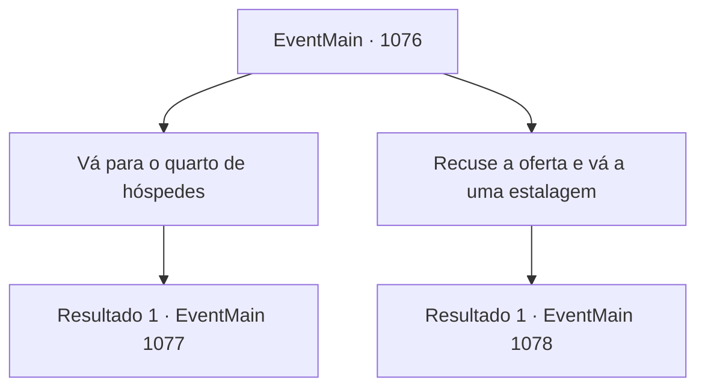

# Eventos principais · 1076

[Índice da tabela](index.md) · [Índice geral](../index.md)

ID: `pt:EventMain:1076` · Fonte: `EventMain4` · Versão: 1.2.47.

Mapeamento estático dos arquivos; a disponibilidade e a execução dependem do estado da run.

## Texto do evento

*Sem texto no arquivo.*

## Dados de entrada

```json
{
  "id": 1076,
  "grade": 1,
  "normalGoal": "",
  "required": ""
}
```

## Mapa das escolhas



## Escolhas e resultados

### Escolha 1

Vá para o quarto de hóspedes

Requisitos e outros campos da escolha:

```json
{
  "required": ""
}
```

#### Resultado 1.1

Você segue a criada até seu quarto, localizado no final do segundo andar do edifício principal. Você abre a porta e encontra uma mesa, uma cadeira e uma enorme cama larga o suficiente para duas pessoas. Um cobertor limpo está dobrado cuidadosamente sobre ela. 

 "Desejamos a você um bom descanso."

 A criada faz uma reverência educada e fecha a porta. Você vê o sol se pôr através da janela estreita, e logo fica escuro lá fora. Acomodando-se na cama, você adormece. 

 "COCORICÓ---!!"

 Você acorda ao som do cantar do galo, vindo lá das muralhas externas. Você percebe raios de luz entrando pela janela. Você se levanta rapidamente da cama, faz alguns alongamentos e se veste.

Continuação registrada: [Evento 1077](1077.md) na mesma tabela.

```json
{
  "required": "",
  "chance": "1",
  "nextEvent": 1077,
  "type": 2,
  "reward": "0_0_1|0_1_1"
}
```

### Escolha 2

Recuse a oferta e vá a uma estalagem

Requisitos e outros campos da escolha:

```json
{
  "required": ""
}
```

#### Resultado 2.1

Você recusa educadamente a oferta da criada e segue para fora. Ao sair pelo portão do castelo, você encontra a cidade tingida de laranja, cor do pôr do sol. A estalagem fica entre a ferraria e a padaria. Uma placa de madeira com o desenho de um copo de cerveja. Luz sai pela porta. Você abre a porta e, por um momento, é dominado por uma combinação de sensações — ar quente, cheiro de comida, cerveja e gente conversando alto. Você se aproxima do balcão. Um homem corpulento e musculoso de meia-idade, que também parece ser o estalajadeiro, está servindo no bar. Ele está limpando copos, usando um avental engordurado. Ele fala, sem nem olhar para você. 

 "Procurando um quarto? 10 de ouro por noite."


Continuação registrada: [Evento 1078](1078.md) na mesma tabela.

```json
{
  "required": "",
  "chance": "1",
  "nextEvent": 1078,
  "type": 2,
  "reward": ""
}
```

## Referências que chegam a este evento

- [Evento 1075 · escolha 1 · resultado 1](1075.md#escolha-1)
