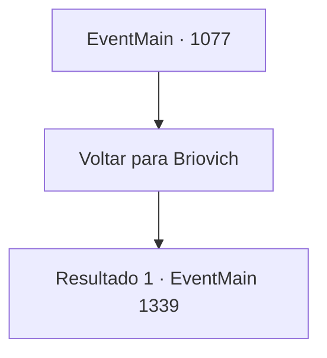

# Eventos principais · 1077

[Índice da tabela](index.md) · [Índice geral](../index.md)

ID: `pt:EventMain:1077` · Fonte: `EventMain4` · Versão: 1.2.47.

Mapeamento estático dos arquivos; a disponibilidade e a execução dependem do estado da run.

## Texto do evento

*Sem texto no arquivo.*

## Dados de entrada

```json
{
  "id": 1077,
  "grade": 1,
  "normalGoal": "",
  "required": ""
}
```

## Mapa das escolhas



## Escolhas e resultados

### Escolha 1

Voltar para Briovich

Requisitos e outros campos da escolha:

```json
{
  "required": ""
}
```

#### Resultado 1.1

Você sai do quarto de hóspedes e caminha por um caminho no jardim. Lá fora, há carroções de viagem alinhados um após o outro, cada um pintado com o brasão de Greymoor. Há trabalhadores carregando os carroções com baús de madeira, com Katrin supervisionando todo o processo. Quando ela te encontra, põe a mão no peito e te cumprimenta. 

 "Bom dia, Conde Briovich. Eu estava verificando as entregas para seu condado."

 Você lança um olhar rápido aos carroções. Cinco carroções de viagem, cada um puxado por quatro cavalos, estão fortemente guardados por um grupo de soldados de Greymoor. 

 "Isto vai levar no máximo uma semana."


Continuação registrada: [Evento 1339](1339.md) na mesma tabela.

```json
{
  "required": "",
  "chance": "1",
  "nextEvent": 1339,
  "type": 2,
  "reward": ""
}
```

## Referências que chegam a este evento

- [Evento 1076 · escolha 1 · resultado 1](1076.md#escolha-1)
