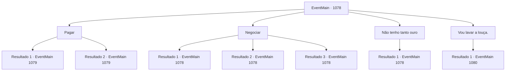

# Eventos principais · 1078

[Índice da tabela](index.md) · [Índice geral](../index.md)

ID: `pt:EventMain:1078` · Fonte: `EventMain4` · Versão: 1.2.47.

Mapeamento estático dos arquivos; a disponibilidade e a execução dependem do estado da run.

## Texto do evento

*Sem texto no arquivo.*

## Dados de entrada

```json
{
  "id": 1078,
  "grade": 1,
  "normalGoal": "",
  "required": ""
}
```

## Mapa das escolhas



## Escolhas e resultados

### Escolha 1

Pagar

Requisitos e outros campos da escolha:

```json
{
  "required": "1_4_10"
}
```

#### Resultado 1.1

Você puxa a bolsa de couro e coloca dez peças de ouro no balcão. O estalajadeiro pega tudo com um gesto da mão e lhe entrega uma chave da parede próxima. 

 "Segundo andar, terceira sala. Jantar?"

 Você responde que ainda não comeu. O estalajadeiro faz sinal para um lugar vazio em uma das mesas e continua. 

 "Sente-se ali. Vou trazer algumas salsichas e cerveja com uma tigela de ensopado."

 Você vai até o assento que ele mencionou e se senta. De uma mesa próxima, você ouve dois mercadores conversando. 

 "Você viu a Lady Katrin recentemente?"

 "Uma vez, de longe. Tive que importar algumas mercadorias para o castelo interior no mês passado."

 Enquanto você escuta às escondidas, uma garçonete traz a comida para sua mesa. Você continua a ouvir, mordendo as salsichas. 

 "Eu a vi algumas vezes quando ela ainda era uma garotinha. Ah, como ela era adorável. Como um cachorrinho hiperativo! Definitivamente uma pessoa sociável, aquela, tão gentil com cada pessoa que conhecia."

 Então, o outro mercador intervém. 

 "Mas agora... desde que ela assumiu o papel de Condessa, é como se fosse uma pessoa completamente diferente. Ela ficou fria e cortante agora. Igual ao senhor anterior, Ulrich. Acho que o trono realmente muda as pessoas, hein?"


Continuação registrada: [Evento 1079](1079.md) na mesma tabela.

```json
{
  "required": "18_885_1",
  "chance": "1",
  "nextEvent": 1079,
  "type": 2,
  "reward": "0_4_-10"
}
```

#### Resultado 1.2

Você puxa a bolsa de couro e coloca dez peças de ouro no balcão. O estalajadeiro pega tudo com um gesto da mão e lhe entrega uma chave da parede próxima. 

 "Segundo andar, terceira sala. Jantar?"

 Você responde que ainda não comeu. O estalajadeiro faz sinal para um lugar vazio em uma das mesas e continua. 

 "Sente-se ali. Vou trazer algumas salsichas e cerveja com uma tigela de ensopado."

 Você vai até o assento que ele mencionou e se senta. De uma mesa próxima, você ouve dois mercadores conversando. 

 "Você viu a Lady Katrin recentemente?"

 "Uma vez, de longe. Tive que importar algumas mercadorias para o castelo interior no mês passado."

 Enquanto você escuta às escondidas, uma garçonete traz a comida para sua mesa. Você continua a ouvir, mordendo as salsichas. 

 "Eu a vi algumas vezes quando ela ainda era uma garotinha. Ah, como ela era adorável. Como um cachorrinho hiperativo! Definitivamente uma pessoa sociável, aquela, tão gentil com cada pessoa que conhecia."

 Então, o outro mercador intervém. 

 "Mas agora... desde que ela assumiu o papel de Condessa, é como se fosse uma pessoa completamente diferente. Ela ficou fria e cortante agora. Igual ao senhor anterior, Ulrich. Acho que o trono realmente muda as pessoas, hein?"


Continuação registrada: [Evento 1079](1079.md) na mesma tabela.

```json
{
  "required": "5_885_1",
  "chance": "1",
  "nextEvent": 1079,
  "type": 2,
  "reward": "0_4_-8"
}
```

### Escolha 2

Negociar

Requisitos e outros campos da escolha:

```json
{
  "required": "5_885_0"
}
```

#### Resultado 2.1

Você tenta pechinchar por algo mais barato. O estalajadeiro para de limpar por um instante, olha para você e responde. 

 "Olha, cara, este é o lugar mais barato que você vai encontrar por aqui. Se não gosta, vá embora."

 Você continua a encará-lo nos olhos. O estalajadeiro pigarreia e propõe um novo preço. 

 "9 de ouro."

 Você balança a cabeça, insistindo em 7. O estalajadeiro acrescenta. 

 "8. 8 de ouro. Aceita ou não."


Continuação registrada: [Evento 1078](1078.md) na mesma tabela.

```json
{
  "required": "21_4_4",
  "chance": "1|0_12_1",
  "nextEvent": 1078,
  "type": 0,
  "reward": "5_885_1"
}
```

#### Resultado 2.2

Você tenta pechinchar por algo mais barato. O estalajadeiro para brevemente de limpar, levanta os olhos para você e responde. 

 "Olha, amigo, este é o lugar mais barato que você vai encontrar por aqui. Não gosta, pega a estrada."

 Ele soa teimoso — você percebe que ele não tem intenção de baixar o preço.

Continuação registrada: [Evento 1078](1078.md) na mesma tabela.

```json
{
  "required": "21_4_4",
  "chance": "14",
  "nextEvent": 1078,
  "type": 1,
  "reward": "5_885_9"
}
```

#### Resultado 2.3

Você tenta pechinchar por algo mais barato. O estalajadeiro para de limpar por um instante, olha para você e responde. 

 "...Olha, hum... algo me diz que você não faz parte da plebe comum. Não faço ideia em que enrascada você se meteu, mas..."

 Você fixa o olhar nos olhos dele. O estalajadeiro pigarreia e aparece com um novo preço. 

 "Caramba, fica com isso. Talvez você me pague depois ou algo assim."

 Ele te entrega uma chave. 

 "Segundo andar, terceiro quarto. Jantar?"

 Você responde que ainda não comeu. O estalajadeiro faz um gesto para um lugar vago em uma das mesas e continua. 

 "Sente-se ali. Vou te trazer umas salsichas e cerveja com uma tigela de guisado."

 Você vai até o assento que ele mencionou e se senta. De uma mesa próxima, você escuta dois mercadores conversando. 

 "Você viu a Lady Katrin recentemente?"

 "Uma vez, de longe. Tive que importar umas mercadorias para o castelo interno no mês passado."

 Enquanto você escuta, uma garçonete traz a comida para sua mesa. Você continua ouvindo, mordendo as salsichas. 

 "Eu a vi algumas vezes quando ela ainda era uma garotinha. Ah, como ela era adorável. Como um filhote hiperativo! Definitivamente uma pessoa sociável, essa aí, tão gentil com todo mundo que conhecia."

 Então, o outro mercador intervém. 

 "Mas agora... desde que ela assumiu o papel de Condessa, parece que virou outra pessoa. Ela ficou fria e afiada agora. Igual ao senhor anterior, Ulrich. Acho que o trono realmente muda a gente, hein?"


Continuação registrada: [Evento 1078](1078.md) na mesma tabela.

```json
{
  "required": "20_4_4",
  "chance": "1",
  "nextEvent": 1078,
  "type": 2,
  "reward": ""
}
```

### Escolha 3

Não tenho tanto ouro

Requisitos e outros campos da escolha:

```json
{
  "required": "5_886_0"
}
```

#### Resultado 3.1

O estalajadeiro percebe você hesitando em puxar sua bolsa. Ele te observa dos pés à cabeça. Ele coça o queixo e faz um gesto em direção à cozinha. 

 "T tenho algumas louças que precisam ser lavadas. Cuida disso e posso te dar algo, acho. Você vai dormir ao lado dos cavalos, porém."


Continuação registrada: [Evento 1078](1078.md) na mesma tabela.

```json
{
  "required": "",
  "chance": "1",
  "nextEvent": 1078,
  "type": 2,
  "reward": "5_886_1"
}
```

### Escolha 4

Vou lavar a louça.

Requisitos e outros campos da escolha:

```json
{
  "required": "5_886_1"
}
```

#### Resultado 4.1

Você aceita a oferta dele. O estalajadeiro solta um pequeno suspiro e continua. 

 "Tudo bem. Lave a louça, então."

 Ele abre um pequeno portão perto do balcão para deixá-lo entrar. Você entra, caminhando até a cozinha. A cozinha estreita está coberta de manchas de óleo e fuligem. Você percebe uma panela pendurada em um forno. Você pega um pouco de água morna nela e derrama a água em uma tigela grande. Você começa a lavar a louça. Enquanto isso, ouve as vozes de alguns mercadores conversando. 

 "Você viu a Lady Katrin recentemente?"

 "Uma vez, de longe. Tive que importar algumas mercadorias para o castelo interno no mês passado."

 Você para de lavar a louça por um momento e escuta. 

 "Eu a vi algumas vezes quando ela ainda era uma garotinha. Ah, como ela era adorável. Parecia um filhote hiperativo! Definitivamente uma pessoa sociável, essa — tão gentil com cada pessoa que conhecia."

 Então, outro mercador intervém. 

 "Mas agora... desde que ela assumiu o papel de Condessa, é como se fosse uma pessoa completamente diferente. Ela ficou fria e afiada agora. Igual ao senhor anterior, Ulrich. Acho que o trono realmente muda a gente, né?"

 Você termina de lavar o último prato e volta para o estalajadeiro. Ele olha para a cozinha e sorri satisfeito. 

 "Bom trabalho. Obrigado. Vá descansar, agora."


Continuação registrada: [Evento 1080](1080.md) na mesma tabela.

```json
{
  "required": "",
  "chance": "1",
  "nextEvent": 1080,
  "type": 2,
  "reward": ""
}
```

## Referências que chegam a este evento

- [Evento 1076 · escolha 2 · resultado 1](1076.md#escolha-2)
- [Evento 1078 · escolha 2 · resultado 1](1078.md#escolha-2)
- [Evento 1078 · escolha 2 · resultado 2](1078.md#escolha-2)
- [Evento 1078 · escolha 2 · resultado 3](1078.md#escolha-2)
- [Evento 1078 · escolha 3 · resultado 1](1078.md#escolha-3)
