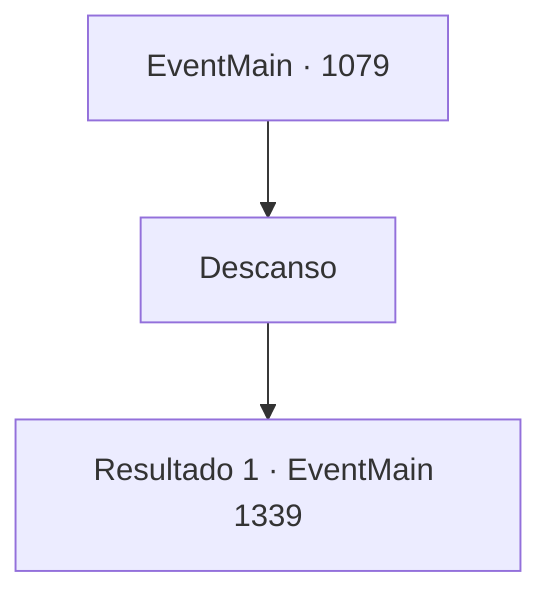

# Eventos principais · 1079

[Índice da tabela](index.md) · [Índice geral](../index.md)

ID: `pt:EventMain:1079` · Fonte: `EventMain4` · Versão: 1.2.47.

Mapeamento estático dos arquivos; a disponibilidade e a execução dependem do estado da run.

## Texto do evento

*Sem texto no arquivo.*

## Dados de entrada

```json
{
  "id": 1079,
  "grade": 1,
  "normalGoal": "",
  "required": ""
}
```

## Mapa das escolhas



## Escolhas e resultados

### Escolha 1

Descanso

Requisitos e outros campos da escolha:

```json
{
  "required": ""
}
```

#### Resultado 1.1

Você sobe as rangentes escadas de madeira e chega ao seu quarto no segundo andar. A porta dá para um cômodo pequeno. Uma cama, uma mesa, uma cadeira, e só isso. Há uma janela, meia coberta por cortinas. O quarto cheira a madeira seca e poeira. Você tira as roupas e as pendura em um cabideiro ali perto. Você sente os tornozelos e joelhos doloridos ao pular na cama. Vozes de clientes conversando são claramente audíveis daqui, embora com o passar do tempo fique visivelmente mais silencioso. Logo, você adormece. 

 Ao abrir os olhos, você vê pela janela que um novo dia está prestes a começar. Você ouve rodas de carroça e cascos de cavalo lá fora. Você se põe de pé, veste as roupas e sai da estalagem. Lá fora, encontra carroções alinhados um após o outro, cada um pintado com o brasão de Greymoor. Há trabalhadores carregando os carroções com caixotes de madeira, com Katrin supervisionando todo o processo. Quando ela te encontra, põe uma mão no peito e te cumprimenta. 

 "Ah, Conde Briovich."

 Ela aponta para os carroções e continua. 

 "Eu estava checando as entregas para sua propriedade."

 Você dá uma breve olhada nos carroções. Cinco carroções, cada um puxado por quatro cavalos, estão fortemente guardados por um grupo de soldados de Greymoor. 

 "Isto levará no máximo uma semana."


Continuação registrada: [Evento 1339](1339.md) na mesma tabela.

```json
{
  "required": "",
  "chance": "1",
  "nextEvent": 1339,
  "type": 2,
  "reward": "0_0_1|0_1_1"
}
```

## Referências que chegam a este evento

- [Evento 1078 · escolha 1 · resultado 1](1078.md#escolha-1)
- [Evento 1078 · escolha 1 · resultado 2](1078.md#escolha-1)
