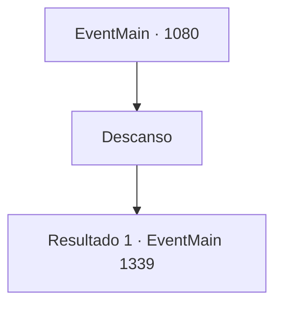

# Eventos principais · 1080

[Índice da tabela](index.md) · [Índice geral](../index.md)

ID: `pt:EventMain:1080` · Fonte: `EventMain4` · Versão: 1.2.47.

Mapeamento estático dos arquivos; a disponibilidade e a execução dependem do estado da run.

## Texto do evento

*Sem texto no arquivo.*

## Dados de entrada

```json
{
  "id": 1080,
  "grade": 1,
  "normalGoal": "",
  "required": ""
}
```

## Mapa das escolhas



## Escolhas e resultados

### Escolha 1

Descanso

Requisitos e outros campos da escolha:

```json
{
  "required": ""
}
```

#### Resultado 1.1

Você chega ao estábulo e nota um pequeno monte de feno. Segurando o casaco, deita-se sobre ele. O fedor de cavalos, feno molhado e ervas o incomoda. Pelo telhado de palha, você vê estrelas brilhando no céu noturno. Sons de cavalos farejando e cavando a terra acompanham seu sono. Você ouve risadas da estalagem, mas logo tudo se desvanece. 

 Você abre os olhos, e um novo dia está prestes a começar. O monte de feno está encharcado de orvalho da manhã — assim como seu manto. Sons de cascos de cavalo e rodas de carroça podem ser ouvidos lá fora. Você limpa o feno de si e sai para as ruas. Lá fora, encontra carroções dispostos um atrás do outro, cada um pintado com o brasão de Greymoor. Há trabalhadores carregando os carroções com baús de madeira, com Katrin supervisionando todo o processo. Quando ela o encontra, coloca uma mão no peito e o cumprimenta. 

 "Oh, uh... Conde Briovich."

 Ela aponta para os carroções e continua. 

 "Eu estava checando as entregas para sua propriedade."

 Você lança um olhar rápido aos carroções. Cinco carroções, cada um puxado por quatro cavalos, estão rigidamente guardados por um grupo de soldados de Greymoor. 

 "Isso vai levar no máximo uma semana."


Continuação registrada: [Evento 1339](1339.md) na mesma tabela.

```json
{
  "required": "",
  "chance": "1",
  "nextEvent": 1339,
  "type": 2,
  "reward": "0_0_1"
}
```

## Referências que chegam a este evento

- [Evento 1078 · escolha 4 · resultado 1](1078.md#escolha-4)
