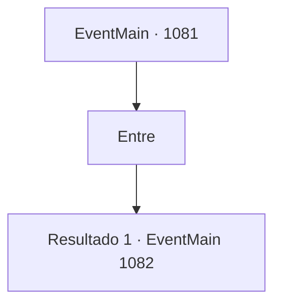

# Eventos principais · 1081

[Índice da tabela](index.md) · [Índice geral](../index.md)

ID: `pt:EventMain:1081` · Fonte: `EventMain4` · Versão: 1.2.47.

Mapeamento estático dos arquivos; a disponibilidade e a execução dependem do estado da run.

## Texto do evento

Você retorna em segurança a Briovich. A estrada diante do portão do castelo foi limpa das ervas daninhas. As muralhas mostram sinais claros de reparos - embora feitos às pressas. Você passa pelo portão e entra. Há pilhas de feno perto do estábulo, e um par de cavalos está lá dentro. No pátio interno, dois soldados estão ocupados movendo baús de madeira. As condições claramente melhoraram, mas você ainda vê alguns pontos óbvios que precisam de reparos aqui e ali. Você segue pela estrada e entra na mansão, pelos corredores e finalmente até o seu escritório. Ah, a sensação familiar da cadeira. Você se recosta nela confortavelmente. 
 *toc, toc* 
 Assim que você se senta para relaxar, ouve batidas na porta.

## Dados de entrada

```json
{
  "id": 1081,
  "grade": 1,
  "normalGoal": "",
  "required": "13_6_3|1_2_25"
}
```

## Mapa das escolhas



## Escolhas e resultados

### Escolha 1

Entre

Requisitos e outros campos da escolha:

```json
{
  "required": ""
}
```

#### Resultado 1.1

A porta se abre, e Rennart entra. Ele faz uma reverência educada, fica diante da mesa e espalha uma pilha de documentos. 

 "Suprimentos de Greymoor chegaram. Tomei a liberdade de distribuí-los."

 Seus dedos manchados de tinta percorrem os números. 

 "Pusemos em dia os pagamentos dos soldados, compramos estoques de alimentos suficientes para nos durar três meses. Também iniciamos os reparos das muralhas sul do castelo e terminamos de consertar a estrada em frente ao portão do castelo e o estábulo."

 Rennart ajusta os óculos e passa para outras categorias. 

 "Agora, sobre a situação nos arredores... ataques da tribo Zaraid continuam, mas não é nada grave por enquanto. Três ou quatro orcs aparecem para roubar alguns animais ou algumas colheitas de nossas fazendas. Pequenos furtos, na melhor das hipóteses."

 O olhar de Rennart se volta para você. 

 "Conseguimos lidar com a emergência. Agora, cabe a você decidir onde devemos investir."

 Ele tira uma nova folha de papel e a espalha sobre a mesa. 

 "Primeira opção - uma oficina de ferreiro. Com a tribo Zaraid nos incomodando continuamente, nossos recursos militares estão bastante esticados. Minha recomendação é que, em vez de aumentar o número de nossas tropas, as fortaleçamos reforçando seu equipamento."

 Rennart passa para a próxima categoria. 

 "Segunda opção. Há um poço de mina abandonado, nas partes sul de nossa propriedade. Se reabrirmos, poderíamos ter um fluxo contínuo de prata, que a longo prazo será uma fonte confiável de renda."


Continuação registrada: [Evento 1082](1082.md) na mesma tabela.

```json
{
  "required": "",
  "chance": "1",
  "nextEvent": 1082,
  "type": 2,
  "reward": ""
}
```

## Referências que chegam a este evento

Nenhum `nextEvent` positivo da mesma tabela aponta para este nó. Isso não prova que seja inacessível: sorteio e estado de história podem selecioná-lo.

