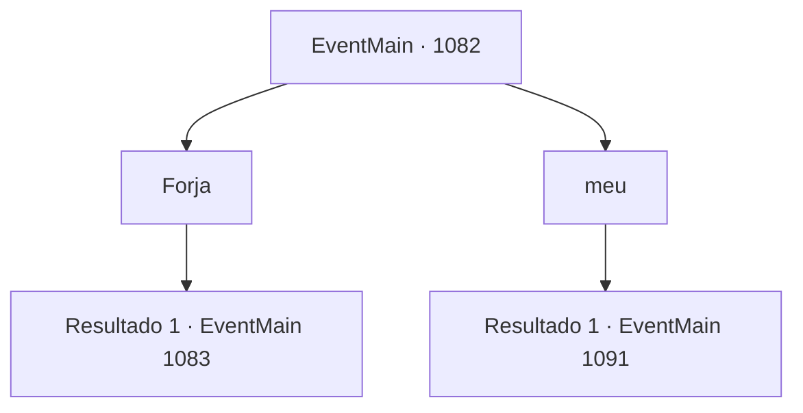

# Eventos principais · 1082

[Índice da tabela](index.md) · [Índice geral](../index.md)

ID: `pt:EventMain:1082` · Fonte: `EventMain4` · Versão: 1.2.47.

Mapeamento estático dos arquivos; a disponibilidade e a execução dependem do estado da run.

## Texto do evento

*Sem texto no arquivo.*

## Dados de entrada

```json
{
  "id": 1082,
  "grade": 1,
  "normalGoal": "",
  "required": ""
}
```

## Mapa das escolhas



## Escolhas e resultados

### Escolha 1

Forja

Requisitos e outros campos da escolha:

```json
{
  "required": ""
}
```

#### Resultado 1.1


 "Entendido. Vou reunir alguns trabalhadores agora."

 Alguns dias se passam, e a construção de uma nova forja começa. Carpinteiros qualificados são encarregados de montar a estrutura, com voluntários da propriedade e alguns soldados cobrindo o restante. Sons de pedras sendo lapidadas e martelos batendo ecoam pela propriedade. Mais alguns dias se passam desde que a construção começou. 
 *toc, toc* 
 O padrão familiar, de dois toques. Embora desta vez você note que o intervalo entre os toques é muito curto. A porta se abre antes que você possa responder. Rennart entra, os lábios bem cerrados. 

 "Tengo algo a relatar."

 Rennart se aproxima da escrivaninha e continua. 

 "Dois dos soldados da construção da forja desapareceram."

 Ele respira fundo e acrescenta. 

 "Um é um anão chamado 'Bill', e o outro é 'Smith', um humano. Eles não aparecem no local de trabalho há dois dias."

 Rennart empurra os óculos para cima.

Continuação registrada: [Evento 1083](1083.md) na mesma tabela.

```json
{
  "required": "",
  "chance": "1",
  "nextEvent": 1083,
  "type": 2,
  "reward": "5_887_1"
}
```

### Escolha 2

meu

Requisitos e outros campos da escolha:

```json
{
  "required": ""
}
```

#### Resultado 2.1


 "Entendido. Começarei pelo poço de mina sul."

 Passam-se alguns dias, e a operação para reativar o poço de mina começa. A estrada até a mina é consertada, e os escombros que bloqueavam a entrada são removidos. Trabalhadores experientes entram primeiro para checar as condições do poço. Voluntários da propriedade e alguns soldados os seguem. Sons de picaretas ecoam pelas minas, com vagonetes cheios de terra e pedras movendo-se pra lá e pra cá. Mais alguns dias desde o início da operação. 

 *toc, toc* 
 O padrão familiar, de dois toques. Embora desta vez você perceba que a pausa entre os toques é bem curta. A porta se abre antes que você possa responder. Rennart entra, com os lábios bem cerrados. 

 "Tenho algo a reportar."

 Rennart aproxima-se da escrivaninha e continua. 

 "Tivemos... um pequeno incidente de trabalho nas minas."

 Rennart puxa um pedaço de papel e o coloca sobre a mesa. É um relatório do capataz, escrito às pressas. 
 'Um suporte foi destruído durante a operação no poço 3. Plataforma desabou. Trabalhador 'Ed' arremessado. Fratura na perna direita. Ainda consciente.' 
 

 "É o Ed, um humano do sexo masculino. Trouxemos ele como pedreiro de pedra. Confirmamos a fratura na perna direita e o imobilizamos fora das minas, mas..."

 Rennart para por um momento. 

 "Faltam instalações adequadas para tratá-lo de forma suficiente. Tudo o que fizemos foi aplicar algumas ervas medicinais ao redor da ferida e fazê-lo deitar."

 Rennart ajeita os óculos. 

 "A estrutura interna do poço mostrou-se completamente degradada. Tememos que novos desabamentos possam ocorrer, então, por enquanto, suspenderemos temporariamente a operação."


Continuação registrada: [Evento 1091](1091.md) na mesma tabela.

```json
{
  "required": "",
  "chance": "1",
  "nextEvent": 1091,
  "type": 2,
  "reward": "5_888_1"
}
```

## Referências que chegam a este evento

- [Evento 1081 · escolha 1 · resultado 1](1081.md#escolha-1)
