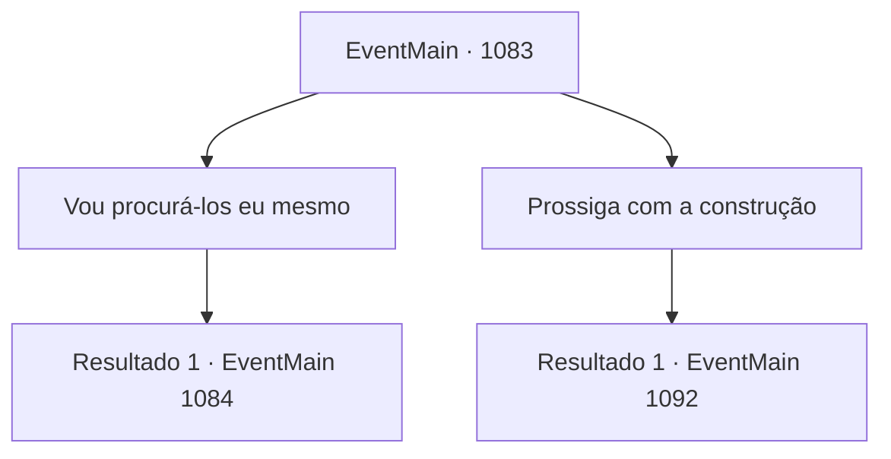

# Eventos principais · 1083

[Índice da tabela](index.md) · [Índice geral](../index.md)

ID: `pt:EventMain:1083` · Fonte: `EventMain4` · Versão: 1.2.47.

Mapeamento estático dos arquivos; a disponibilidade e a execução dependem do estado da run.

## Texto do evento

*Sem texto no arquivo.*

## Dados de entrada

```json
{
  "id": 1083,
  "grade": 1,
  "normalGoal": "",
  "required": ""
}
```

## Mapa das escolhas



## Escolhas e resultados

### Escolha 1

Vou procurá-los eu mesmo

Requisitos e outros campos da escolha:

```json
{
  "required": ""
}
```

#### Resultado 1.1

Rennart ouve sua resposta, ajusta os óculos e responde.  

 "Eu irei com você."

  Você segue Rennart até o canteiro de obras da ferraria.  Tijolos e ferramentas dos trabalhadores estão espalhados por todo o chão.  Ao redor deles, você nota pegadas - provavelmente dos soldados.  Rennart se agacha e as examina.  

 "Aqui - pegadas. Elas levam ao Bosque de Almorn."

  O Bosque de Almorn é uma pequena área de floresta artificial, e também o playground da sua juventude.  Rennart sussurra baixinho para si mesmo.  

 "Tenho certeza de que este não é o lugar de onde tiramos nossa madeira."

  Você e Rennart seguem as pegadas para dentro do bosque.  Folhas secas cobrem o chão. A cada passo que você dá, ouve ruídos úmidos.  |drawing_hunterHouse|  Logo, vocês dois encontram uma pequena construção dentro do bosque.  É uma pequena cabana de troncos, com um telhado coberto de musgo e paredes cobertas por algo preto.  

 "É a cabana do guardião da floresta."

  Rennart abre a porta com cuidado.  Um fedor de sangue vem de dentro.  O cômodo é estreito - uma cama no canto, e uma mesa e uma cadeira no outro canto.  Há uma figura humanoide caída no chão. Pela posição dela, você supõe que algo a jogou para fora da cadeira.  Os olhos do corpo ainda estão abertos, embora o próprio corpo esteja imóvel.  

Continuação registrada: [Evento 1084](1084.md) na mesma tabela.

```json
{
  "required": "",
  "chance": "1",
  "nextEvent": 1084,
  "type": 2,
  "reward": ""
}
```

### Escolha 2

Prossiga com a construção

Requisitos e outros campos da escolha:

```json
{
  "required": ""
}
```

#### Resultado 2.1

Você ordena arquivar o desaparecimento dos soldados e continuar a construção. Rennart para brevemente. Você sente um leve sinal de hesitação em seus olhos. 

 "...Entendido. Será feito."

 Ele anota algo em seus papéis, faz uma reverência e sai do escritório. 

 Dias se passam. Você está folheando alguns documentos em seu escritório. Então, depois de bater duas vezes, Rennart abre a porta e entra. 

 "Meu senhor. O senhor deveria vir dar uma olhada nisto."


Continuação registrada: [Evento 1092](1092.md) na mesma tabela.

```json
{
  "required": "",
  "chance": "1",
  "nextEvent": 1092,
  "type": 2,
  "reward": "5_889_1"
}
```

## Referências que chegam a este evento

- [Evento 1082 · escolha 1 · resultado 1](1082.md#escolha-1)
