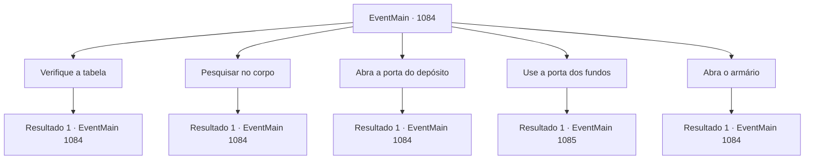

# Eventos principais · 1084

[Índice da tabela](index.md) · [Índice geral](../index.md)

ID: `pt:EventMain:1084` · Fonte: `EventMain4` · Versão: 1.2.47.

Mapeamento estático dos arquivos; a disponibilidade e a execução dependem do estado da run.

## Texto do evento

*Sem texto no arquivo.*

## Dados de entrada

```json
{
  "id": 1084,
  "grade": 1,
  "normalGoal": "",
  "required": ""
}
```

## Mapa das escolhas



## Escolhas e resultados

### Escolha 1

Verifique a tabela

Requisitos e outros campos da escolha:

```json
{
  "required": "5_890_0"
}
```

#### Resultado 1.1

Você se aproxima da mesa. Na mesa há alguns pedaços de coxa de coelho, queijo e três copos de cerveja. Um dos três está meio cheio, os outros dois completamente vazios. Ao lado deles está o diário do guarda-florestal e um pequeno pedaço de carvão. Você verifica o diário. É um relatório geral do guarda-florestal — seções de patrulha, distinções territoriais e o número de lobos, cervos e porcos mantidos na floresta estão todos apontados em símbolos simples. Na última página, porém, a escrita parece trêmula e instável. Queda súbita na população de porcos, movimento anormal de alcateias de lobos avistado, vozes humanas

Continuação registrada: [Evento 1084](1084.md) na mesma tabela.

```json
{
  "required": "",
  "chance": "1",
  "nextEvent": 1084,
  "type": 2,
  "reward": "5_890_1"
}
```

### Escolha 2

Pesquisar no corpo

Requisitos e outros campos da escolha:

```json
{
  "required": "5_891_0"
}
```

#### Resultado 2.1

Você se aproxima do corpo do guardião da floresta e se ajoelha. Com cuidado, você vira o cadáver e encontra uma ferida nas costas dele. Centralizados ao redor da ferimento há pregos brancos feitos de ossos. A carne ao redor da ferida está negra como breu, espalhando-se por todo o corpo. Você supõe que a ferida é onde a podridão teve origem. Na cintura do guardião da floresta, você encontra um pequeno martelo e uma bolsa de couro. Dentro da bolsa de couro há uma coleção de estacas de madeira, usadas para marcar símbolos pela floresta. Rennart fixa o olhar na ferida e murmura para si mesmo. 

 "Eu não acho que ele esteja morto há muito tempo... mas esse nível de podridão? Algo aqui não está certo."

 As mãos dele permanecem perto da ferida, hesitantes em tocá-la.

Continuação registrada: [Evento 1084](1084.md) na mesma tabela.

```json
{
  "required": "",
  "chance": "1",
  "nextEvent": 1084,
  "type": 2,
  "reward": "5_891_1"
}
```

### Escolha 3

Abra a porta do depósito

Requisitos e outros campos da escolha:

```json
{
  "required": "5_892_0"
}
```

#### Resultado 3.1

Você abre uma porta que leva a um depósito. A porta de madeira range ao se abrir, e o cheiro de terra te recebe. É um espaço pequeno. Você encontra um machado e uma serra pendurados na parede, com partes de cercas de madeira no chão. São todas ferramentas do guardião da floresta. Ao lado delas jaze um saquinho de carnes secas, um saco de grãos e algumas garrafas de bebida barata. No meio, há um armário de madeira gasto.

Continuação registrada: [Evento 1084](1084.md) na mesma tabela.

```json
{
  "required": "",
  "chance": "1",
  "nextEvent": 1084,
  "type": 2,
  "reward": "5_892_1"
}
```

### Escolha 4

Use a porta dos fundos

Requisitos e outros campos da escolha:

```json
{
  "required": "5_890_1|5_891_1|5_892_1"
}
```

#### Resultado 4.1

Depois de vasculhar a cabana, você abre uma porta nos fundos. Ela dá para uma pequena abertura, atrás da cabana. Há alguns tocos de árvore espalhados, com pilhas de lenha cortada. Dois corpos juncam-se entre eles. Eles também tinham as mesmas cicatrizes nas costas. Rennart te segue para fora, avista os corpos e franze a testa. 

 "Oh não... essas cicatrizes parecem exatamente com a que o guardião da floresta tinha."

 Ele abaixa o corpo até o chão para checar os dois corpos. 

 "...É o Bill e o Smith."


Continuação registrada: [Evento 1085](1085.md) na mesma tabela.

```json
{
  "required": "",
  "chance": "1",
  "nextEvent": 1085,
  "type": 2,
  "reward": ""
}
```

### Escolha 5

Abra o armário

Requisitos e outros campos da escolha:

```json
{
  "required": "5_892_1|5_893_0"
}
```

#### Resultado 5.1

Você abre o baú de madeira — ele nem está trancado. A tampa empoeirada se abre com um estalo, e você encontra algumas moedas de ouro e uma velha ratoeira coberta de teias de aranha. Você limpa o pó das moedas de ouro e as guarda no bolso.

Continuação registrada: [Evento 1084](1084.md) na mesma tabela.

```json
{
  "required": "",
  "chance": "1",
  "nextEvent": 1084,
  "type": 2,
  "reward": "0_4_3|5_893_1"
}
```

## Referências que chegam a este evento

- [Evento 1083 · escolha 1 · resultado 1](1083.md#escolha-1)
- [Evento 1084 · escolha 1 · resultado 1](1084.md#escolha-1)
- [Evento 1084 · escolha 2 · resultado 1](1084.md#escolha-2)
- [Evento 1084 · escolha 3 · resultado 1](1084.md#escolha-3)
- [Evento 1084 · escolha 5 · resultado 1](1084.md#escolha-5)
