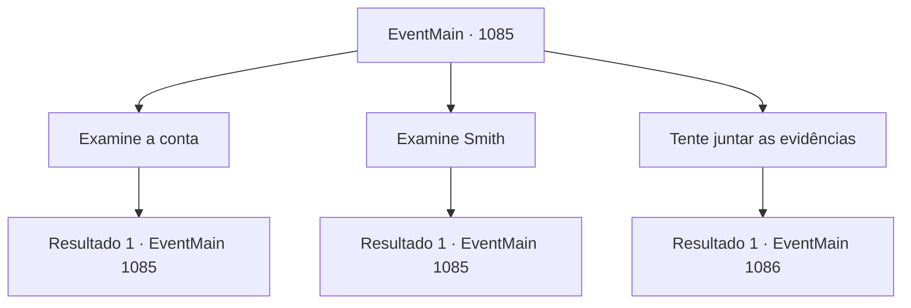

# Eventos principais · 1085

[Índice da tabela](index.md) · [Índice geral](../index.md)

ID: `pt:EventMain:1085` · Fonte: `EventMain4` · Versão: 1.2.47.

Mapeamento estático dos arquivos; a disponibilidade e a execução dependem do estado da run.

## Texto do evento

*Sem texto no arquivo.*

## Dados de entrada

```json
{
  "id": 1085,
  "grade": 1,
  "normalGoal": "",
  "required": ""
}
```

## Mapa das escolhas



## Escolhas e resultados

### Escolha 1

Examine a conta

Requisitos e outros campos da escolha:

```json
{
  "required": "5_894_0"
}
```

#### Resultado 1.1

Você examina o cadáver de Bill. O mais notável é a enorme ferida nas costas, com uma ponta de osso cravada. Já está supurada além de recuperação, exalando um fedor horrível. Você tampa o nariz e continua sua busca, começando pela cabeça. Bill é um anão de meia-idade com cabelo cor de trigo e barba rala e desgrenhada. No cinto há uma corda de apoio para uma machadinha. Você nota que a corda está cortada. Uma machadinha, presumivelmente de Bill, é encontrada no chão a alguns passos do corpo.

Continuação registrada: [Evento 1085](1085.md) na mesma tabela.

```json
{
  "required": "",
  "chance": "1",
  "nextEvent": 1085,
  "type": 2,
  "reward": "5_894_1"
}
```

### Escolha 2

Examine Smith

Requisitos e outros campos da escolha:

```json
{
  "required": "5_895_0"
}
```

#### Resultado 2.1

Você examina o cadáver de Smith. A ferida, igual à que estava em Bill, chama sua atenção. A mesma ferida exata, mesmo grau de decomposição e um espinho ósseo. Entre a carne enegrecida, ossos estão claramente visíveis. Você cobre o nariz e volta o olhar para a cabeça dele. Smith deve ter mantido o cabelo curto — quase careca. Há uma cicatriz no rosto. A decomposição destruiu completamente sua carne, mas você ainda consegue ver sua expressão facial e algumas outras características notáveis. Ele deve ter ficado muito surpreso com algo. Ao redor dos pés dele, cacos de uma lança quebrada estão espalhados. Rennart abaixa o corpo e fecha os olhos de Smith em silêncio. 

 "Devem ter sido pegos de surpresa por algo e tentado reagir às pressas."


Continuação registrada: [Evento 1085](1085.md) na mesma tabela.

```json
{
  "required": "",
  "chance": "1",
  "nextEvent": 1085,
  "type": 2,
  "reward": "5_895_1"
}
```

### Escolha 3

Tente juntar as evidências

Requisitos e outros campos da escolha:

```json
{
  "required": "5_894_1|5_895_1"
}
```

#### Resultado 3.1

Você junta as evidências. O guarda-florestal, em sua patrulha habitual, deve ter testemunhado anomalias como a súbita diminuição da população de porcos, o deslocamento inexplicável de alcateias de lobos e vozes humanas. Então, Bill e Smith foram visitar o guarda-florestal, com quem compartilharam algumas bebidas. E então, os três foram emboscados por algo, resultando em suas mortes. Rennart acena com a cabeça em resposta. 

 "Como você disse, meu senhor. Bill e Smith deviam ser próximos do guarda-florestal."

 Rennart continua, examinando um copo de cerveja. 

 "Talvez o guarda-florestal os tenha convidado para conversar sobre as anomalias que viu. Eles se reuniram tarde da noite, beberam algumas garrafas e então foram emboscados."


Continuação registrada: [Evento 1086](1086.md) na mesma tabela.

```json
{
  "required": "",
  "chance": "1",
  "nextEvent": 1086,
  "type": 2,
  "reward": "5_896_1"
}
```

## Referências que chegam a este evento

- [Evento 1084 · escolha 4 · resultado 1](1084.md#escolha-4)
- [Evento 1085 · escolha 1 · resultado 1](1085.md#escolha-1)
- [Evento 1085 · escolha 2 · resultado 1](1085.md#escolha-2)
