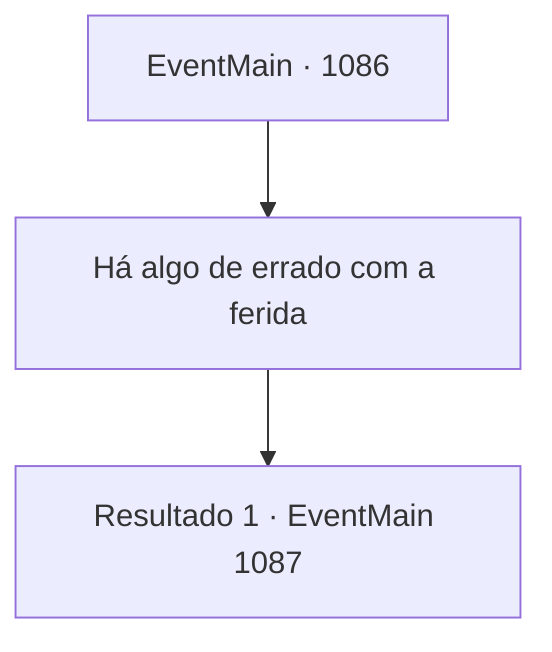

# Eventos principais · 1086

[Índice da tabela](index.md) · [Índice geral](../index.md)

ID: `pt:EventMain:1086` · Fonte: `EventMain4` · Versão: 1.2.47.

Mapeamento estático dos arquivos; a disponibilidade e a execução dependem do estado da run.

## Texto do evento

*Sem texto no arquivo.*

## Dados de entrada

```json
{
  "id": 1086,
  "grade": 1,
  "normalGoal": "",
  "required": ""
}
```

## Mapa das escolhas



## Escolhas e resultados

### Escolha 1

Há algo de errado com a ferida

Requisitos e outros campos da escolha:

```json
{
  "required": ""
}
```

#### Resultado 1.1

Você aponta a estranheza das feridas. A aparente velocidade de decomposição estava muito além do esperado para um corpo que está morto há apenas alguns dias. Rennart acena com a cabeça silenciosamente em resposta. 

 "Você está certo... De fato é antinatural. Além disso, os espinhos ósseos — sinto algo sinistro neles."

 Ele para por um momento e então continua. 

 "Eu sei... São sinais de necromancia em ação."

 Assim que termina, você ouve uma cacofonia de ossos e músculos tremendo e estalando. O guardião da floresta, Bill e Smith estão se levantando lentamente, virando-se para você. Rennart prepara seu arco e se coloca à sua frente. 

 "Fique para trás, meu senhor. Eu o protegerei."

 Sua voz é calma, mas firme. O guardião da floresta terminou de reanimar-se e está pronto para lutar. Seus olhos cinzentos e turvos rolam antes de se fixarem em você.

Continuação registrada: [Evento 1087](1087.md) na mesma tabela.

```json
{
  "required": "",
  "chance": "1",
  "nextEvent": 1087,
  "type": 2,
  "reward": ""
}
```

## Referências que chegam a este evento

- [Evento 1085 · escolha 3 · resultado 1](1085.md#escolha-3)
