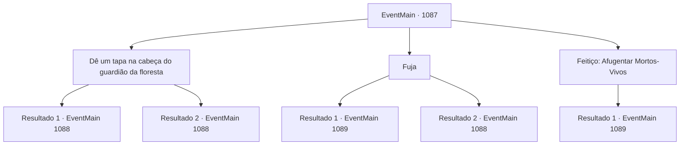

# Eventos principais · 1087

[Índice da tabela](index.md) · [Índice geral](../index.md)

ID: `pt:EventMain:1087` · Fonte: `EventMain4` · Versão: 1.2.47.

Mapeamento estático dos arquivos; a disponibilidade e a execução dependem do estado da run.

## Texto do evento

*Sem texto no arquivo.*

## Dados de entrada

```json
{
  "id": 1087,
  "grade": 1,
  "normalGoal": "",
  "required": ""
}
```

## Mapa das escolhas



## Escolhas e resultados

### Escolha 1

Dê um tapa na cabeça do guardião da floresta

Requisitos e outros campos da escolha:

```json
{
  "required": ""
}
```

#### Resultado 1.1

Você pega um machado de uma parede próxima e acerta a cabeça do guardião da floresta com ele. Com um estrondo alto, a lâmina do machado abre seu crânio. Um estalo alto de ossos ecoa pela mata. O guardião da floresta cai pela última vez. Não se mexe mais. Rennart limpa o sangue do rosto. Seu olhar se volta para Bill e Smith. Dois corpos reanimados ainda cambaleiam na sua direção e na direção de Rennart.

Continuação registrada: [Evento 1088](1088.md) na mesma tabela.

```json
{
  "required": "",
  "chance": "1|0_5_1",
  "nextEvent": 1088,
  "type": 0,
  "reward": "6_2_84",
  "place": 1
}
```

#### Resultado 1.2

Você pega um machado na parede próxima e acerta a cabeça do guardião da floresta com ele. Mas infelizmente você erra. O machado não crava na cabeça, e sim no ombro dele. Você tenta arrancá-lo, mas não sai. Então, o guardião reanimado levanta os braços e te agarra. 

 "Meu Senhor!"

 Rennart exclama, e logo uma flecha voa para o crânio do guardião. Com um guincho, o guardião cai, soltando você. 

 "Você está bem?!"

 Você concorda com a cabeça para tranquilizá-lo. Seu olhar se volta para Bill e Smith. Dois corpos reanimados ainda cambaleiam em sua direção e na direção de Rennart.

Continuação registrada: [Evento 1088](1088.md) na mesma tabela.

```json
{
  "required": "",
  "chance": "16",
  "nextEvent": 1088,
  "type": 1,
  "reward": "6_0_84",
  "place": 1
}
```

### Escolha 2

Fuja

Requisitos e outros campos da escolha:

```json
{
  "required": ""
}
```

#### Resultado 2.1

Rennart puxa seu arco e dispara uma flecha no guardião da floresta, mirando nas pernas. Quando a flecha o acerta, o corpo reanimado tropeça e perde o equilíbrio. Você e Rennart aproveitam a oportunidade, saltando para uma clareira próxima. Três corpos reanimados ainda correm atrás de vocês. Eles não são tão rápidos, no entanto. Estalos constantes ecoam pela mata, como se seus ossos discordassem uns dos outros. Você e Rennart conseguem sair da floresta. Só depois de correr por um bom tempo vocês dois ousam olhar para trás. Parece que os mortos não estão mais atrás de vocês. Rennart guarda seu arco na aljava e segue em frente. 

 "É melhor retornarmos ao castelo imediatamente."

 Ele começa a caminhar, vasculhando a área com cuidado. Você e Rennart finalmente deixam a região. Alguns momentos depois, vocês retornam ao portão do castelo. Ele fala. 

 "Que tal você voltar primeiro, meu senhor. Eu reunirei alguns homens e cuidarei dos corpos mortos."

 Com isso, Rennart parte para os quartéis. Você retorna a saudação do guarda do portão e vai direto para seu escritório.

Continuação registrada: [Evento 1089](1089.md) na mesma tabela.

```json
{
  "required": "",
  "chance": "1|0_6_1",
  "nextEvent": 1089,
  "type": 0,
  "reward": "0_2_1"
}
```

#### Resultado 2.2

Você recua, sugerindo que fuja. Mas o corpo morto é mais rápido do que você esperava. Sem hesitar, ele se lança sobre você.

Continuação registrada: [Evento 1088](1088.md) na mesma tabela.

```json
{
  "required": "",
  "chance": "16",
  "nextEvent": 1088,
  "type": 1,
  "reward": "6_0_84",
  "place": 1
}
```

### Escolha 3

Feitiço: Afugentar Mortos-Vivos

Requisitos e outros campos da escolha:

```json
{
  "required": "20_0_1|20_3_1|1_1_2"
}
```

#### Resultado 3.1

Você entoa um encantamento. Um raio de luz sagrada aparece. Quando a luz toca os cadáveres, fumaça branca emerge de suas carnes, dissipando-se no ar. Os corpos caem um a um, como marionetes que perderam os fios. Os olhos de Rennart se arregalam de surpresa. Rennart guarda o arco na aljava e segue em frente. 

 "É melhor voltarmos para o castelo imediatamente."

 Ele começa a andar, vasculhando a área com cuidado. Você e Rennart finalmente deixam a cabana. Alguns momentos depois, você e Rennart retornam ao portão do castelo. Ele fala: 

 "Que tal você voltar primeiro, meu senhor. Vou reunir alguns homens e lidar com os corpos."

 Com isso, Rennart parte para os quartéis. Você retribui a saudação do guarda do portão e vai direto para o seu escritório.

Continuação registrada: [Evento 1089](1089.md) na mesma tabela.

```json
{
  "required": "",
  "chance": "1",
  "nextEvent": 1089,
  "type": 2,
  "reward": "0_0_-1|0_2_1"
}
```

## Referências que chegam a este evento

- [Evento 1086 · escolha 1 · resultado 1](1086.md#escolha-1)
