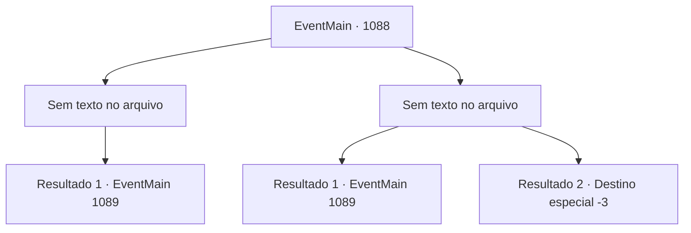

# Eventos principais · 1088

[Índice da tabela](index.md) · [Índice geral](../index.md)

ID: `pt:EventMain:1088` · Fonte: `EventMain4` · Versão: 1.2.47.

Mapeamento estático dos arquivos; a disponibilidade e a execução dependem do estado da run.

## Texto do evento

*Sem texto no arquivo.*

## Dados de entrada

```json
{
  "id": 1088,
  "grade": 1,
  "normalGoal": "",
  "required": ""
}
```

## Mapa das escolhas



## Escolhas e resultados

### Escolha 1

*Sem texto no arquivo; o papel dessa opção depende da interface do jogo.*

Requisitos e outros campos da escolha:

```json
{
  "required": ""
}
```

#### Resultado 1.1

O último corpo morto cai no chão. O que só pode ser descrito como névoa negra emerge dos corpos, das feridas para ser preciso, e se dissipa no ar. Os corpos ficam imóveis mais uma vez. Rennart guarda o arco no coldre. Então, seu olhar se volta para os três corpos mortos no chão. 

 "É melhor voltarmos ao castelo imediatamente."

 Ele começa a andar, vasculhando cuidadosamente a área. Você e Rennart finalmente deixam a cabana. Alguns momentos depois, você e Rennart retornam ao portão do castelo. Ele fala. 

 "Que tal você voltar primeiro, minha senhora. Eu vou reunir alguns homens e lidar com os corpos."

 Com isso, Rennart parte em direção às guaritas. Você retribui a saudação do guarda do portão e vai direto para seu escritório.

Continuação registrada: [Evento 1089](1089.md) na mesma tabela.

```json
{
  "required": "",
  "chance": "1",
  "nextEvent": 1089,
  "type": 2,
  "reward": ""
}
```

### Escolha 2

*Sem texto no arquivo; o papel dessa opção depende da interface do jogo.*

Requisitos e outros campos da escolha:

```json
{
  "required": ""
}
```

#### Resultado 2.1

O corpo reanimado balança suas garras em sua direção, rasgando sua carne. A flecha de Rennart atinge o corpo morto, destruindo a ponta de osso nele. O que só poderia ser descrito como uma névoa negra emerge dos corpos e se dissipa no ar. 

 "Você está bem, meu senhor?"

 Rennart guarda seu arco no coldre e ajuda você a se levantar. 

 "É melhor voltarmos ao castelo imediatamente."

 Ele o acompanha até o seu escritório. Após certificar-se de que você está sentado em uma cadeira, Rennart sai do escritório e chama uma das criadas. 

 "Desinfete as feridas e coloque alguns curativos. Rápido."

 A criada traz apressadamente uma bacia de água morna, alguns panos e ervas medicinais. Então, ela tira sua armadura, lava suas feridas, administra algumas ervas nelas e termina envolvendo-as com o pano. Rennart observa o processo em silêncio, ficando ao lado dela. Quando o tratamento termina, Rennart fala. 

 "As feridas não parecem tão graves. Mas você foi arranhado pelos mortos-vivos. Sempre há a chance de infecção. Insisto que você descanse o dia todo. Vou reunir alguns homens e lidar com os corpos."

 Com isso, Rennart parte para o quartel.

Continuação registrada: [Evento 1089](1089.md) na mesma tabela.

```json
{
  "required": "1_0_2|1_1_2",
  "chance": "1",
  "nextEvent": 1089,
  "type": 2,
  "reward": "0_0_-1|0_1_-1"
}
```

#### Resultado 2.2

O guardião da floresta golpeia você de forma imprudente e implacável. Você pisa em um trecho escorregadio de musgo e perde o equilíbrio. Você cai no chão, batendo a cabeça em um canto afiado. A força bruta atinge você como um caminhão. 

 "N- não! Meu Senhor!"

 Você sente algo quente pingando da sua cabeça. Rennart desvanece-se lentamente da sua visão enquanto você perde a consciência.

Continuação registrada: [Destino especial `-3`](../destinos-especiais.md).

```json
{
  "required": "-1|2_0_2|2_1_2",
  "chance": "1",
  "nextEvent": -3,
  "type": 2,
  "reward": "0_0_-1|0_1_-1"
}
```

## Referências que chegam a este evento

- [Evento 1087 · escolha 1 · resultado 1](1087.md#escolha-1)
- [Evento 1087 · escolha 1 · resultado 2](1087.md#escolha-1)
- [Evento 1087 · escolha 2 · resultado 2](1087.md#escolha-2)
