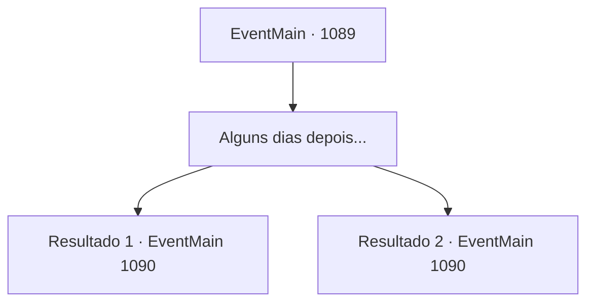

# Eventos principais · 1089

[Índice da tabela](index.md) · [Índice geral](../index.md)

ID: `pt:EventMain:1089` · Fonte: `EventMain4` · Versão: 1.2.47.

Mapeamento estático dos arquivos; a disponibilidade e a execução dependem do estado da run.

## Texto do evento

*Sem texto no arquivo.*

## Dados de entrada

```json
{
  "id": 1089,
  "grade": 1,
  "normalGoal": "",
  "required": ""
}
```

## Mapa das escolhas



## Escolhas e resultados

### Escolha 1

Alguns dias depois...

Requisitos e outros campos da escolha:

```json
{
  "required": ""
}
```

#### Resultado 1.1

Alguns dias se passam.
 Você está em seu escritório, cuidando de alguns documentos. No momento em que solta a caneta, mesmo antes da tinta secar, ouve uma batida na porta. Rennart entra, carregando uma pilha de documentos. Ele se curva respeitosamente, depois se aproxima da escrivaninha. 

 "Tenho algo a relatar."

 Rennart coloca a pilha sobre a mesa. 

 "Em primeiro lugar - a forja. A construção está pronta, e ferreiros habilidosos já estão trabalhando na produção de armaduras para nossos soldados."

 Seus dedos viram a página para a próxima... 

 "Nos arredores de nossa propriedade, os orcs da tribo Zaraid continuam lançando incursões. A cada três ou quatro dias aparece uma patrulha de caça - frequência semelhante à de antes."

 Ele pega uma peça de armadura. 

 "Isso é da nossa nova forja. Os ferreiros enviam seus agradecimentos e esperam que lhe agrade, meu senhor."

 Você pega a armadura de Rennart. Ele continua. 

 "...Há algumas coisas das quais você deve estar ciente, meu senhor."


Continuação registrada: [Evento 1090](1090.md) na mesma tabela.

```json
{
  "required": "5_887_1",
  "chance": "1",
  "nextEvent": 1090,
  "type": 2,
  "reward": "3_33_1"
}
```

#### Resultado 1.2

Passam-se alguns dias.
 Você está em seu escritório, cuidando de alguns documentos. No momento em que larga a caneta, antes mesmo que a tinta possa secar, batem à porta. Rennart entra, carregando uma pilha de documentos. Ele se curva respeitosamente e então se aproxima da escrivaninha. 

 "Terei algo a relatar."

 Rennart coloca a pilha sobre a mesa. 

 "Decidimos que o problemático poço de mina 3 deve permanecer fechado. Contudo, encontramos outro setor do poço e começamos uma nova operação de mineração lá."

 Seus dedos viram a página para a seguinte. 

 "Nos arredores da nossa propriedade, os orcs da tribo Zaraid ainda fazem ataques. A cada três ou quatro dias aparece uma patrulha de caça — frequência semelhante à de antes."

 Rennart tira um pequeno saco cheio de ouro. 

 "Esta é parte do lucro obtido com nossa nova mina."

 Ele lhe entrega, e continua. 

 "...Há algumas coisas das quais deveis estar ciente, meu senhor."


Continuação registrada: [Evento 1090](1090.md) na mesma tabela.

```json
{
  "required": "5_888_1",
  "chance": "1",
  "nextEvent": 1090,
  "type": 2,
  "reward": "0_4_100"
}
```

## Referências que chegam a este evento

- [Evento 1087 · escolha 2 · resultado 1](1087.md#escolha-2)
- [Evento 1087 · escolha 3 · resultado 1](1087.md#escolha-3)
- [Evento 1088 · escolha 1 · resultado 1](1088.md#escolha-1)
- [Evento 1088 · escolha 2 · resultado 1](1088.md#escolha-2)
- [Evento 1093 · escolha 1 · resultado 1](1093.md#escolha-1)
- [Evento 1093 · escolha 1 · resultado 2](1093.md#escolha-1)
- [Evento 1093 · escolha 2 · resultado 1](1093.md#escolha-2)
- [Evento 1097 · escolha 2 · resultado 1](1097.md#escolha-2)
- [Evento 1097 · escolha 3 · resultado 1](1097.md#escolha-3)
- [Evento 1098 · escolha 1 · resultado 1](1098.md#escolha-1)
- [Evento 1098 · escolha 2 · resultado 1](1098.md#escolha-2)
