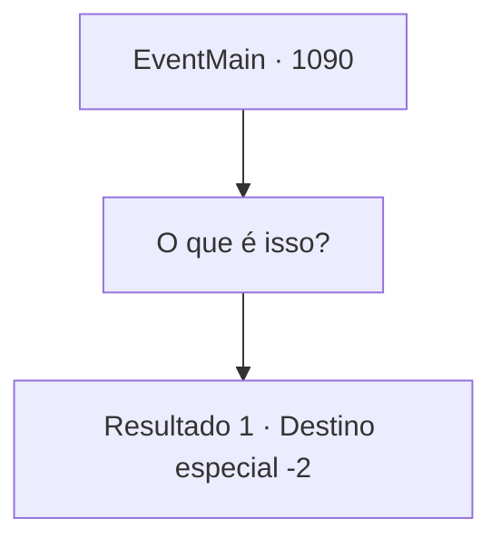

# Eventos principais · 1090

[Índice da tabela](index.md) · [Índice geral](../index.md)

ID: `pt:EventMain:1090` · Fonte: `EventMain4` · Versão: 1.2.47.

Mapeamento estático dos arquivos; a disponibilidade e a execução dependem do estado da run.

## Texto do evento

*Sem texto no arquivo.*

## Dados de entrada

```json
{
  "id": 1090,
  "grade": 1,
  "normalGoal": "",
  "required": ""
}
```

## Mapa das escolhas



## Escolhas e resultados

### Escolha 1

O que é isso?

Requisitos e outros campos da escolha:

```json
{
  "required": ""
}
```

#### Resultado 1.1

Rennart abre um mapa da propriedade sobre a mesa e aponta com os dedos por toda a região. Relatos de aparições de mortos-vivos, espalhados por toda parte - não só ao redor do castelo, mas nas fazendas do norte, nos postos comerciais do leste e nas pastagens do sul. O olhar de Rennart se volta para baixo por um momento. Ele deve estar perdido em pensamentos. Ele examina o mapa uma vez e então tira as mãos dele. 

 "O problema dos mortos-vivos atingiu oficialmente um ponto em que não pode ser tratado apenas com nossas capacidades."

 Ele respira fundo e continua. 

 "Sugiro que vocês busquem assistência oficial no Mosteiro Nordil. Eles têm histórico de praticar defesa contra necromancia. Espero que tenham um meio de lidar com isso."

 Depois de ouvir seu conselho, você fica olhando para o mapa por alguns segundos e decide que deve visitar esse Mosteiro Nordil.

Continuação registrada: [Destino especial `-2`](../destinos-especiais.md).

```json
{
  "required": "",
  "chance": "1",
  "nextEvent": -2,
  "type": 2,
  "reward": "13_6_4"
}
```

## Referências que chegam a este evento

- [Evento 1089 · escolha 1 · resultado 1](1089.md#escolha-1)
- [Evento 1089 · escolha 1 · resultado 2](1089.md#escolha-1)
