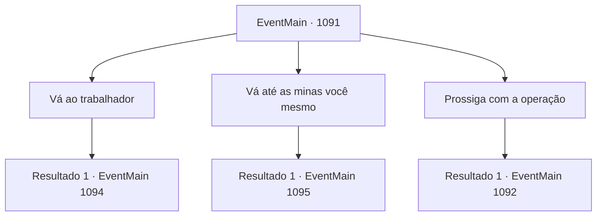

# Eventos principais · 1091

[Índice da tabela](index.md) · [Índice geral](../index.md)

ID: `pt:EventMain:1091` · Fonte: `EventMain4` · Versão: 1.2.47.

Mapeamento estático dos arquivos; a disponibilidade e a execução dependem do estado da run.

## Texto do evento

*Sem texto no arquivo.*

## Dados de entrada

```json
{
  "id": 1091,
  "grade": 1,
  "normalGoal": "",
  "required": ""
}
```

## Mapa das escolhas



## Escolhas e resultados

### Escolha 1

Vá ao trabalhador

Requisitos e outros campos da escolha:

```json
{
  "required": "5_971_0"
}
```

#### Resultado 1.1

Você sai do escritório e vai direto para onde o trabalhador ferido está. Rennart o acompanha. Ed está deitado em um quarto vazio no primeiro andar da mansão. A perna direita está apoiada por talas de madeira, seguradas por um pano enrolado. O rosto está coberto de sujeira e suor. Você percebe que ele ainda está consciente — nota os olhos dele se arregalando ao vê-lo pessoalmente vindo até ele. 

 "M- meu senhor..."

 Ed tenta se levantar. Você faz um gesto com as mãos para tranquilizá-lo de que está tudo bem. Ed se deita de novo, solta um suspiro e ensaia um sorriso. Mas então sua expressão facial muda. 

 "Meu senhor... há algo que devo lhe contar."

 A voz de Ed fica mais baixa. Ele olha ao redor do quarto, preocupado, e então continua. 

 "Antes da plataforma cair, eu vi algo... mais fundo no poço da mina."

 As mãos de Ed agarram firmemente o cobertor. 

 "Além do alcance da luz da tocha, algo... estava ali. Parecia humano de longe, mas..."


Continuação registrada: [Evento 1094](1094.md) na mesma tabela.

```json
{
  "required": "",
  "chance": "1",
  "nextEvent": 1094,
  "type": 2,
  "reward": "5_971_1"
}
```

### Escolha 2

Vá até as minas você mesmo

Requisitos e outros campos da escolha:

```json
{
  "required": ""
}
```

#### Resultado 2.1

|drawing_mine| Você segue Rennart até as minas. Na entrada da mina, há uma placa proibindo a entrada. Ferramentas estão espalhadas pelo chão, com um carrinho de mina abandonado cheio de terra. Você entra nas minas. Rennart te segue, carregando uma tocha. Logo, vocês chegam ao local onde o incidente aconteceu. A plataforma destruída surge diante dos seus olhos. Ela está escurecida desde o núcleo, com a viga de madeira partida ao meio. 

 "...Isto não é um desgaste natural."

 Rennart comenta, fazendo uma inspeção mais atenta. 

 "Começou do núcleo e depois se espalhou."

 O olhar de Rennart se volta para a escuridão, além do alcance da luz da tocha. Você também sente — um fedor úmido e frio vindo das trevas. Você decide seguir mais para dentro. A estrada faz uma curva. Você a pega e nota que o chão desabou. Você encontra um enorme abismo. Rennart senta-se ao lado dele, olhando para baixo. 

 "...Você vai descer ali?"


Continuação registrada: [Evento 1095](1095.md) na mesma tabela.

```json
{
  "required": "",
  "chance": "1",
  "nextEvent": 1095,
  "type": 2,
  "reward": ""
}
```

### Escolha 3

Prossiga com a operação

Requisitos e outros campos da escolha:

```json
{
  "required": ""
}
```

#### Resultado 3.1

Você diz a ele para prosseguir com a operação. Rennart te observa por um momento, mas então acena com a cabeça. 

 "Entendido. Reforçaremos as vigas de sustentação e colocaremos um fiscal adicional."

 Ele anota cuidadosamente suas ordens, faz uma reverência e parte. Você se afunda na cadeira e descansa. 

 Alguns dias se passam. Você está no seu plantão habitual no escritório, cuidando de alguns documentos. Então, com duas batidas, Rennart entra. 

 "Meu Senhor. O senhor deveria vir dar uma olhada nisto."


Continuação registrada: [Evento 1092](1092.md) na mesma tabela.

```json
{
  "required": "",
  "chance": "1",
  "nextEvent": 1092,
  "type": 2,
  "reward": "5_889_1"
}
```

## Referências que chegam a este evento

- [Evento 1082 · escolha 2 · resultado 1](1082.md#escolha-2)
- [Evento 1094 · escolha 2 · resultado 1](1094.md#escolha-2)
- [Evento 1094 · escolha 3 · resultado 1](1094.md#escolha-3)
