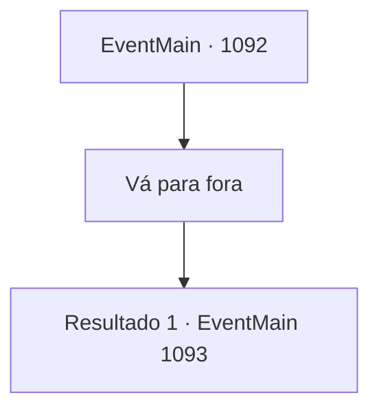

# Eventos principais · 1092

[Índice da tabela](index.md) · [Índice geral](../index.md)

ID: `pt:EventMain:1092` · Fonte: `EventMain4` · Versão: 1.2.47.

Mapeamento estático dos arquivos; a disponibilidade e a execução dependem do estado da run.

## Texto do evento

*Sem texto no arquivo.*

## Dados de entrada

```json
{
  "id": 1092,
  "grade": 1,
  "normalGoal": "",
  "required": ""
}
```

## Mapa das escolhas



## Escolhas e resultados

### Escolha 1

Vá para fora

Requisitos e outros campos da escolha:

```json
{
  "required": ""
}
```

#### Resultado 1.1

Você segue Rennart, fora do castelo. Ao sair pelo portão, um fedor de sangue te dá as boas-vindas. Há uma multidão enorme na praça principal. Eles estão reunidos em volta de algo, murmurando. Eles abrem um espaço para você e Rennart passarem. Três corpos estão no chão. Um veste roupas de camponês. Seu pescoço está dilacerado, sua camisa grudada ao chão coberta por sangue viscoso e seco. Ao lado do camponês há uma mulher. Há marcas de arranhões em suas costas, como se alguém a tivesse atingido com garras afiadas. O terceiro corpo é de um soldado. Seu capacete foi retirado, o pescoço quebrado. Em seus braços, você encontra marcas de mordida. O que os três corpos têm em comum é a ponta de osso nas feridas. Uma criança na multidão começa a chorar. Uma mulher que aparenta ser a mãe da criança faz o possível para desviar o olhar da criança da cena macabra. Rennart sussurra ao seu ouvido. 

 "Segundo os relatos, cinco ghouls apareceram do nada e atacaram algumas casas civis. Felizmente havia soldados patrulhando a área, e eles conseguiram matar todos eles..."

 Seu olhar percorre os corpos. 

 "O povo está abalado, meu senhor."


Continuação registrada: [Evento 1093](1093.md) na mesma tabela.

```json
{
  "required": "",
  "chance": "1",
  "nextEvent": 1093,
  "type": 2,
  "reward": ""
}
```

## Referências que chegam a este evento

- [Evento 1083 · escolha 2 · resultado 1](1083.md#escolha-2)
- [Evento 1091 · escolha 3 · resultado 1](1091.md#escolha-3)
