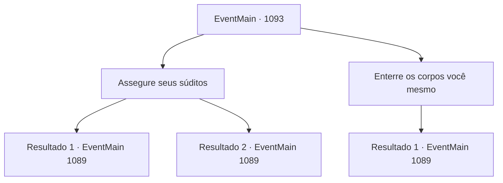

# Eventos principais · 1093

[Índice da tabela](index.md) · [Índice geral](../index.md)

ID: `pt:EventMain:1093` · Fonte: `EventMain4` · Versão: 1.2.47.

Mapeamento estático dos arquivos; a disponibilidade e a execução dependem do estado da run.

## Texto do evento

*Sem texto no arquivo.*

## Dados de entrada

```json
{
  "id": 1093,
  "grade": 1,
  "normalGoal": "",
  "required": ""
}
```

## Mapa das escolhas



## Escolhas e resultados

### Escolha 1

Assegure seus súditos

Requisitos e outros campos da escolha:

```json
{
  "required": ""
}
```

#### Resultado 1.1

Você dá uma olhada ao redor. Você vê rostos desesperados e preocupados - uma criança tremendo, um velho sentado ao lado dos corpos, outros claramente apavorados. Todos estão esperando que você diga algo. Você avança para encará-los. Você declara que tem a capacidade e a força de vontade para proteger a propriedade, que não fechará os olhos para os que caíram. Seu discurso carismático chama a atenção de seus súditos. Preocupações e temores começam a desaparecer de seus rostos. No lugar deles, confiança e lealdade preenchem esse espaço. 

 "Claro...! Confiamos em você, meu senhor!"

 "Acreditamos em você!"

 Convencidos, eles retornam para suas casas. Você ordena que seus homens cuidem dos corpos, então volta para seu escritório.

Continuação registrada: [Evento 1089](1089.md) na mesma tabela.

```json
{
  "required": "",
  "chance": "1|0_12_1",
  "nextEvent": 1089,
  "type": 0,
  "reward": "0_1_1"
}
```

#### Resultado 1.2

Você dá uma olhada ao redor. Vê rostos desesperados e apreensivos — uma criança tremendo, um velho sentado ao lado dos corpos, outros claramente aterrorizados. Todos esperam que você diga algo. Você avança para encará-los. Declara que tem capacidade e força de vontade para proteger a propriedade, que não fechará os olhos diante dos caídos. Mas seu discurso não consegue conquistar o coração dos seus súditos. Alguns começam a chorar. Outros começam a murmurar. Preocupações e temores se espalham como uma doença. Os soldados começam a dispersar a multidão, ordenando que voltem para suas casas. Mas seus súditos não parecem convencidos. Você volta às pressas para o seu escritório.

Continuação registrada: [Evento 1089](1089.md) na mesma tabela.

```json
{
  "required": "",
  "chance": "16",
  "nextEvent": 1089,
  "type": 1,
  "reward": ""
}
```

### Escolha 2

Enterre os corpos você mesmo

Requisitos e outros campos da escolha:

```json
{
  "required": "1_3_15"
}
```

#### Resultado 2.1

Você olha ao redor. Você vê rostos desesperados e preocupados - uma criança tremendo, um homem idoso sentado ao lado dos corpos, outros que estão claramente aterrorizados. Todos esperam que você diga algo. Mas, em vez de dizer algo, você começa a cuidar dos corpos com seus soldados. A multidão observa a cena se desenrolar com surpresa e assombro. Rennart também. Logo, ele arregaça as mangas e se junta a você. Você leva os corpos ao cemitério, enterrando-os e fazendo uma pequena oração. As pessoas começam a derramar lágrimas de respeito. Você os observa atentamente antes de voltar para o seu escritório.

Continuação registrada: [Evento 1089](1089.md) na mesma tabela.

```json
{
  "required": "",
  "chance": "1",
  "nextEvent": 1089,
  "type": 2,
  "reward": "0_3_3"
}
```

## Referências que chegam a este evento

- [Evento 1092 · escolha 1 · resultado 1](1092.md#escolha-1)
