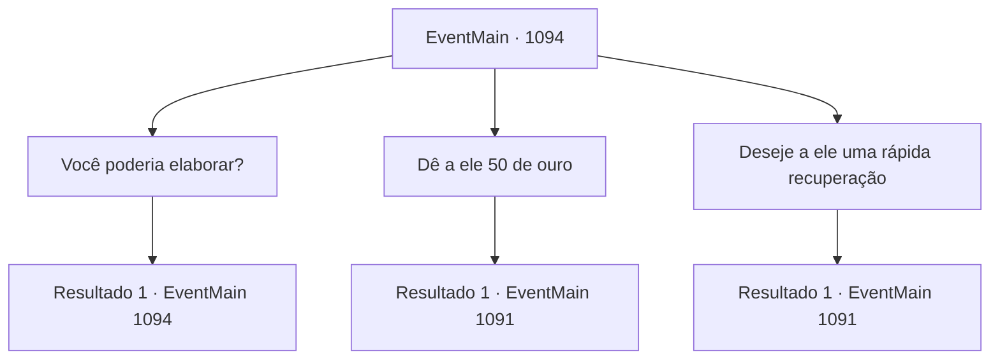

# Eventos principais · 1094

[Índice da tabela](index.md) · [Índice geral](../index.md)

ID: `pt:EventMain:1094` · Fonte: `EventMain4` · Versão: 1.2.47.

Mapeamento estático dos arquivos; a disponibilidade e a execução dependem do estado da run.

## Texto do evento

*Sem texto no arquivo.*

## Dados de entrada

```json
{
  "id": 1094,
  "grade": 1,
  "normalGoal": "",
  "required": ""
}
```

## Mapa das escolhas



## Escolhas e resultados

### Escolha 1

Você poderia elaborar?

Requisitos e outros campos da escolha:

```json
{
  "required": "5_897_0"
}
```

#### Resultado 1.1

Ed afrouxa e aperta o cobertor repetidas vezes. 

 "Uh... eu estava verificando as vigas de sustentação nas minas, e..."

 Ele engole em seco, depois continua. 

 "Há um ponto na galeria onde o caminho faz uma curva. Além daquela esquina, onde a luz da tocha não alcança, algo estava ali parado. Havia algo de antinatural no jeito que se movia. Parecia humano. Mas seu movimento definitivamente não era..."

 Uma gota de suor escorre pela sua cabeça. 

 "E eu senti... que ele estava me encarando. Então eu tentei passar para o outro lado, e de repente a plataforma inteira desabou."

 Ele acrescenta que perdeu a consciência ali mesmo. 

 "Ah. E o fedor. O cheiro de carne podre... não é algo que você esperaria de uma galeria mineira."


Continuação registrada: [Evento 1094](1094.md) na mesma tabela.

```json
{
  "required": "",
  "chance": "1",
  "nextEvent": 1094,
  "type": 2,
  "reward": "5_897_1"
}
```

### Escolha 2

Dê a ele 50 de ouro

Requisitos e outros campos da escolha:

```json
{
  "required": "1_4_50"
}
```

#### Resultado 2.1

Você puxa um saco de ouro e o coloca na cama de Ed, para seu tratamento. Os olhos de Ed se arregalam novamente. 

 "M- Meu senhor... isto é..."

 Os olhos dele ficam marejados. Ele tenta se levantar mais uma vez, mas as pernas não funcionam. Em vez disso, ele se curva. 

 "Obrigado, meu senhor..."

 A voz dele falha. Rennart o coloca de volta na cama e acrescenta. 

 "Descanse, agora."

 Você e Rennart saem do quarto. Após fechar a porta, Rennart fala. 

 "Você gostaria de visitar as minas?"


Continuação registrada: [Evento 1091](1091.md) na mesma tabela.

```json
{
  "required": "",
  "chance": "1",
  "nextEvent": 1091,
  "type": 2,
  "reward": "0_4_-50|0_3_2"
}
```

### Escolha 3

Deseje a ele uma rápida recuperação

Requisitos e outros campos da escolha:

```json
{
  "required": ""
}
```

#### Resultado 3.1

Você deseja que ele se recupere rapidamente. Ed se curva para demonstrar gratidão. 

 "Sim... Obrigado."

 Você e Rennart saem da sala. Depois de fechar a porta, Rennart fala. 

 "Você gostaria de visitar as minas?"


Continuação registrada: [Evento 1091](1091.md) na mesma tabela.

```json
{
  "required": "",
  "chance": "1",
  "nextEvent": 1091,
  "type": 2,
  "reward": ""
}
```

## Referências que chegam a este evento

- [Evento 1091 · escolha 1 · resultado 1](1091.md#escolha-1)
- [Evento 1094 · escolha 1 · resultado 1](1094.md#escolha-1)
