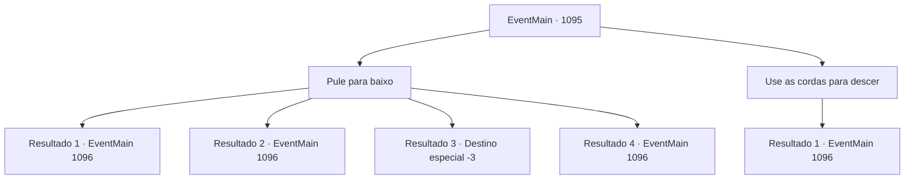

# Eventos principais · 1095

[Índice da tabela](index.md) · [Índice geral](../index.md)

ID: `pt:EventMain:1095` · Fonte: `EventMain4` · Versão: 1.2.47.

Mapeamento estático dos arquivos; a disponibilidade e a execução dependem do estado da run.

## Texto do evento

*Sem texto no arquivo.*

## Dados de entrada

```json
{
  "id": 1095,
  "grade": 1,
  "normalGoal": "",
  "required": ""
}
```

## Mapa das escolhas



## Escolhas e resultados

### Escolha 1

Pule para baixo

Requisitos e outros campos da escolha:

```json
{
  "required": ""
}
```

#### Resultado 1.1

Você fica à beira do abismo, dando mais uma olhada na abertura. Você percebe um fraco brilho do piso de pedra através da luz. Rennart olha para você, preocupado. 

 "N- de jeito nenhum."

 Você pula. O vento uiva arranhando seus ouvidos. Seus pés tocam o chão. Você se ajoelha, absorvendo a dor. A voz de Rennart ecoa lá em cima. 

 "Você está bem?! ...Espere, vou baixar uma corda."

 Rennart puxa uma corda longa, prende-a com um prego e então desce. Desta vez, ele vai na frente, segurando uma tocha e adentrando mais nas minas.

Continuação registrada: [Evento 1096](1096.md) na mesma tabela.

```json
{
  "required": "21_0_1|21_10_1",
  "chance": "1|0_13_1",
  "nextEvent": 1096,
  "type": 0,
  "reward": ""
}
```

#### Resultado 1.2

Você fica na beira do abismo, olhando mais uma vez para a abertura. Você percebe um tênue brilho do piso de pedra através da luz. Rennart olha para você, preocupado. 

 "N- não pode ser."

 Você pula. O vento uivante rasga seus ouvidos. Seus pés tocam o chão. Você tenta se ajoelhar para amortecer a queda, mas não consegue, e é jogado ao solo. Com um estrondo alto, uma onda de dor se espalha pelos seus tornozelos. A voz de Rennart ecoa lá de cima. 

 "Você está bem?! ...Segure firme, vou descer uma corda."

 Rennart puxa uma corda longa, ancora-a e então desce. Depois, ele tira alguns curativos e os aplica em seus tornozelos. Você sente a dor diminuir. Desta vez, ele vai na frente, segurando uma tocha e adentrando mais nas minas.

Continuação registrada: [Evento 1096](1096.md) na mesma tabela.

```json
{
  "required": "21_0_1|21_10_1|1_0_2",
  "chance": "14",
  "nextEvent": 1096,
  "type": 1,
  "reward": "0_0_-1"
}
```

#### Resultado 1.3

Você fica na beira do abismo, dando mais uma olhada na abertura. Você nota um leve brilho do chão de pedra através da luz. Rennart te olha, preocupado. 

 "N- de jeito nenhum."

 Você pula. O vento uivante arranha seus ouvidos. Seus pés tocam o chão. Você tenta se ajoelhar para amortecer a dor, mas não funciona, e você é lançado ao chão. Com um estrondo alto, uma onda de dor se espalha pelos seus tornozelos, e sua consciência desaparece.

Continuação registrada: [Destino especial `-3`](../destinos-especiais.md).

```json
{
  "required": "21_0_1|21_10_1|2_0_2",
  "chance": "14",
  "nextEvent": -3,
  "type": 1,
  "reward": "0_0_-1"
}
```

#### Resultado 1.4

Você desce lentamente pelo abismo. Você avança pela superfície rochosa da mina, com algumas partes úmidas e molhadas aqui e ali. Logo sente seus pés tocar o chão de pedra. Rennart olha lá de cima. Você distingue seu rosto pela luz da tocha — os olhos arregalados de surpresa. A voz de Rennart ecoa do alto. 

 "Espera, vou descer uma corda."

 Rennart desce, uma mão na corda e outra segurando a tocha. Ele pisa no chão de pedra e abre caminho para as partes mais profundas da mina.

Continuação registrada: [Evento 1096](1096.md) na mesma tabela.

```json
{
  "required": "-1|20_0_1|20_10_1",
  "chance": "1",
  "nextEvent": 1096,
  "type": 2,
  "reward": ""
}
```

### Escolha 2

Use as cordas para descer

Requisitos e outros campos da escolha:

```json
{
  "required": "8_39_1"
}
```

#### Resultado 2.1

Você puxa uma corda longa, amarrando-a às pedras próximas. Rennart confere o nó novamente e acena, confiante. 

 "Eu mantenho a luz acesa."

 Você começa a descer pelo abismo, segurando a corda. Você desce lentamente, passo a passo, conseguindo chegar ao chão de pedra. Soltando a corda, você olha ao redor. A umidade é ainda mais intensa aqui embaixo. A voz de Rennart ecoa lá do alto. 

 "Eu também vou descer."

 Rennart desce, uma mão na corda e a outra segurando a tocha. Ele pisa no chão de pedra e abre caminho para as minas mais profundas.

Continuação registrada: [Evento 1096](1096.md) na mesma tabela.

```json
{
  "required": "",
  "chance": "1",
  "nextEvent": 1096,
  "type": 2,
  "reward": "4_39_1"
}
```

## Referências que chegam a este evento

- [Evento 1091 · escolha 2 · resultado 1](1091.md#escolha-2)
