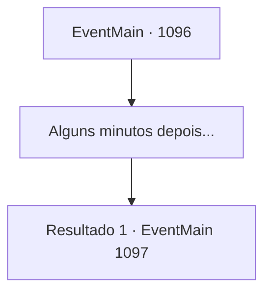

# Eventos principais · 1096

[Índice da tabela](index.md) · [Índice geral](../index.md)

ID: `pt:EventMain:1096` · Fonte: `EventMain4` · Versão: 1.2.47.

Mapeamento estático dos arquivos; a disponibilidade e a execução dependem do estado da run.

## Texto do evento

*Sem texto no arquivo.*

## Dados de entrada

```json
{
  "id": 1096,
  "grade": 1,
  "normalGoal": "",
  "required": ""
}
```

## Mapa das escolhas



## Escolhas e resultados

### Escolha 1

Alguns minutos depois...

Requisitos e outros campos da escolha:

```json
{
  "required": ""
}
```

#### Resultado 1.1

O fedor piora à medida que você se aprofunda. Você ouve algo nas trevas — algo está se movendo, além do alcance da luz. |drawing_undeadsAppear| É um esqueleto. As órbitas vazias do seu crânio encaram você. Suas mandíbulas clicam, para cima e para baixo. Não é só um — das trevas, esqueletos surgem um após outro. Alguns ainda têm pedaços de armadura, outros estão completamente nus. Eles formam um círculo, cercando você e Rennart. 

 "Estamos em grande desvantagem numérica."

 Rennart murmura baixinho, preparando o arco.

Continuação registrada: [Evento 1097](1097.md) na mesma tabela.

```json
{
  "required": "",
  "chance": "1",
  "nextEvent": 1097,
  "type": 2,
  "reward": ""
}
```

## Referências que chegam a este evento

- [Evento 1095 · escolha 1 · resultado 1](1095.md#escolha-1)
- [Evento 1095 · escolha 1 · resultado 2](1095.md#escolha-1)
- [Evento 1095 · escolha 1 · resultado 4](1095.md#escolha-1)
- [Evento 1095 · escolha 2 · resultado 1](1095.md#escolha-2)
