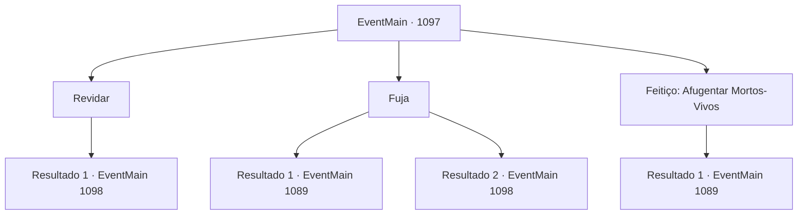

# Eventos principais · 1097

[Índice da tabela](index.md) · [Índice geral](../index.md)

ID: `pt:EventMain:1097` · Fonte: `EventMain4` · Versão: 1.2.47.

Mapeamento estático dos arquivos; a disponibilidade e a execução dependem do estado da run.

## Texto do evento

*Sem texto no arquivo.*

## Dados de entrada

```json
{
  "id": 1097,
  "grade": 1,
  "normalGoal": "",
  "required": ""
}
```

## Mapa das escolhas



## Escolhas e resultados

### Escolha 1

Revidar

Requisitos e outros campos da escolha:

```json
{
  "required": ""
}
```

#### Resultado 1.1

Você decide revidar. Rennart fica à sua esquerda, cobrindo os esqueletos com flechas. Suas flechas atingem os crânios deles. Você também assume o comando.

Continuação registrada: [Evento 1098](1098.md) na mesma tabela.

```json
{
  "required": "",
  "chance": "1",
  "nextEvent": 1098,
  "type": 2,
  "reward": "6_2_12",
  "place": 6
}
```

### Escolha 2

Fuja

Requisitos e outros campos da escolha:

```json
{
  "required": ""
}
```

#### Resultado 2.1

Rennart acena, entendendo sua intenção. 

 "Estou bem atrás de você, meu Senhor."

 Você se vira e foge. Rennart acena, disparando um único tiro. A flecha quebra as pernas de um esqueleto, e ele cai no chão. Os outros esqueletos atrás dele ficam bloqueados pelo que caiu. Você e Rennart aproveitam a oportunidade e correm. Usando a corda novamente, você e Rennart conseguem sair do abismo. Rennart guarda o arco no coldre e segue em frente. 

 "É melhor voltarmos ao castelo."

 Você e Rennart caminham, mantendo-se em alerta. Quando finalmente chegam à entrada, Rennart sugere que você retorne primeiro. 

 "Vou reunir alguns homens e fechar a mina."

 Rennart olha de volta para a escuridão e acrescenta. 

 "Não temos ideia do que há lá embaixo. Seria melhor impedir que alguém entre até que o problema seja resolvido."

 Você acena em resposta e sai das minas. A luz do sol faz cócegas nos seus olhos. Você deixa para trás a escuridão e o fedor da mina.

Continuação registrada: [Evento 1089](1089.md) na mesma tabela.

```json
{
  "required": "",
  "chance": "1|0_6_1",
  "nextEvent": 1089,
  "type": 0,
  "reward": ""
}
```

#### Resultado 2.2

Rennart assente, compreendendo sua intenção. 

 "Estou bem atrás de você, meu Senhor."

 Você se vira e foge, mas tropeça em algo e cai. 

 "Meu Senhor! Você está bem?!"

 Rennart se aproxima apressadamente de você e ajuda você a se levantar. Enquanto isso, os esqueletos rodearam vocês e começam a desferir estocadas com suas armas enferrujadas.

Continuação registrada: [Evento 1098](1098.md) na mesma tabela.

```json
{
  "required": "",
  "chance": "10",
  "nextEvent": 1098,
  "type": 1,
  "reward": "6_2_12",
  "place": 6
}
```

### Escolha 3

Feitiço: Afugentar Mortos-Vivos

Requisitos e outros campos da escolha:

```json
{
  "required": "20_0_1|20_3_1|1_1_2"
}
```

#### Resultado 3.1

Você murmura um encantamento, invocando um raio de luz sagrada. Os esqueletos param enquanto seus ossos começam a tremer. Um deles é arremessado para trás, enquanto os outros são derrubados. À medida que a luz se intensifica, a força que mantinha os esqueletos unidos se dissipa, reduzindo-os a nada além de uma pilha de ossos. Rennart parece surpreso. Ele recolhe seu arco ao coldre e fala. 

 "Nós é melhor voltarmos ao castelo."

 Você e Rennart caminham, mantendo-se em guarda. Quando finalmente chegam à entrada, Rennart sugere que você volte primeiro. 

 "Eu vou reunir alguns homens e fechar a mina."

 Rennart olha para a escuridão e acrescenta. 

 "Não temos ideia do que há abaixo. Seria melhor impedir que alguém entre até que o assunto esteja resolvido."

 Você acena com a cabeça em resposta e deixa as minas. A luz do sol faz cócegas em seus olhos. Você deixa para trás a escuridão e o fedor da mina.

Continuação registrada: [Evento 1089](1089.md) na mesma tabela.

```json
{
  "required": "",
  "chance": "1",
  "nextEvent": 1089,
  "type": 2,
  "reward": "0_2_1|0_1_-1"
}
```

## Referências que chegam a este evento

- [Evento 1096 · escolha 1 · resultado 1](1096.md#escolha-1)
