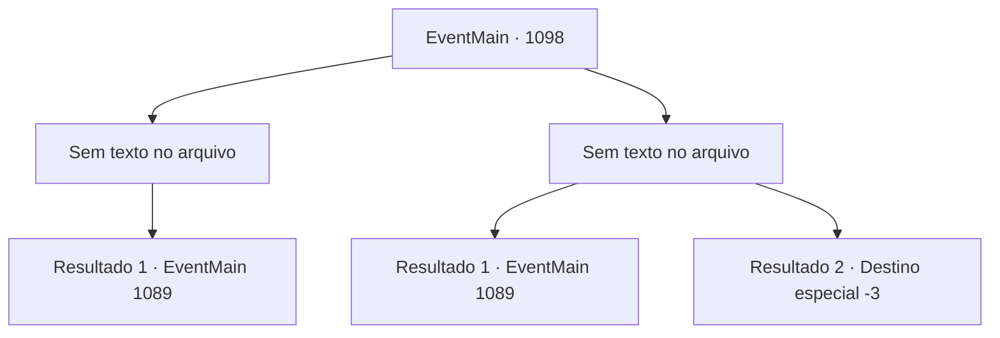

# Eventos principais · 1098

[Índice da tabela](index.md) · [Índice geral](../index.md)

ID: `pt:EventMain:1098` · Fonte: `EventMain4` · Versão: 1.2.47.

Mapeamento estático dos arquivos; a disponibilidade e a execução dependem do estado da run.

## Texto do evento

*Sem texto no arquivo.*

## Dados de entrada

```json
{
  "id": 1098,
  "grade": 1,
  "normalGoal": "",
  "required": ""
}
```

## Mapa das escolhas



## Escolhas e resultados

### Escolha 1

*Sem texto no arquivo; o papel dessa opção depende da interface do jogo.*

Requisitos e outros campos da escolha:

```json
{
  "required": ""
}
```

#### Resultado 1.1

Montes de ossos brancos espalham-se ao redor do caminho escuro. Poeira e pó de osso enchem o ar. Rennart guarda o arco no carcaj e fala. 

 "Nós é melhor retornarmos ao castelo."

  Você e Rennart caminham, mantendo-se em alerta. Quando finalmente alcançam a entrada, Rennart sugere que você retorne primeiro. 

 "Vou reunir alguns homens e fechar o poço da mina."

 Rennart olha para a escuridão e acrescenta. 

 "Não temos ideia do que se esconde abaixo. Seria melhor impedir que alguém entrasse até que a situação seja resolvida."

 Você acena com a cabeça em resposta e sai das minas. A luz do sol faz cócegas nos seus olhos. Você deixa para trás a escuridão e o fedor do poço da mina.

Continuação registrada: [Evento 1089](1089.md) na mesma tabela.

```json
{
  "required": "",
  "chance": "1",
  "nextEvent": 1089,
  "type": 2,
  "reward": ""
}
```

### Escolha 2

*Sem texto no arquivo; o papel dessa opção depende da interface do jogo.*

Requisitos e outros campos da escolha:

```json
{
  "required": ""
}
```

#### Resultado 2.1

A espada do esqueleto te derruba. Com um pequeno estalo, o esqueleto ergue sua arma mais uma vez. Mas antes que ele possa te terminar, a flecha de Rennart se crava no pescoço do esqueleto. 

 "Você está bem?"

 Você pega a mão dele e se levanta. Poeira e pó de osso enchem o ar. Rennart te ajuda a voltar para seu escritório. Depois de se certificar de que você está sentado em uma cadeira, Rennart sai do escritório e chama uma das criadas. 

 "Desinfete as feridas e coloque algumas bandagens. Rápido."

 A criada traz apressadamente uma tigela de água morna, alguns panos e ervas medicinais. Então, ela tira sua armadura, lava suas feridas, aplica algumas ervas nelas e termina envolvendo-as com o pano. Rennart observa o processo em silêncio, em pé ao lado dela. Quando o tratamento termina, Rennart fala. 

 "As feridas não parecem tão sérias. Mas você foi atacado por uma lâmina enferrujada. Sempre há chance de infecção. Insisto que você descanse o dia. Vou reunir alguns homens e selar a mina por enquanto."

 Com isso, Rennart se despede educadamente e parte.

Continuação registrada: [Evento 1089](1089.md) na mesma tabela.

```json
{
  "required": "1_0_2|1_1_2",
  "chance": "1",
  "nextEvent": 1089,
  "type": 2,
  "reward": "0_0_-1|0_1_-1"
}
```

#### Resultado 2.2

A espada do esqueleto corta você. Sangue jorra do seu pescoço enquanto a lâmina enferrujada encontra um ponto fraco. 

 "M- meu Senhor!"

 Rennart cuida do esqueleto e corre em seu auxílio, mas sua visão já está desvanecendo rapidamente. 

 "Não! Vamos, olhe para mim! Por favor....!!"

 Seu pedido desesperado também está se apagando. Logo, tudo fica escuro e silencioso.

Continuação registrada: [Destino especial `-3`](../destinos-especiais.md).

```json
{
  "required": "-1|2_0_2|2_1_2",
  "chance": "1",
  "nextEvent": -3,
  "type": 2,
  "reward": "0_0_-1|0_1_-1"
}
```

## Referências que chegam a este evento

- [Evento 1097 · escolha 1 · resultado 1](1097.md#escolha-1)
- [Evento 1097 · escolha 2 · resultado 2](1097.md#escolha-2)
