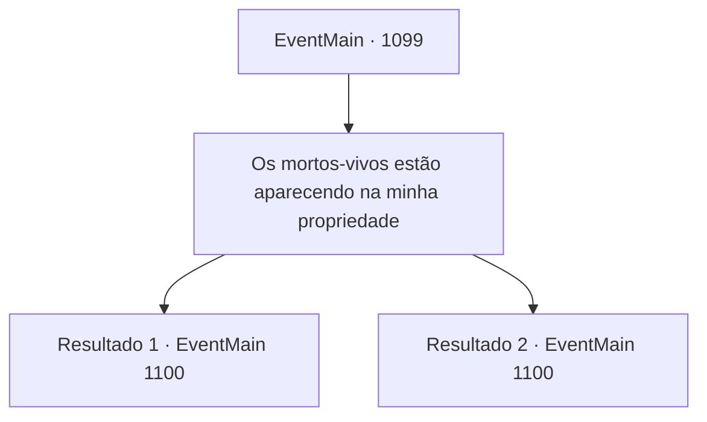

# Eventos principais · 1099

[Índice da tabela](index.md) · [Índice geral](../index.md)

ID: `pt:EventMain:1099` · Fonte: `EventMain4` · Versão: 1.2.47.

Mapeamento estático dos arquivos; a disponibilidade e a execução dependem do estado da run.

## Texto do evento

|drawing_nordilTemple| A luz da lua brilha através das nuvens, iluminando seu destino. Você se apressa em direção ao Monastério Nordil. O monastério fica na extremidade distante da cordilheira das terras altas. As grossas muralhas de pedra brilham em um prateado acinzentado sob a luz da lua. Além das muralhas, você nota a torre simbólica e uma capela de pedra com janelas em arco. Você para diante do portão da frente, dizendo ao porteiro quem você é. Logo, o portão se abre, e uma jovem donzela em vestes brancas de oração aparece diante de você, fazendo uma reverência. 

 "Por aqui."

 Você segue a freira por um corredor e entra em uma sala de audiências. Lá dentro, você encontra uma mesa, quatro cadeiras e um castiçal na parede. Pelas janelas, você vê uma floresta se estendendo atrás do monastério. Logo, uma mulher de idade entra na sala. Por cima de suas vestes brancas de oração, ela usa uma camada adicional de casaco cinza. 

 "Ah, Conde Briovich. Deve ter sido uma longa jornada. Como podemos ajudá-lo?"


## Dados de entrada

```json
{
  "id": 1099,
  "grade": 1,
  "normalGoal": "",
  "required": "13_6_4|1_2_50"
}
```

## Mapa das escolhas



## Escolhas e resultados

### Escolha 1

Os mortos-vivos estão aparecendo na minha propriedade

Requisitos e outros campos da escolha:

```json
{
  "required": ""
}
```

#### Resultado 1.1

Você explica o que tem acontecido em sua propriedade. A Madre Abadesa escuta você em silêncio, as mãos no colo. Mesmo depois que você termina, ela não fala por um momento. 

 "...Bem, avistamento de mortos-vivos em si não é exatamente raro."

 Ela fala devagar. 

 "...mas se houve um surto repentino, a área pode precisar de uma purificação."

 Seu olhar se volta para as janelas por um momento e então continua. 

 "Normalmente, enviaríamos uma de nossas próprias..."

 A Madre Abadesa começa a remexer no seu rosário. 

 "...mas, infelizmente, nosso mosteiro tem tido... dificuldades de gestão."

 Ela olha diretamente para você. 

 "Em teoria, eu poderia ensinar você esse ritual de purificação. Você poderia realizá-lo sozinho. Isso seria uma opção."

 Ela pigarreia uma vez e cuidadosamente acrescenta. 

 "...Ou, se você puder fornecer ao mosteiro uma doação generosa, teremos prazer em enviar uma de nossas irmãs."


Continuação registrada: [Evento 1100](1100.md) na mesma tabela.

```json
{
  "required": "2_3_25",
  "chance": "1",
  "nextEvent": 1100,
  "type": 2,
  "reward": ""
}
```

#### Resultado 1.2

Você explica o que tem acontecido na sua propriedade. A Madre Abadessa ouve você em silêncio, com as mãos no colo. Mesmo depois que você termina, ela permanece em silêncio por um momento. 

 "...Bem, avistamento de mortos-vivos em si não é exatamente raro."

 Ela fala devagar. 

 "...mas se houve um surto repentino, a área pode precisar de uma purificação."

 Seu olhar vai até as janelas por um momento e então continua. 

 "Normalmente, enviaríamos alguém nosso..."

 A Madre Abadessa começa a mexer no seu terço. 

 "...mas infelizmente, nosso mosteiro tem tido... dificuldades de gestão."

 Ela olha diretamente para você. 

 "Eu poderia te ensinar esse ritual de purificação. Você poderia realizá-lo por conta própria. Sinto bondade em você, então acho que é definitivamente uma opção viável."


Continuação registrada: [Evento 1100](1100.md) na mesma tabela.

```json
{
  "required": "1_3_25",
  "chance": "1",
  "nextEvent": 1100,
  "type": 2,
  "reward": "5_899_1"
}
```

## Referências que chegam a este evento

Nenhum `nextEvent` positivo da mesma tabela aponta para este nó. Isso não prova que seja inacessível: sorteio e estado de história podem selecioná-lo.

