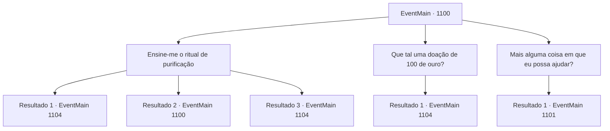

# Eventos principais · 1100

[Índice da tabela](index.md) · [Índice geral](../index.md)

ID: `pt:EventMain:1100` · Fonte: `EventMain4` · Versão: 1.2.47.

Mapeamento estático dos arquivos; a disponibilidade e a execução dependem do estado da run.

## Texto do evento

*Sem texto no arquivo.*

## Dados de entrada

```json
{
  "id": 1100,
  "grade": 1,
  "normalGoal": "",
  "required": ""
}
```

## Mapa das escolhas



## Escolhas e resultados

### Escolha 1

Ensine-me o ritual de purificação

Requisitos e outros campos da escolha:

```json
{
  "required": "5_898_0"
}
```

#### Resultado 1.1

Você decide aprender o ritual de purificação com a Madre Abadessa. Ela acena com a cabeça, levando você a uma sala de arquivos, lá no porão do mosteiro. Do canto da sala, ela puxa um livro com capa de couro preta, tirando a poeira dele. 

 "Este é o Tomo da Purificação."

 Ela o coloca sobre uma mesa e o abre. 

 "Ele explica um ritual de purificação para consagrar uma área amaldiçoada, onde os mortos-vivos aparecem."

 Você dá uma olhada no tomo. Como a Madre Abadessa disse, escrito no tomo estão a ordem precisa do ritual, uma lista dos ingredientes necessários e ilustrações dos sigilos de purificação. A Madre Abadessa senta-se ao seu lado, guiando você pelo conteúdo do tomo. Depois de algumas lições, você agora se sente confiante em recordar como desenhar os sigilos e em que ordem o ritual deve ser realizado. 

 "Impressionante. Você está mais do que capacitado para executar o ritual agora."

 Ela acena com a cabeça. 

 "Leve o tomo também. Você vai precisar consultá-lo no local."

 A Madre Abadessa levanta-se e acrescenta. 

 "Ah, mas o tomo pertence ao mosteiro. Então, por favor, devolva-o assim que o problema dos mortos-vivos em sua propriedade for resolvido."

 Você coloca o Tomo da Purificação em seu inventário.

Continuação registrada: [Evento 1104](1104.md) na mesma tabela.

```json
{
  "required": "18_899_1",
  "chance": "1|0_7_1",
  "nextEvent": 1104,
  "type": 0,
  "reward": "5_898_1|3_377_1"
}
```

#### Resultado 1.2

Você decide aprender o ritual de purificação com a Madre Abadessa. Ela acena com a cabeça, levando você a uma sala de arquivos, lá no porão do mosteiro. Do canto da sala, ela puxa um livro com capa de couro preto, limpando o pó dele. 

 "Este é o Tomo da Purificação."

 Ela o coloca sobre uma mesa e o abre. 

 "Ele explica um ritual de purificação para consagrar uma área amaldiçoada, onde os mortos-vivos aparecem."

 Você dá uma olhada no tomo. Como a Madre Abadessa disse, escrito no tomo está a ordem precisa do ritual, uma lista de ingredientes necessários e ilustrações de sigilos de purificação. A Madre Abadessa senta-se ao seu lado, guiando você pelo conteúdo do tomo. Mas você não consegue entender seu conteúdo. 

 "...Eu entendo. Um ritual de purificação está longe de ser um simples truque, afinal. Lembre-se, há outras maneiras pelas quais poderíamos ajudá-lo."


Continuação registrada: [Evento 1100](1100.md) na mesma tabela.

```json
{
  "required": "18_899_1",
  "chance": "15",
  "nextEvent": 1100,
  "type": 1,
  "reward": "5_898_9"
}
```

#### Resultado 1.3

Você decide aprender o ritual de purificação com a Mãe Abadessa. Ela acena com a cabeça e te conduz a uma sala de arquivos, no subsolo do mosteiro. Do canto da sala, ela retira um livro com capa de couro preta, limpando o pó. 

 "Este é o Tomo da Purificação."

 Ela o coloca sobre uma mesa e o abre. 

 "Ele explica um ritual de purificação para consagrar uma área amaldiçoada, onde os mortos-vivos aparecem."

 Você examina o tomo. Como a Mãe Abadessa disse, nele estão escritos a ordem precisa do ritual, uma lista dos ingredientes necessários e ilustrações dos sigilos de purificação. A Mãe Abadessa senta-se ao seu lado, guiando você pelo conteúdo do tomo. Após algumas aulas, você agora se sente confiante em lembrar como desenhar os sigilos e qual é a ordem do ritual. 

 "Impressionante. Você está mais do que capaz de realizar o ritual agora."

 Ela acena. 

 "Leve também o tomo. Você precisará consultá-lo no local."

 Você coloca o Tomo da Purificação em seu inventário.

Continuação registrada: [Evento 1104](1104.md) na mesma tabela.

```json
{
  "required": "5_899_1",
  "chance": "1",
  "nextEvent": 1104,
  "type": 2,
  "reward": "5_898_1|3_377_1"
}
```

### Escolha 2

Que tal uma doação de 100 de ouro?

Requisitos e outros campos da escolha:

```json
{
  "required": "1_4_100"
}
```

#### Resultado 2.1

Você tira um saquinho de couro cheio de ouro. O som das moedas enche a sala. A Mãe Abadessa se curva em gratidão. 

 "Você tem nossos agradecimentos."

 Cuidadosamente, ela pega o saquinho com suas mãos enrugadas. Então, ela sai da sala, e você ouve algo nos corredores. Alguns minutos depois, a Mãe Abadessa retorna. Uma jovem freira com o cabelo bem arrumado e vestida de branco a acompanha. Ela se curva respeitosamente. 

 "Sou a Irmã Matilde, para ajudar no ritual de purificação. À sua disposição."


Continuação registrada: [Evento 1104](1104.md) na mesma tabela.

```json
{
  "required": "",
  "chance": "1",
  "nextEvent": 1104,
  "type": 2,
  "reward": "5_902_1|0_4_-100"
}
```

### Escolha 3

Mais alguma coisa em que eu possa ajudar?

Requisitos e outros campos da escolha:

```json
{
  "required": ""
}
```

#### Resultado 3.1

Você diz a ela que a ajudará com prazer em qualquer coisa. A Madre Abadessa o examina de cima a baixo antes de falar. 

 "...Há... uma coisa com a qual alguém da sua espécie poderia nos ajudar."

 Ela se levanta de sua cadeira e se aproxima das janelas. Uma grande floresta se estende atrás do mosteiro. 

 "Temos um pequeno jardim administrado pelo mosteiro ali. Recentemente, um enorme javali apareceu do nada e devastou as plantações."

 Ela olha para você. 

 "Você cuidaria da besta selvagem, para que nossas irmãs possam voltar a cuidar do jardim?"

 Você imediatamente segue para a floresta. Logo, você encontra o jardim que ela mencionou. As cercas de madeira estão completamente destruídas, e todas as plantações estão reviradas.

Continuação registrada: [Evento 1101](1101.md) na mesma tabela.

```json
{
  "required": "",
  "chance": "1",
  "nextEvent": 1101,
  "type": 2,
  "reward": ""
}
```

## Referências que chegam a este evento

- [Evento 1099 · escolha 1 · resultado 1](1099.md#escolha-1)
- [Evento 1099 · escolha 1 · resultado 2](1099.md#escolha-1)
- [Evento 1100 · escolha 1 · resultado 2](1100.md#escolha-1)
