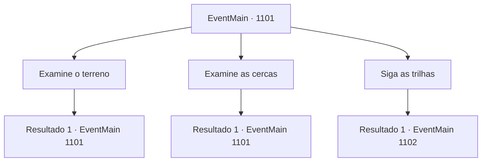

# Eventos principais · 1101

[Índice da tabela](index.md) · [Índice geral](../index.md)

ID: `pt:EventMain:1101` · Fonte: `EventMain4` · Versão: 1.2.47.

Mapeamento estático dos arquivos; a disponibilidade e a execução dependem do estado da run.

## Texto do evento

*Sem texto no arquivo.*

## Dados de entrada

```json
{
  "id": 1101,
  "grade": 1,
  "normalGoal": "",
  "required": ""
}
```

## Mapa das escolhas



## Escolhas e resultados

### Escolha 1

Examine o terreno

Requisitos e outros campos da escolha:

```json
{
  "required": "5_900_0"
}
```

#### Resultado 1.1

Você se agacha, examinando o chão. Pegadas enormes e sinais de escavação no solo. Você também nota marcas de mordida profundas em uma abóbora. Seu interior está exposto, como se algo tivesse mordido e cuspido de volta. Você tenta seguir as pegadas, mas, como as marcas estão por toda parte, simplesmente não consegue determinar de onde a besta veio nem para onde foi.

Continuação registrada: [Evento 1101](1101.md) na mesma tabela.

```json
{
  "required": "",
  "chance": "1",
  "nextEvent": 1101,
  "type": 2,
  "reward": "5_900_1"
}
```

### Escolha 2

Examine as cercas

Requisitos e outros campos da escolha:

```json
{
  "required": "5_901_0"
}
```

#### Resultado 2.1

Você se aproxima das cercas de madeira, que costumavam servir como perímetro ao redor do jardim. Elas são finas e fracas, amarradas de forma precária, feitas de galhos. Um trabalhador experiente da fazenda jamais faria cercas assim. Você supõe que as freiras as construíram sozinhas. De qualquer forma, as cercas estão destruídas além do reconhecimento. Você nota sinais de algo grande colidindo com as cercas — algumas foram arrancadas do chão completamente, e outras estão rachadas no meio. Seu olhar para em um lado da cerca. A besta deve ter esfregado o corpo na cerca — você percebe um tufo de pelo grosso preso entre as cascas das árvores. Abaixo dele há um monte de grama rasgada e um monte de excremento fumegante. Você abaixa o olhar. Além do excremento, percebe pegadas enormes seguindo pelo chão molhado, que levam às partes mais profundas da floresta.

Continuação registrada: [Evento 1101](1101.md) na mesma tabela.

```json
{
  "required": "",
  "chance": "1",
  "nextEvent": 1101,
  "type": 2,
  "reward": "5_901_1"
}
```

### Escolha 3

Siga as trilhas

Requisitos e outros campos da escolha:

```json
{
  "required": "5_901_1"
}
```

#### Resultado 3.1

Você segue as pegadas pela mata, entre os arbustos. Arbustos e árvores mais baixos estão quebrados verticalmente, como se algo pesado tivesse passado por ali. Você segue as pegadas, que ficam cada vez mais nítidas. Logo, chega a uma clareira entre as árvores. Lá, encontra uma fera com o focinho plantado no chão, cavando raízes. Não é um mero javali. Sua altura envergonha a maioria dos humanoides adultos, com pelagem tão espessa quanto aço, endurecida em espinhos. Este é um javali navalha. Seus pequenos olhos vermelhos se voltam para você. Ele roça as patas dianteiras na terra. Você percebe vapor branco saindo de suas enormes narinas. Após um breve impasse, o javali navalha avança contra você primeiro.

Continuação registrada: [Evento 1102](1102.md) na mesma tabela.

```json
{
  "required": "",
  "chance": "1",
  "nextEvent": 1102,
  "type": 2,
  "reward": "6_0_46",
  "place": 1
}
```

## Referências que chegam a este evento

- [Evento 1100 · escolha 3 · resultado 1](1100.md#escolha-3)
- [Evento 1101 · escolha 1 · resultado 1](1101.md#escolha-1)
- [Evento 1101 · escolha 2 · resultado 1](1101.md#escolha-2)
