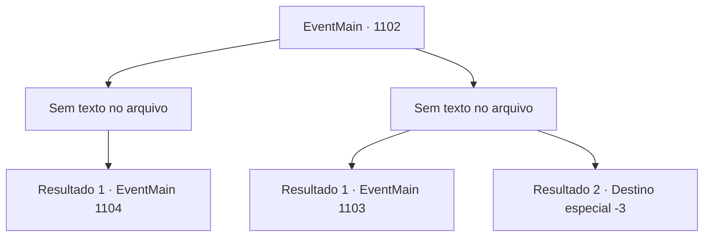

# Eventos principais · 1102

[Índice da tabela](index.md) · [Índice geral](../index.md)

ID: `pt:EventMain:1102` · Fonte: `EventMain4` · Versão: 1.2.47.

Mapeamento estático dos arquivos; a disponibilidade e a execução dependem do estado da run.

## Texto do evento

*Sem texto no arquivo.*

## Dados de entrada

```json
{
  "id": 1102,
  "grade": 1,
  "normalGoal": "",
  "required": ""
}
```

## Mapa das escolhas



## Escolhas e resultados

### Escolha 1

*Sem texto no arquivo; o papel dessa opção depende da interface do jogo.*

Requisitos e outros campos da escolha:

```json
{
  "required": ""
}
```

#### Resultado 1.1

Você consegue derrotar o javali navalha, trazendo paz de volta ao jardim do mosteiro. Você corta o nariz do javali como prova, então volta para o mosteiro. Lá, você conta à Madre Abadessa que se livrou da besta que estava incomodando o jardim. Ela observa a sujeira e as ervas por todo o seu casaco e assente. 

 "O mosteiro agradece pelo seu serviço."

 A Madre Abadessa se inclina e sai da sala. Alguns minutos depois, a Madre Abadessa retorna. Uma jovem freira com cabelo arrumado e vestida de branco a acompanha. Ela se inclina respeitosamente. 

 "Sou a Irmã Mathilda, para ajudar com o ritual de purificação. À sua disposição."


Continuação registrada: [Evento 1104](1104.md) na mesma tabela.

```json
{
  "required": "",
  "chance": "1",
  "nextEvent": 1104,
  "type": 2,
  "reward": "5_902_1"
}
```

### Escolha 2

*Sem texto no arquivo; o papel dessa opção depende da interface do jogo.*

Requisitos e outros campos da escolha:

```json
{
  "required": ""
}
```

#### Resultado 2.1

O javali navalha te empala, cravando suas presas no seu corpo. Sua carne cede impotente. Você é lançado contra um toco de árvore, caindo de volta ao chão. O javali vê uma abertura e investe de novo. Você rola para o lado, conseguindo por um triz desviar da investida. Tateando com as mãos, pega uma pedra e a golpeia nas presas do javali navalha. Com um estrondo, a presa direita do javali se racha. Ele recua, gritando de dor. Um filete de sangue pinga da presa rachada. O javali se retira para os arbustos, desaparecendo na escuridão, pisoteando galhos. Você pressiona a ferida com as mãos. Quando você finalmente volta para a câmara de audiências, a Madre Abadessa fica assombrada. 

 "Vamos dar uma olhada na ferida primeiro."


Continuação registrada: [Evento 1103](1103.md) na mesma tabela.

```json
{
  "required": "1_0_2|1_1_2",
  "chance": "1",
  "nextEvent": 1103,
  "type": 2,
  "reward": "0_0_-1|0_1_-1"
}
```

#### Resultado 2.2

O javali navalha investe contra você, fincando suas presas em seu corpo. Sua carne cede, impotente. Você é lançado contra um toco de árvore, caindo de volta ao chão. O javali vê uma abertura e investe novamente. Um choque esmagador o envolve, e sua consciência se apaga.

Continuação registrada: [Destino especial `-3`](../destinos-especiais.md).

```json
{
  "required": "-1|2_0_2|2_1_2",
  "chance": "1",
  "nextEvent": -3,
  "type": 2,
  "reward": "0_0_-1|0_1_-1"
}
```

## Referências que chegam a este evento

- [Evento 1101 · escolha 3 · resultado 1](1101.md#escolha-3)
