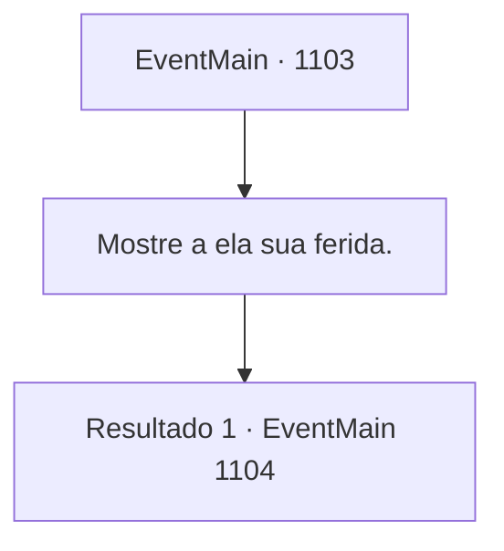

# Eventos principais · 1103

[Índice da tabela](index.md) · [Índice geral](../index.md)

ID: `pt:EventMain:1103` · Fonte: `EventMain4` · Versão: 1.2.47.

Mapeamento estático dos arquivos; a disponibilidade e a execução dependem do estado da run.

## Texto do evento

*Sem texto no arquivo.*

## Dados de entrada

```json
{
  "id": 1103,
  "grade": 1,
  "normalGoal": "",
  "required": ""
}
```

## Mapa das escolhas



## Escolhas e resultados

### Escolha 1

Mostre a ela sua ferida.

Requisitos e outros campos da escolha:

```json
{
  "required": ""
}
```

#### Resultado 1.1

A Madre Abadessa examina sua ferida e chama pelo corredor. 

 "Irmã. Entre."

 Passos ficam cada vez mais altos, até que uma jovem freira entra na câmara com uma tigela de ervas medicinais e ataduras. A Madre Abadessa tritura pessoalmente as ervas, as espalha sobre sua ferida e a enfaixa. A dor diminui. 

 "O mosteiro agradece pelo seu serviço."

 A Madre Abadessa inclina-se e sai da sala. Alguns minutos depois, a Madre Abadessa retorna. Uma jovem freira com cabelos arrumados e vestida de branco a acompanha. Ela inclina-se respeitosamente. 

 "Sou a Irmã Mathilda, para ajudar com o ritual de purificação. À sua disposição."


Continuação registrada: [Evento 1104](1104.md) na mesma tabela.

```json
{
  "required": "",
  "chance": "1",
  "nextEvent": 1104,
  "type": 2,
  "reward": "0_0_1|5_902_1"
}
```

## Referências que chegam a este evento

- [Evento 1102 · escolha 2 · resultado 1](1102.md#escolha-2)
